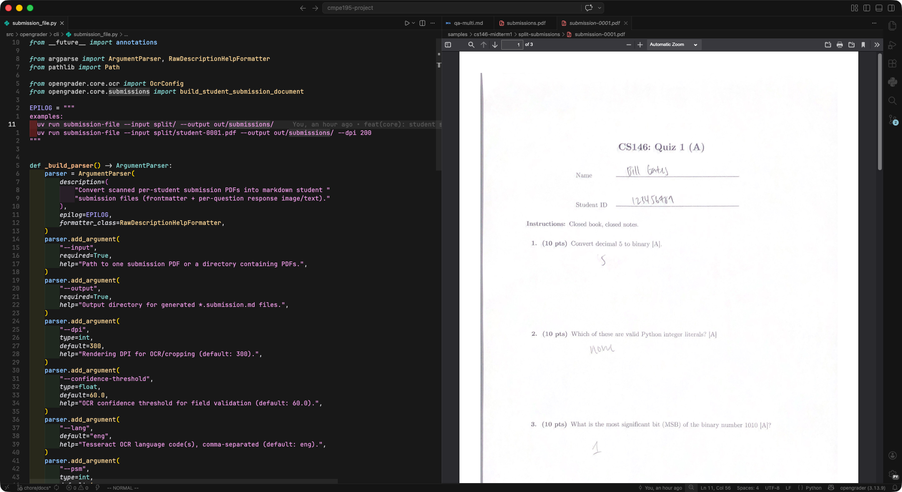
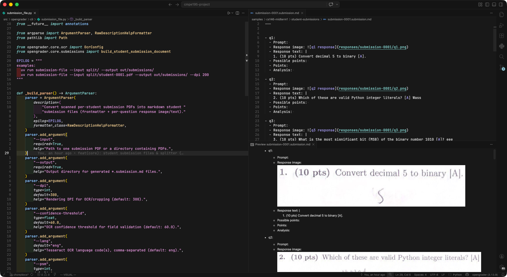
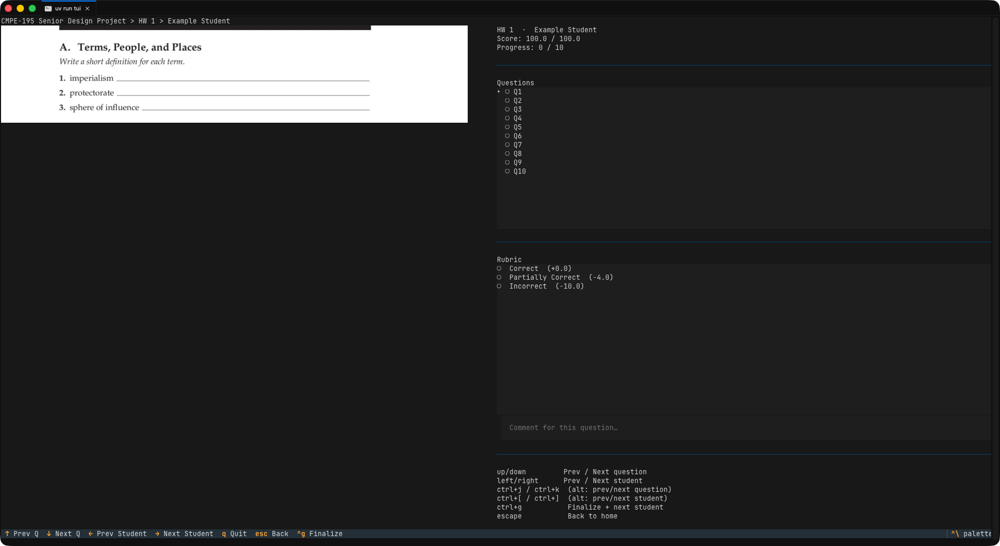

# Opengrader

>

## Team

| Name        | GitHub                                           | Email                |
| ----------- | ------------------------------------------------ | -------------------- |
| Marco Lopez | [@TheMarco408](https://github.com/username)      | marco.lopez@sjsu.edu |
| Tommy Liu   | [@toommyliu](https://github.com/toommyliu)       | tommy.liu@sjsu.edu   |
| Andy Cortes | [@andycortes23](https://github.com/andycortes23) | andy.cortes@sjsu.edu |
| Arjun Gill  | [@arjung04](https://github.com/arjung04)         | arjun.gill@sjsu.edu  |

**Advisor:** [Dr. Carlos Rojas](mailto:carlos.rojas@sjsu.edu)

---

## Project Description

Opengrader is a local, offline-first exam-grading toolchain — think Gradescope, but on your own machine. Existing grading solutions aren't flexible enough to enable educators to grade assignments efficiently. Timely, quality feedback helps improve student learning outcomes, and yet, today's tools fail to meet these needs.

## Capabilities

- **Template generation** — turn a QA-format markdown answer key into printable exam PDFs (Computer Modern fonts, answer boxes, multi-version exams). Draft the QA file itself from an existing answer-key PDF or a text2qti exam.
- **Scan ingestion** — split a bulk scanner PDF into per-student PDFs and crop every answer, name and ID, with no blank template and no QR codes: the scanned pages are matched to each other, so every copy of a printed page is cropped along the same questions (read from the print with PaddleOCR's PP-OCR models), and turned upright. Pages stay in the order they were scanned: a submission that looks out of order is flagged, and sorted only when you ask (`--reorder`). Missing, repeated and unrecognized pages are flagged. Each student's name and ID (vision LLM, or PP-OCR without one) and printed title (subscript form markers included) are always read; answers are transcribed only when asked, for automated grading. Everything lands in structured per-student markdown files.
- **Grading TUI** — Gradescope-style question-by-question rubric grading in the terminal: in-terminal response images, rubric editing, per-question statistics, anonymous grading by default (teacher mode reveals names), and automatic write-back of grades to submission files and annotated PDFs.
- **Automated grading** — auto-score submissions against a solutions file (exact, numeric, and true/false answer matching). With `--llm`, an AI model suggests grades for free responses, tagged `[AI]` for you to review; anything it isn't confident about is left for manual grading. The AI can also draft partial-credit rubric items from the answers students gave and a first-pass grade for each answer, which you review and confirm.
- **Canvas export** — push scores and per-question comments to Canvas LMS via `canvas-sak`, from the CLI or from inside the TUI.
- **Offline-first** — grading work is saved in a local SQLite workspace. By default the only network use is the localhost Ollama server and optional Canvas export. A cloud AI provider can be added (`opengrader providers`), but only with your explicit consent, and `opengrader data-flow` shows exactly which student data would leave your machine and where it would go.

## Prerequisites

- [Python v3.12](https://www.python.org/)
- [Homebrew](https://brew.sh/)
- [uv](https://docs.astral.sh/uv/getting-started/installation/)
- [Tesseract](https://tesseract-ocr.github.io/tessdoc/Installation.html)
- [Ollama](https://ollama.com/)
- A terminal emulator (any — see below)

### Terminal Compatibility

Opengrader shows each student's scanned answer *inside* the terminal. It speaks three
image protocols and picks the right one for your terminal automatically[^1]:

| Protocol | Terminals |
| --- | --- |
| [Kitty graphics](https://sw.kovidgoyal.net/kitty/graphics-protocol/) | [Ghostty](https://github.com/ghostty-org/ghostty), [kitty](https://sw.kovidgoyal.net/kitty/), Contour |
| [iTerm2 inline images](https://iterm2.com/documentation-images.html) | [iTerm2](https://iterm2.com/), [WezTerm](https://wezfurlong.org/wezterm/), VS Code |
| [Sixel](https://en.wikipedia.org/wiki/Sixel) | Konsole, foot, mlterm, Windows Terminal 1.22+, Rio, XTerm |

**No compatible terminal? Opengrader still works.** On macOS Terminal.app, GNOME
Terminal, PuTTY, or inside tmux, answer crops fall back to a coarse colour-block
preview and the app tells you so — press **`o`** while grading to open the
full-resolution crop in your normal desktop image viewer.

Check what was detected (and paste this into any bug report):

```bash
uv run tui --check-graphics
```

If detection guesses wrong, force a protocol with `--graphics {kitty,iterm2,sixel,halfcell,unicode}`
or `OPENGRADER_GRAPHICS=<protocol>`. Choose a specific external viewer with
`OPENGRADER_IMAGE_VIEWER` (e.g. `OPENGRADER_IMAGE_VIEWER="feh {}"`).

> [!NOTE]
> Visual Studio Code's integrated terminal needs the `terminal.integrated.enableImages` setting. See [Image Support](https://code.visualstudio.com/docs/terminal/advanced#_image-support) for details.

[^1]: Detection is environment-first (recognising the terminal from the variables it exports) and falls back to querying the terminal's capabilities. See `src/opengrader/tui/terminal_graphics.py`.

## Installation

Install homebrew and dependencies:
```bash
/bin/bash -c "$(curl -fsSL https://raw.githubusercontent.com/Homebrew/install/HEAD/install.sh)"
brew install tesseract
brew install uv
brew install python@3.12
brew install ollama
```

Clone the repository:
```bash
git clone https://github.com/SJSU-CMPE-195/group-project-group-14.git opengrader
cd opengrader
```

Set up a Python virtual environment and install packages:
```bash
uv sync --all-groups --extra pydantic-ai --extra photos
```

`--all-groups` installs the development tools (tests, linters). The optional
features are *extras*, which `--all-groups` does **not** include — name each
one you want with `--extra`:

| Extra | What it adds | Needed for |
| --- | --- | --- |
| `pydantic-ai` | Clients for cloud AI services (Anthropic, OpenAI, Google, Bedrock, Cohere, Groq, Mistral) | Using a cloud AI provider, and part of the test suite |
| `photos` | Reading iPhone HEIC photos | `photo-import` with HEIC files |
| `math` | Handwritten-math recognition (pix2tex) | Reading handwritten math as LaTeX. Large: it installs PyTorch |

Local grading with Ollama needs none of them.

> [!WARNING]
> `uv sync` makes the environment match *exactly* what you ask for, so a plain
> `uv sync` (or `uv sync --all-groups`) **removes** any extras that are
> installed. If cloud providers or provider tests stop working after a sync,
> re-run the command above. (`uv run` only adds what is missing; it never
> removes packages.)

### Desktop App (Optional)

To create a double-clickable **Opengrader** icon on your Desktop, double-click **Install Opengrader (Mac)** or **Install Opengrader (Windows)** in the checkout, or run once from it:

```bash
bash packaging/install.sh                                        # macOS / Linux
powershell -ExecutionPolicy Bypass -File packaging\install.ps1   # Windows
```

The icon opens a terminal window and launches the classic app (`opengrader classic`: Tools & Settings with a *Start grading* card, for grading class folders with no workspace), quietly installing/repairing `uv`, Python 3.12, and dependencies on the way (first launch takes a minute or two; later launches are instant). While this checkout exists, every launch also re-syncs the installed copy from it, so the icon always runs the latest code. See [packaging/README.md](packaging/README.md) for details and uninstall steps.

## Usage Guide

The [web grading app](src/opengrader/web/README.md) opens assignments from the
same workspace as the terminal app through `opengrader serve`.

Every tool lives behind one front door:
```bash
uv run opengrader <command> [arguments]
```
`opengrader --help` lists the power-user commands grouped by what you're doing
(Start here, Hand back, ...) instead of alphabetically: launching, the
workspace, and exports. The tools for grading *folders* — claim, calibrate,
grade-merge, curve, regrade, the audits and reports, and the single pipeline
stages — are left out of that list because `opengrader classic` has a screen
for each of them. They are hidden, not removed: typing one by name (or alias)
still runs it, and `opengrader commands --all` lists them. The standalone script names underneath it still work exactly
as before — `uv run submission-splitter ...` and
`uv run opengrader submission-splitter ...` run the same command with the
same flags — so every command in this guide keeps working; `opengrader` is
just the one name to remember instead of thirty.

There are two ways into the terminal grading app:

- **`opengrader tui`** — a **workspace**, straight to its assignment list,
  shared live with the web app. Run it inside a workspace, or name a folder:
  a folder outside any workspace becomes one, and a class folder that is
  already ready to grade is imported with the grades in its files. There is no
  Tools page here; F2 goes back to the assignment list, which starts on the
  assignment you were last grading. Run it with no folder outside any
  workspace and it lists your recent workspaces to pick from (`d` forgets one
  that has moved or been deleted).
  ```bash
  uv run opengrader tui /path/to/course/quiz-1
  ```
  (`uv run tui ...` and `uv run opengrader grade ...` are the same command.)
- **`opengrader classic`** — what the desktop icon opens: Tools & Settings
  (every pipeline step and helper tool — doctor, AI setup, providers, sharing,
  backup) with a *Start grading* card that grades class folders in place.
  Never uses a workspace or starts a service. *Start grading* lists your 5
  most recent class folders — press ↩ on one to reopen it, `d` to forget one
  that has moved. F2 comes back to *Start grading*, F3 moves between Tools and
  grading.
  **A folder that is not ready yet:** choose it and press *Launch Grading*
  anyway. If it holds scans but nothing to grade, Opengrader asks once, then
  checks, splits and reads them with the settings saved for that folder (the
  progress shows on the card) and opens grading. With no answer key it says
  what to do: with a blank template it offers to draft the key from it (every
  question, its points, the usual rubric; answers left blank), otherwise
  *Create answer key* opens and the run carries on by itself when the key is
  made. *Add answers* (shown while the key has a question with no answer)
  is a form for the answers — one accepted answer per line, tick-boxes for
  multiple choice, *Suggest answers with AI* when an AI is available, and
  *Open as text file* for editing the key in a plain-text editor.
  **Optional browser app:** tick *Show Open in browser* under Tools → *Browser
  app* to enable the *Open in browser* button on the *Start grading* card. The
  button opens your class folder as a folder session and shows it in your
  browser. Every grade you save in the browser writes immediately into the
  student's `.submission.md` file; edits made in Opengrader (classic) appear in
  the browser when you switch back. *Open in browser* prepares a folder that
  is not ready the same way *Launch Grading* does, and opens the browser when
  the run finishes. In the browser, the Answer key page has *Add answers*
  (every question still without one, on one page) and *Edit answers and
  rubric* on each question; both save straight into the answer key file.
  Saving answers changes no grade: *Grade again with these answers* then
  scores what the key settles outright (replacing a hand grade on those
  questions only) and is recorded in the history like any auto-grading run. Click **Create a workspace** to switch to
  shared grading across several graders — after that, browser grades save into
  the workspace instead, and you write them back to the files with `W` in the
  TUI (`opengrader tui`, open the assignment). The Tools → *Browser app* section
  shows a health check with **Check again** and **Build/Rebuild** buttons; a
  build is needed only once (or run `install.sh --build-web` before handing the
  app to others). Node.js and pnpm are only needed to build the web app, once.
  ```bash
  uv run opengrader classic
  ```

### Finding a command

```bash
uv run opengrader --help              # the power-user commands, grouped by workflow step
uv run opengrader help submission-extractor   # that tool's own --help (hidden tools too)
uv run opengrader commands            # the same list, one per line
uv run opengrader commands --all      # ...plus the folder tools `opengrader classic` covers
uv run opengrader commands --json     # every command, with its folder_tool flag, for scripts
uv run opengrader completion zsh      # shell completion for subcommands and their flags
```

Short aliases exist for the tools you'll reach for most: `split`
(submission-splitter), `extract` (submission-extractor), `auto-grade`
(automated-grading), `answer-key` (create-answer-key), `grade` (tui), and
`pipeline` / `opengrader-run` (run — the whole pipeline in one command, below).
Get a subcommand's name slightly wrong and `opengrader` suggests the closest
match instead of just rejecting it.

### The short version: one command

If you have a stack of scans and an answer key, you do not need to learn the
tools below. One command checks the scan, splits it, reads every answer,
auto-grades what it can, and opens the grading app on the result:

```bash
uv run opengrader-run cs146-quiz1/
```

Point it at an assignment folder: the scanned bundle, the answer key, a roster
(`ID<TAB>NAME`) and a blank template (a PDF named `*template*` or `*blank*`)
are found inside it, and the results are built there too. If two files could
both be the scan or the answer key it stops and names them. Any flag overrides
what it found, and the explicit form still works:
`uv run opengrader-run --scan scans/all-submissions.pdf --qa qa.md --out cohort/`.

Opengrader creates a workspace in that folder, or uses the nearest workspace
above it. One workspace can hold several assignments in separate folders:

```text
course/
  .opengrader/workspace.sqlite3
  quiz-1/scans.pdf
  quiz-2/scans.pdf
```

Run from `quiz-1/` or `quiz-2/` to select that assignment. From `course/`,
pass `--assignment <id>` when there are several. Re-running with unchanged inputs
reuses completed pipeline steps and keeps saved grades. If an input changes,
`opengrader run` asks for `--fresh`; that starts a new assignment and preserves
the old grading work. Add `--dry-run` to preview the pipeline. In `opengrader classic`
the same run is the one card under *Prepare an assignment* ("Run it — one scan
in, graded work out"); running it again does only what is left.

Add `--draft-rubrics` to have the AI draft partial-credit rubric items for
written questions that don't have any yet. The run writes them into your
answer key and **stops before grading** so you can check them; run the same
command again and it grades with them. (In the app: tick *Draft missing rubric
items with AI first* on the pipeline card.)

<details>
<summary>Available Scripts</summary>

Every script below runs standalone (`uv run <name> ...`) or through the front
door (`uv run opengrader <name> ...`) — same code, same flags, either
spelling. The one exception is `classic`, which only exists as
`uv run opengrader classic`.

- `opengrader-run` (`opengrader run`, alias `pipeline`): The whole pre-grading pipeline in one resumable command — scan check → split → extract → auto-grade, then the grading app opens on what it built. Give it an assignment folder and it finds the inputs itself, or pass them explicitly: `--scan` takes your scanned bundle or a folder of already-split per-student PDFs; `--qa` is optional (without it the run stops after reading the answers). `--dry-run` prints the plan, `--fresh` redoes everything and creates a new assignment when inputs change, `--no-auto-grade` stops after extraction, `--draft-rubrics` drafts missing rubric items and pauses for you to review them before grading, submissions that look out of order pause the run before extraction until you sort or confirm them (`--reorder` / `--keep-page-order` answer up front), and a scan with a serious problem stops the run before anything is graded until you fix it or pass `--force`.
- `tui`: Open a workspace in the TUI — an assignment or workspace folder, or `--workspace` and `--assignment`. `--qa-file` + `--submissions` still grade one folder directly, the classic way.
- `classic` (`opengrader classic`): Tools & Settings and folder grading with no workspace; what the desktop icon opens.
- `qa-file`: Work with QA markdown files.
  - `validate --qa-file <qa.md>`: Validate QA markdown structure.
  - `generate-template --qa-file <qa.md> --output-pdf <template.pdf>`: Generate template PDFs from QA markdown.
- `scan-check`: Pre-flight a scan before grading it — rotated pages, blank sheets, low resolution, clipped margins, and a page count that isn't a whole number of submissions. `--fix` writes an upright copy (your original is never modified).
- `region-map`: Grade an assignment Opengrader didn't generate. Draw the answer regions once on a blank copy of your own assignment (Word, LaTeX, or a scan of a paper original — no text layer needed) and save them as `<assignment>.regions.json`; every scan of that assignment then extracts against those boxes. `propose` drafts the boxes for you, `preview` renders the assignment with them outlined so you can check a map in ten seconds, and `validate` reports anything that would crop the wrong thing. Feed it to `submission-extractor --region-map`.
- `photo-import`: Turn a folder of phone photos (JPEG/HEIC/PNG) into per-student PDFs. Each photo is deskewed and perspective-corrected — by the sheet's corner registration marks when it has them, by the page's own edges otherwise — then the photos belonging to one student are bound into a single PDF for `submission-extractor`. Your photos are only ever read. For a class that submits photos instead of a scanned bundle; it lands where `submission-splitter` lands, so the rest of the pipeline is unchanged.
- `submission-splitter`: Split one scanned PDF containing many students into per-student PDFs.
- `submission-extractor`: Convert per-student submission PDFs into `.submission.md` files and response image crops using digital text, templates, or OCR. Runs submissions in parallel across CPU cores (`--jobs`) and can pick up where an interrupted run stopped (`--resume`).
- `create-answer-key` (`answer-key`): Build a QA markdown draft from an existing answer key — a [text2qti](https://github.com/gpoore/text2qti) file, a Word document, or a solved answer-key PDF (OCR + vision model for a scanned one). A text or Word file, or a PDF that carries its own text, needs only numbered questions (`1.`, `1)`, `Q1.`; parts as `1a)`, `1b)`) and `Answer:` lines (one per accepted answer); points are optional, anywhere on the question's line (`… (10 points)`), and a question with none gets `--default-points` (10, half for partial credit). A scanned PDF is read by the same rules after OCR. The input format is detected from the file extension; replaces the old `pdf-to-qa-solutions` and `text2qti-to-qa` scripts, both retired.
- `draft-rubric`: Analyze student answers to free-response questions and ask the AI to draft partial-credit rubric items. By default, it prints the drafts; use `--write` to save them into your QA file. The next step is `automated-grading --llm` to apply the rubric and get a first-pass grade for each answer.
- `automated-grading`: Update student `.submission.md` files from a solutions markdown file. With `--llm`, it also tells you which written questions have no partial-credit rubric items yet and how to draft them.
- `claim`: Divide grading between several TAs. `claim divide --graders alice,bob,carol` splits the cohort into contiguous slices; `claim status` shows coverage, gaps and any double-booked work. Claiming work someone else holds is refused.
- `canvas-export`: Push saved workspace scores and per-question comments to Canvas LMS (requires `canvas-sak` setup; supports `--dry-run`). Pass `--submissions` to export file-based grading work.

</details>

> [!TIP]
> Every script supports `--help` to show its current options.

#### CLI Reference

Validate a QA markdown file:
```bash
uv run qa-file validate --qa-file samples/cmpe195a-quiz1/qa.md
```

Generate a template PDF from a QA markdown file:
```bash
uv run qa-file generate-template \
  --qa-file samples/cmpe195a-quiz1/qa.md \
  --output-pdf out/template-single.pdf
```

Useful `qa-file generate-template` options:
- `--version <ID>`: Generate a specific template version.
- `--all-versions`: Generate one template per QA version. Output filenames get a `-v<ID>` suffix.
- `--title <title>`: Override the QA file title. Required if the QA file has no title.
- `--instructions <text>`: Override the QA file instructions.
- `--continued-page-header <text>`: Override the continued page header.
- `--questions-start-page 1|2`: Start questions on page 1 or page 2.
- `--font-regular-file <path>` and `--font-bold-file <path>`: Use custom template fonts.

Generated templates use Computer Modern by default.

Split a scanned submissions PDF:
```bash
uv run submission-splitter \
  --input scans/all-submissions.pdf \
  --output split/
```

Without a page count, the splitter matches the scanned pages to each other: every
copy of a printed page lines up with every other copy, so it learns the assignment's
printed pages from the scans themselves (no blank template, no QR codes). Each
student starts at a copy of page 1 (or wherever a printed page repeats); pages
are turned upright; missing, repeated and unrecognized pages are flagged. What it
learned is saved in `split/.opengrader-pages/` and reused by `submission-extractor`.

Pages are left in the order they were scanned. Extraction finds each page by its
print, not its position, so a shuffled submission is still cropped against the right
questions — whereas sorting on a misread page number would move pages that were
already right. A submission that looks out of order gets a warning naming what was
read; when most of the class shows the same break, the warning says a page number
was probably misread instead.

Those submissions are then put to you before anything is extracted. In a terminal
the splitter (and `opengrader run`) asks: sort the recommended ones, sort all, keep
all as scanned, choose which, or stop. In the app the pipeline shows the same choice
as a checklist. Sorting is only the suggested answer when a blank template supplied
the order; page numbers read off a scan start unticked. Stopping moves nothing: open
the split PDFs, rearrange any that need it in a PDF viewer, and run again — pages you
put in order yourself are recognised and not asked about. `opengrader run` does not
extract until every flagged submission has an answer; unattended runs give it up
front with `--reorder` (sort) or `--keep-page-order` (leave as scanned).

Useful `submission-splitter` options:
- `--pages-per-submission <N>`: How many pages each submission should have. For scans it checks the split (a submission of another length is flagged); pages are still matched to decide it. For typed PDFs it is a fixed split size.
- `--reorder`: Sort each submission's pages without asking. With `--blank-template`, scanned pages are matched to the template by their print and put in its order; otherwise the page numbers read off the scan are used. `opengrader run --reorder` does the same for the whole pipeline.
- `--reorder-only submission-0007,submission-0012`: Sort only the named submissions (and only if they look out of order); the rest are left as scanned.
- `--detect-boundaries`: The older boundary detection: QR/printed page-number restarts and Name/ID headers read with Tesseract. Combine with `--pages-per-submission 3` to flag short scans while keeping each student's pages together. A blank template supplies an expected count, not fixed groups.
- Missing-page and duplicate-page warnings are saved beside each split PDF in `.scan.json` files and carried into extracted submissions and the review queue. Keep these sidecars with the split PDFs. Unnumbered scans with identical headers on every page may still need manual split review.
- `--start-page <N>` and `--end-page <N>`: Split only a page range, using 1-indexed page numbers.
- `--filename-prefix <prefix>`: Change output names from `submission-0001.pdf`.
- `--zero-pad-width <N>`: Change output number padding.
- `--dry-run`: Print planned split ranges without writing files.
- `--fix-rotation`: Check the scan first and turn upside-down/sideways pages upright before splitting (`--scan-check` reports without fixing). Worth doing: a stack fed into the scanner the wrong way round still splits and still extracts — it just transcribes to nothing and grades to zeros, with no error anywhere.

Check a scan before you split it:
```bash
uv run scan-check --input scans/all-submissions.pdf --pages-per-submission 6
uv run scan-check --input scans/all-submissions.pdf --fix   # writes all-submissions-upright.pdf
```

Convert per-student PDFs into student submission markdown:
```bash
uv run submission-extractor \
  --input split/ \
  --output out/student-submissions/
```

Useful `submission-extractor` options:
- `--jobs <N|auto>` (`-j`): Extract several submissions at once, one process per job. Default is `auto` (the CPU count, capped at 8 — or 4 while the vision model transcribes, since Ollama only serves a few requests at a time). Use `--jobs 1` to go back to one submission at a time. On a 16-core Mac, 12 three-page scans went from 230s to 45s.
- `--resume`: Skip submissions an earlier run already finished. A submission is only skipped when the scan, the settings, and all of its output files are unchanged, so editing a scan or changing a flag correctly re-extracts. The ledger (`<output>/.opengrader/extraction-manifest.jsonl`) is written on every run, so a run interrupted *without* `--resume` is still resumable afterwards. Grades saved in the TUI are never re-extracted over.
- `--fail-fast`: Stop at the first failed submission. By default the batch finishes and lists every failure at the end, so one unreadable scan doesn't discard hours of work; re-run with `--resume` to retry only those.
- `--dpi <N>`: Set rendering DPI for OCR and cropping. Default is `300`.
- `--confidence-threshold <N>`: Set OCR field validation threshold. Default is `60.0`.
- `--lang <codes>`: Set Tesseract layout language codes. Default is `eng`.
- `--no-deskew`: Disable automatic deskewing.
- `--no-split-subquestions`: Keep nested subquestion boxes in one response image.
- `--ollama-model <model>`: Set the Ollama vision model. Defaults to the saved AI settings, falling back to `qwen3.5:9b` if not configured.
- `--ollama-host <url>`: Set the Ollama server URL. Defaults to the saved AI settings, falling back to `http://127.0.0.1:11434` if not configured.
- `--ollama-timeout <seconds>`: Set the Ollama request timeout. Defaults to the saved AI settings, falling back to `120` if not configured.
- `--llm-responses`: Also transcribe every answer (vision model, Tesseract fallback) so it can be graded automatically. Defaults to AI Setup's *read handwriting*. Without it, scans are still cropped and each student's name, ID and title are still read, so grading can start from the crops right away.
- `--no-ollama-qa`: With `--legacy-layout`, skip Ollama question prompt/answer extraction while still using it for name, ID, and title extraction.
- `--legacy-layout`: Detect each scan's layout on its own, as before page matching. By default, scans are matched to each other (using the splitter's saved pages when present) and every student's answers are cut along the same printed questions.
- `--debug`: Write `<submission>/layout_debug/`: each scanned page with every crop's outline (answers, name, ID, title) drawn on it, and the layout as JSON.

Transcription uses separate system and user instructions. Student answers use an answer-only JSON schema, preserve repeated words and mistakes, and flag `[unclear]` readings for review. A valid empty model response stays empty. Invalid or truncated JSON is a failed reading, not student text.

Convert an answer key PDF into a QA markdown draft:
```bash
uv run create-answer-key \
  --input samples/cmpe142-midterm2/answer-key-vB.pdf \
  --output out/qa.md \
  --title "Midterm 1 Solutions"
```

Automatically grade student submission markdown files from a solutions file:
```bash
uv run automated-grading \
  --solutions solutions.md \
  --input out/student-submissions/
```

Export grades and comments to Canvas (preview with `--dry-run` first):
```bash
uv run canvas-export \
  --submissions out/student-submissions/ \
  --course "CS146" \
  --assignment "Quiz 1" \
  --dry-run
```

#### Example Usage Flow

0. (Optional) Convert an existing answer key PDF to a QA file:
```bash
uv run create-answer-key --input /path/to/answer-key.pdf --output /path/to/qa.md
```

1. Generate a template from a QA file:
```bash
uv run qa-file generate-template --qa-file /path/to/qa.md --output-pdf /path/to/template.pdf
```

2. Process scan into individual student submissions:
```bash
uv run submission-splitter --input /path/to/scan.pdf --output /path/to/split --pages-per-submission N
```

3. Process student submissions into structured markdown:
```bash
uv run submission-extractor --input /path/to/split --output /path/to/student-submissions
```

Run a vision language model to extract printed and handwritten text from the processed submissions:

In the desktop app none of this is typed: open **Tools → AI setup** and press
**Set up local AI**. It starts the Ollama server, lists which models are missing,
and on a second press downloads them with the progress on screen. The commands
below are the same thing by hand.

Terminal 1: install the Ollama vision model and keep it running:
```bash
# Download the handwriting model.
ollama pull qwen3.5:9b
# Start the Ollama server.
ollama serve
```

Terminal 2: process the submissions with the model:
```bash
uv run submission-extractor \
  --input samples/cs146-quiz1/split-submissions \
  --output samples/cs146-quiz1/student-submissions \
  --ollama-model qwen3.5:9b
```

If `ollama run` cannot connect to Ollama, start the Ollama app or run `ollama serve`
before processing submissions.

#### AI Settings

Opengrader saves your AI configuration once in `config.json` in your user config directory (`~/Library/Application Support/Opengrader/config.json` on macOS, `~/.config/opengrader/config.json` on Linux, `%APPDATA%\Opengrader\config.json` on Windows). The file points to a local JSON Schema for editor completion and validation. Blank fields follow Opengrader's recommended defaults.

Settings are resolved in this order: explicit command flags, saved settings, then Opengrader's built-in defaults. A provider's API key is never written to an Opengrader file: paste it under **AI providers → Set up a provider…** and it is kept in the operating system's password store (macOS Keychain, Windows Credential Manager, or the Linux keyring via `secret-tool`), or supply it in the provider's credential environment variable, which is used first when set.

Edit the settings from the TUI: run `opengrader classic` and open the "AI setup" tool under "Helper Tools".

4. (Optional) Auto-score what can be matched against a solutions file:
```bash
uv run automated-grading --solutions /path/to/solutions.md --input /path/to/student-submissions
```

5. Process the assignment folder into a workspace, then launch the TUI:
```bash
uv run opengrader-run /path/to/assignment-folder
uv run tui /path/to/assignment-folder
```

The standalone file tools above edit `.submission.md` files. Grading in the TUI
and web app uses the published workspace grades; editing extraction files after
publication does not change them.

6. (Optional) Export grades to Canvas when grading is done:
```bash
uv run canvas-export --course "CS146" --assignment "Quiz 1" --dry-run
```

#### Run it from anywhere (Optional)

By default every command runs through `uv run` from inside the checkout. To
type `opengrader doctor` instead of `uv run opengrader doctor`, from any
directory:

```bash
sh packaging/install-command.sh                                              # macOS / Linux
powershell -ExecutionPolicy Bypass -File packaging\install-command.ps1       # Windows
```

(On Windows, add `-AddToPath` to have it put the install directory on your user
PATH for you.)

That installs **one** command, `opengrader`, into `~/.local/bin` (or
`%USERPROFILE%\.local\bin` on Windows — add that directory to your `PATH` if it
isn't already; the installer tells you the exact line). Everything is still reached through it: `opengrader tui`,
`opengrader run`, `opengrader split ...`.

The installed launcher **contains no path to your checkout**. It finds the
project on every run, so nothing breaks when the project moves, gets cloned
somewhere else, or — the common one on macOS — lives on an external drive that
remounts under a new name (macOS adds a number when another drive with the
same name is already connected, so `/Volumes/MyDrive` can come back as
`/Volumes/MyDrive 1`). It looks, in order, at
`$OPENGRADER_HOME`, the checkout you're standing in, the one it used last
time, then any mounted volume and your home directory. Run it inside a
different clone and that clone is what runs — useful when you have a branch
checked out separately.

```bash
opengrader doctor                       # from anywhere
OPENGRADER_HOME=/path/to/checkout opengrader doctor   # pin a specific clone
OPENGRADER_PYTHON=/path/to/python opengrader doctor   # run with a specific interpreter
OPENGRADER_WRAPPER_DEBUG=1 opengrader doctor          # say which checkout it picked, and why
```

**It does not require uv.** uv is what this project is developed with and is
preferred when installed — it is the only option that installs missing
dependencies rather than failing on them — but the launcher will equally use a
Poetry environment, a plain `python -m venv`, an activated Conda environment,
or any interpreter you point `$OPENGRADER_PYTHON` at. A venv that some other
tool built is used directly and never handed to uv, so `uv run` cannot sync a
Poetry-managed environment against `uv.lock` behind your back. What it can't
do is create an environment from nothing: with none present it tells you the
`uv sync` / `poetry install` / `python -m venv` command to run.

To remove it: `rm ~/.local/bin/opengrader`.

> [!NOTE]
> `uv tool install .` also works and is the more standard incantation, but it
> installs *all* thirty-odd console scripts — `doctor`, `curve`, `claim`,
> `tui`, `calibrate`, `regrade` — onto your `PATH` as global commands, and uv
> has no way to install only one of them. That's why this project ships its
> own one-command installer.

## Demo


https://github.com/user-attachments/assets/f8938fa9-d64f-4d88-a8e4-62a48111a471


---

## Screenshots

| Feature                              | Screenshot                                               |
| ------------------------------------ | -------------------------------------------------------- |
| Template generation from QA file     |              |
| Scan splitting into student PDFs      |  |
| OCR-based submission markdown export |  |
| TUI    |                          |

---

## Technical Stack

| Area | Technologies |
| ---- | ------------ |
| Frontend/backend | [Python](https://www.python.org/), [Textual](https://textual.textualize.io/), Terminal Emulator |
| Command line | [Click](https://click.palletsprojects.com/) |
| Document processing | [pypdf](https://pypdf.readthedocs.io/en/stable/), [PyMuPDF](https://pymupdf.readthedocs.io/en/latest/), [Tesseract](https://tesseract-ocr.github.io/), [opencv](https://pypi.org/project/opencv-python/), [RapidOCR](https://github.com/RapidAI/RapidOCR) (PaddleOCR PP-OCR models) |
| Local model integration | [Ollama](https://ollama.com/)
| Testing | [pytest](https://docs.pytest.org/en/stable/) |

## What's Next (195B)

- Website syncing: Sync local data to the web information securely.

- Automated grading: Extend the current exact-match evaluator (`automated-grading`) with fuzzy, numeric, and LLM-based answer matching.

- Assignment variety: Support the capability to grade Programming or Group assignments.


---

## Acknowledgments

-  Dr. Carlos Rojas - Advisor, for guidance and support throughout the project
-  Dr. Ben Reed - For sharing ideas and experiences, and providing feedback
---

## License

This project is licensed under the <FILL IN> License - see the [LICENSE](LICENSE) file for details.

---

_CMPE 195A/B - Senior Design Project | San Jose State University | Spring 2026_
