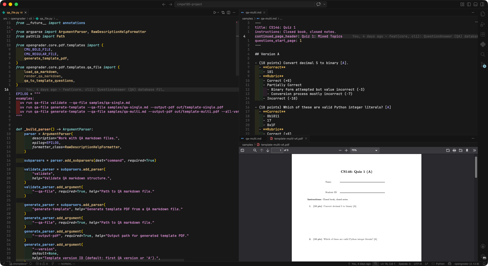

# Opengrader

>

## Team

| Name        | GitHub                                           | Email                |
| ----------- | ------------------------------------------------ | -------------------- |
| Marco Lopez | [@TheMarco408](https://github.com/username)      | marco.lopez@sjsu.edu |
| Tommy Liu   | [@toommyliu](https://github.com/toommyliu)       | tommy.liu@sjsu.edu   |
| Andy Cortes | [@andycortes23](https://github.com/andycortes23) | andy.cortes@sjsu.edu |
| Arjun Gill  | [@arjung04](https://github.com/arjung04)         | arjun.gill@sjsu.edu  |

**Advisor:** [Dr. Carlos Rojas](mailto:carlos.rojas@sjsu.edu)

---

## Project Description

Opengrader is a local, offline-first exam-grading toolchain — think Gradescope, but on your own machine. Existing grading solutions aren't flexible enough to enable educators to grade assignments efficiently. Timely, quality feedback helps improve student learning outcomes, and yet, today's tools fail to meet these needs.

## Capabilities

- **Template generation** — turn a QA-format markdown answer key into printable exam PDFs (Computer Modern fonts, answer boxes, multi-version exams). Draft the QA file itself from an existing answer-key PDF or a text2qti exam.
- **Scan ingestion** — split a bulk scanner PDF into per-student PDFs, fix out-of-order pages, and extract each response via OCR (Tesseract + OpenCV) and a local vision LLM (Ollama) into structured per-student markdown files with response image crops.
- **Grading TUI** — Gradescope-style question-by-question rubric grading in the terminal: in-terminal response images, rubric editing, per-question statistics, anonymous grading by default (teacher mode reveals names), and automatic write-back of grades to submission files and annotated PDFs.
- **Automated grading** — auto-score submissions against a solutions file (exact answer matching; unmatched free responses are left for manual grading).
- **Canvas export** — push scores and per-question comments to Canvas LMS via `canvas-sak`, from the CLI or from inside the TUI.
- **Offline-first** — no cloud APIs, no database; all state lives in files. The only network use is the localhost Ollama server and optional Canvas export.

## Prerequisites

- [Python v3.12](https://www.python.org/)
- [Homebrew](https://brew.sh/)
- [uv](https://docs.astral.sh/uv/getting-started/installation/)
- [Tesseract](https://tesseract-ocr.github.io/tessdoc/Installation.html)
- [Ollama](https://ollama.com/)
- A terminal emulator (any — see below)

### Terminal Compatibility

Opengrader shows each student's scanned answer *inside* the terminal. It speaks three
image protocols and picks the right one for your terminal automatically[^1]:

| Protocol | Terminals |
| --- | --- |
| [Kitty graphics](https://sw.kovidgoyal.net/kitty/graphics-protocol/) | [Ghostty](https://github.com/ghostty-org/ghostty), [kitty](https://sw.kovidgoyal.net/kitty/), Contour |
| [iTerm2 inline images](https://iterm2.com/documentation-images.html) | [iTerm2](https://iterm2.com/), [WezTerm](https://wezfurlong.org/wezterm/), VS Code |
| [Sixel](https://en.wikipedia.org/wiki/Sixel) | Konsole, foot, mlterm, Windows Terminal 1.22+, Rio, XTerm |

**No compatible terminal? Opengrader still works.** On macOS Terminal.app, GNOME
Terminal, PuTTY, or inside tmux, answer crops fall back to a coarse colour-block
preview and the app tells you so — press **`o`** while grading to open the
full-resolution crop in your normal desktop image viewer.

Check what was detected (and paste this into any bug report):

```bash
uv run tui --check-graphics
```

If detection guesses wrong, force a protocol with `--graphics {kitty,iterm2,sixel,halfcell,unicode}`
or `OPENGRADER_GRAPHICS=<protocol>`. Choose a specific external viewer with
`OPENGRADER_IMAGE_VIEWER` (e.g. `OPENGRADER_IMAGE_VIEWER="feh {}"`).

> [!NOTE]
> Visual Studio Code's integrated terminal needs the `terminal.integrated.enableImages` setting. See [Image Support](https://code.visualstudio.com/docs/terminal/advanced#_image-support) for details.

[^1]: Detection is environment-first (recognising the terminal from the variables it exports) and falls back to querying the terminal's capabilities. See `src/opengrader/tui/terminal_graphics.py`.

## Installation

Install homebrew and dependencies:
```bash
/bin/bash -c "$(curl -fsSL https://raw.githubusercontent.com/Homebrew/install/HEAD/install.sh)"
brew install tesseract
brew install uv
brew install python@3.12
brew install ollama
```

Clone the repository:
```bash
git clone https://github.com/SJSU-CMPE-195/group-project-group-14.git opengrader
cd opengrader
```

Set up a Python virtual environment and install packages:
```bash
uv sync --all-groups
```

### Desktop App (Optional)

To create a double-clickable **Opengrader** icon on your Desktop, run once from the checkout:

```bash
bash packaging/install.sh                                        # macOS / Linux
powershell -ExecutionPolicy Bypass -File packaging\install.ps1   # Windows
```

The icon opens a terminal window and launches the TUI, quietly installing/repairing `uv`, Python 3.12, and dependencies on the way (first launch takes a minute or two; later launches are instant). While this checkout exists, every launch also re-syncs the installed copy from it, so the icon always runs the latest code. See [packaging/README.md](packaging/README.md) for details and uninstall steps.

## Usage Guide

Every tool lives behind one front door:
```bash
uv run opengrader <command> [arguments]
```
`opengrader --help` lists every command grouped by what you're doing (Start
here, Prepare an assignment, Take in scans, Grade, ...) instead of
alphabetically. The standalone script names underneath it still work exactly
as before — `uv run submission-splitter ...` and
`uv run opengrader submission-splitter ...` call the same function with the
same flags — so every command in this guide keeps working; `opengrader` is
just the one name to remember instead of thirty.

Run the TUI:
```bash
uv run opengrader tui --qa-file /path/to/qa.md --submissions /path/to/student-submissions
```
(`uv run tui ...` and `uv run opengrader grade ...` are the same command.)

### Finding a command

```bash
uv run opengrader --help              # every command, grouped by workflow step
uv run opengrader help submission-extractor   # that tool's own --help
uv run opengrader commands            # every command, one per line (--json for scripts)
uv run opengrader completion zsh      # shell completion for subcommand names
```

Short aliases exist for the tools you'll reach for most: `split`
(submission-splitter), `extract` (submission-extractor), `auto-grade`
(automated-grading), `answer-key` (create-answer-key), `grade` (tui), and
`pipeline` / `opengrader-run` (run — the whole pipeline in one command, below).
Get a subcommand's name slightly wrong and `opengrader` suggests the closest
match instead of just rejecting it.

### The short version: one command

If you have a stack of scans and an answer key, you do not need to learn the
tools below. One command checks the scan, splits it, reads every answer,
auto-grades what it can, and opens the grading app on the result:

```bash
uv run opengrader-run --scan scans/all-submissions.pdf --qa qa.md --out cohort/
```

Interrupted? Re-scanned a page? Changed your mind? **Run the exact same command
again.** Every step that is still valid is reused rather than repeated, so a
second run on an unchanged class takes seconds, and the summary at the end says
which steps were reused. Add `--dry-run` to see what it would do without doing
any of it. If you would rather not use a terminal, the setup screen has the same
thing in its own section, "RUN THE WHOLE PIPELINE", directly under Start
grading — open "Run every step — one scan in, graded work out" and fill in the
same three paths.

<details>
<summary>Available Scripts</summary>

Every script below runs standalone (`uv run <name> ...`) or through the front
door (`uv run opengrader <name> ...`) — same code, same flags, either
spelling.

- `opengrader-run` (`opengrader run`, alias `pipeline`): The whole pre-grading pipeline in one resumable command — scan check → split → extract → auto-grade, then the grading app opens on what it built. `--scan` takes your scanned bundle or a folder of already-split per-student PDFs; `--qa` is optional (without it the run stops after reading the answers). `--dry-run` prints the plan, `--fresh` redoes everything, `--no-auto-grade` stops after extraction, and a scan with a serious problem stops the run before anything is graded until you fix it or pass `--force`.
- `tui`: Launch the TUI. Optionally pass `--qa-file` and `--submissions` together to load real files.
- `tui-dev`: Launch the TUI with Textual devtools enabled.
- `qa-file`: Work with QA markdown files.
  - `validate --qa-file <qa.md>`: Validate QA markdown structure.
  - `generate-template --qa-file <qa.md> --output-pdf <template.pdf>`: Generate template PDFs from QA markdown.
- `scan-check`: Pre-flight a scan before grading it — rotated pages, blank sheets, low resolution, clipped margins, and a page count that isn't a whole number of submissions. `--fix` writes an upright copy (your original is never modified).
- `region-map`: Grade an assignment Opengrader didn't generate. Draw the answer regions once on a blank copy of your own assignment (Word, LaTeX, or a scan of a paper original — no text layer needed) and save them as `<assignment>.regions.json`; every scan of that assignment then extracts against those boxes. `propose` drafts the boxes for you, `preview` renders the assignment with them outlined so you can check a map in ten seconds, and `validate` reports anything that would crop the wrong thing. Feed it to `submission-extractor --region-map`.
- `photo-import`: Turn a folder of phone photos (JPEG/HEIC/PNG) into per-student PDFs. Each photo is deskewed and perspective-corrected — by the sheet's corner registration marks when it has them, by the page's own edges otherwise — then the photos belonging to one student are bound into a single PDF for `submission-extractor`. Your photos are only ever read. For a class that submits photos instead of a scanned bundle; it lands where `submission-splitter` lands, so the rest of the pipeline is unchanged.
- `submission-splitter`: Split one scanned PDF containing many students into per-student PDFs.
- `submission-extractor`: Convert per-student submission PDFs into `.submission.md` files and response image crops using digital text, templates, or OCR. Runs submissions in parallel across CPU cores (`--jobs`) and can pick up where an interrupted run stopped (`--resume`).
- `create-answer-key` (`answer-key`): Build a QA markdown draft from an existing answer key — a [text2qti](https://github.com/gpoore/text2qti) file, a Word document, or a solved answer-key PDF (OCR + vision model for a scanned one). The input format is detected from the file extension; replaces the old `pdf-to-qa-solutions` and `text2qti-to-qa` scripts, both retired.
- `automated-grading`: Update student `.submission.md` files from a solutions markdown file.
- `claim`: Divide grading between several TAs. `claim divide --graders alice,bob,carol` splits the cohort into contiguous slices; `claim status` shows coverage, gaps and any double-booked work. Claiming work someone else holds is refused.
- `canvas-export`: Push scores and per-question comments from `.submission.md` files to Canvas LMS (requires `canvas-sak` setup; supports `--dry-run`).

</details>

> [!TIP]
> Every script supports `--help` to show its current options.

#### CLI Reference

Validate a QA markdown file:
```bash
uv run qa-file validate --qa-file samples/qa-single.md
```

Generate a template PDF from a QA markdown file:
```bash
uv run qa-file generate-template \
  --qa-file samples/qa-single.md \
  --output-pdf out/template-single.pdf
```

Useful `qa-file generate-template` options:
- `--version <ID>`: Generate a specific template version.
- `--all-versions`: Generate one template per QA version. Output filenames get a `-v<ID>` suffix.
- `--title <title>`: Override the QA file title. Required if the QA file has no title.
- `--instructions <text>`: Override the QA file instructions.
- `--continued-page-header <text>`: Override the continued page header.
- `--questions-start-page 1|2`: Start questions on page 1 or page 2.
- `--font-regular-file <path>` and `--font-bold-file <path>`: Use custom template fonts.

Generated templates use Computer Modern by default.

Split a scanned submissions PDF:
```bash
uv run submission-splitter \
  --input scans/all-submissions.pdf \
  --output split/ \
  --pages-per-submission 6
```

Useful `submission-splitter` options:
- `--start-page <N>` and `--end-page <N>`: Split only a page range, using 1-indexed page numbers.
- `--filename-prefix <prefix>`: Change output names from `submission-0001.pdf`.
- `--zero-pad-width <N>`: Change output number padding.
- `--dry-run`: Print planned split ranges without writing files.
- `--fix-rotation`: Check the scan first and turn upside-down/sideways pages upright before splitting (`--scan-check` reports without fixing). Worth doing: a stack fed into the scanner the wrong way round still splits and still extracts — it just transcribes to nothing and grades to zeros, with no error anywhere.

Check a scan before you split it:
```bash
uv run scan-check --input scans/all-submissions.pdf --pages-per-submission 6
uv run scan-check --input scans/all-submissions.pdf --fix   # writes all-submissions-upright.pdf
```

Convert per-student PDFs into student submission markdown:
```bash
uv run submission-extractor \
  --input split/ \
  --output out/student-submissions/
```

Useful `submission-extractor` options:
- `--jobs <N|auto>` (`-j`): Extract several submissions at once, one process per job. Default is `auto` (the CPU count, capped at 8 — or 4 while the vision model transcribes, since Ollama only serves a few requests at a time). Use `--jobs 1` to go back to one submission at a time. On a 16-core Mac, 12 three-page scans went from 230s to 45s.
- `--resume`: Skip submissions an earlier run already finished. A submission is only skipped when the scan, the settings, and all of its output files are unchanged, so editing a scan or changing a flag correctly re-extracts. The ledger (`<output>/.opengrader/extraction-manifest.jsonl`) is written on every run, so a run interrupted *without* `--resume` is still resumable afterwards. Grades saved in the TUI are never re-extracted over.
- `--fail-fast`: Stop at the first failed submission. By default the batch finishes and lists every failure at the end, so one unreadable scan doesn't discard hours of work; re-run with `--resume` to retry only those.
- `--dpi <N>`: Set rendering DPI for OCR and cropping. Default is `300`.
- `--confidence-threshold <N>`: Set OCR field validation threshold. Default is `60.0`.
- `--lang <codes>`: Set Tesseract layout language codes. Default is `eng`.
- `--no-deskew`: Disable automatic deskewing.
- `--no-split-subquestions`: Keep nested subquestion boxes in one response image.
- `--ollama-model <model>`: Set the Ollama vision model. Defaults to the saved AI settings, falling back to `qwen2.5vl:7b` if not configured.
- `--ollama-host <url>`: Set the Ollama server URL. Defaults to the saved AI settings, falling back to `http://127.0.0.1:11434` if not configured.
- `--ollama-timeout <seconds>`: Set the Ollama request timeout. Defaults to the saved AI settings, falling back to `120` if not configured.
- `--no-ollama-qa`: Skip Ollama question prompt/answer extraction while still using it for name, ID, and title extraction.
- `--save-layout-debug`: Write layout JSON and overlay PNGs for each submission.

Convert an answer key PDF into a QA markdown draft:
```bash
uv run create-answer-key \
  --input samples/exam2b-2-answers.pdf \
  --output out/qa.md \
  --title "Midterm 1 Solutions"
```

Automatically grade student submission markdown files from a solutions file:
```bash
uv run automated-grading \
  --solutions solutions.md \
  --input out/student-submissions/
```

Export grades and comments to Canvas (preview with `--dry-run` first):
```bash
uv run canvas-export \
  --submissions out/student-submissions/ \
  --course "CS146" \
  --assignment "Quiz 1" \
  --dry-run
```

#### Example Usage Flow

0. (Optional) Convert an existing answer key PDF to a QA file:
```bash
uv run create-answer-key --input /path/to/answer-key.pdf --output /path/to/qa.md
```

1. Generate a template from a QA file:
```bash
uv run qa-file generate-template --qa-file /path/to/qa.md --output-pdf /path/to/template.pdf
```

2. Process scan into individual student submissions:
```bash
uv run submission-splitter --input /path/to/scan.pdf --output /path/to/split --pages-per-submission N
```

3. Process student submissions into structured markdown:
```bash
uv run submission-extractor --input /path/to/split --output /path/to/student-submissions
```

Run a vision language model to extract printed and handwritten text from the processed submissions:

Terminal 1: install the Ollama vision model and keep it running:
```bash
# Download the model.
ollama pull qwen2.5vl:7b
# Start the Ollama server.
ollama serve
```

Terminal 2: process the submissions with the model:
```bash
uv run submission-extractor \
  --input samples/cs146-midterm1/split-submissions \
  --output samples/cs146-midterm1/student-submissions \
  --ollama-model qwen2.5vl:7b
```

If `ollama run` cannot connect to Ollama, start the Ollama app or run `ollama serve`
before processing submissions.

#### AI Settings

Opengrader saves your AI configuration once in a settings file — which models to use, where they live, and how confident they must be before suggesting a grade — so every tool uses the same settings without re-entering them. The settings live in your user config directory (`~/Library/Application Support/Opengrader/ai.json` on macOS, `~/.config/opengrader/ai.json` on Linux, `%APPDATA%\Opengrader\ai.json` on Windows). Blank fields mean "follow Opengrader's recommended default," so upgrading Opengrader can move you forward to a newer model without overwriting your deliberate choices.

Settings are resolved in this order (highest priority first): an explicit `--ollama-model` / `--ollama-host` / `--ollama-timeout` CLI flag, then an `OPENGRADER_AI_VISION_MODEL` / `OPENGRADER_AI_HOST` / `OPENGRADER_AI_TIMEOUT` environment variable, then the saved settings file, then Opengrader's built-in defaults. To point the whole system at a different settings file, set `OPENGRADER_AI_CONFIG=/path/to/settings.json`.

Edit the settings from the TUI: launch it and open the "AI setup" tool under "Helper Tools" in the setup screen.

4. (Optional) Auto-score what can be matched against a solutions file:
```bash
uv run automated-grading --solutions /path/to/solutions.md --input /path/to/student-submissions
```

5. Launch the TUI with the generated files:
```bash
uv run tui \
  --qa-file /path/to/qa.md \
  --submissions /path/to/student-submissions
```

6. (Optional) Export grades to Canvas when grading is done:
```bash
uv run canvas-export --submissions /path/to/student-submissions --course "CS146" --assignment "Quiz 1" --dry-run
```

#### Run it from anywhere (Optional)

By default every command runs through `uv run` from inside the checkout. To
type `opengrader doctor` instead of `uv run opengrader doctor`, from any
directory:

```bash
sh packaging/install-command.sh                                              # macOS / Linux
powershell -ExecutionPolicy Bypass -File packaging\install-command.ps1       # Windows
```

(On Windows, add `-AddToPath` to have it put the install directory on your user
PATH for you.)

That installs **one** command, `opengrader`, into `~/.local/bin` (or
`%USERPROFILE%\.local\bin` on Windows — add that directory to your `PATH` if it
isn't already; the installer tells you the exact line). Everything is still reached through it: `opengrader tui`,
`opengrader run`, `opengrader split ...`.

The installed launcher **contains no path to your checkout**. It finds the
project on every run, so nothing breaks when the project moves, gets cloned
somewhere else, or — the common one on macOS — lives on an external drive that
remounts under a new name (`Samsung_T5` one day, `Samsung_T5 1` the next,
depending on what order your drives were plugged in). It looks, in order, at
`$OPENGRADER_HOME`, the checkout you're standing in, the one it used last
time, then any mounted volume and your home directory. Run it inside a
different clone and that clone is what runs — useful when you have a branch
checked out separately.

```bash
opengrader doctor                       # from anywhere
OPENGRADER_HOME=/path/to/checkout opengrader doctor   # pin a specific clone
OPENGRADER_PYTHON=/path/to/python opengrader doctor   # run with a specific interpreter
OPENGRADER_WRAPPER_DEBUG=1 opengrader doctor          # say which checkout it picked, and why
```

**It does not require uv.** uv is what this project is developed with and is
preferred when installed — it is the only option that installs missing
dependencies rather than failing on them — but the launcher will equally use a
Poetry environment, a plain `python -m venv`, an activated Conda environment,
or any interpreter you point `$OPENGRADER_PYTHON` at. A venv that some other
tool built is used directly and never handed to uv, so `uv run` cannot sync a
Poetry-managed environment against `uv.lock` behind your back. What it can't
do is create an environment from nothing: with none present it tells you the
`uv sync` / `poetry install` / `python -m venv` command to run.

To remove it: `rm ~/.local/bin/opengrader`.

> [!NOTE]
> `uv tool install .` also works and is the more standard incantation, but it
> installs *all* thirty-odd console scripts — `doctor`, `curve`, `claim`,
> `tui`, `calibrate`, `regrade` — onto your `PATH` as global commands, and uv
> has no way to install only one of them. That's why this project ships its
> own one-command installer.

## Demo


https://github.com/user-attachments/assets/f8938fa9-d64f-4d88-a8e4-62a48111a471


---

## Screenshots

| Feature                              | Screenshot                                               |
| ------------------------------------ | -------------------------------------------------------- |
| Template generation from QA file     |              |
| Scan splitting into student PDFs      |  |
| OCR-based submission markdown export |  |
| TUI    |                          |

---

## Technical Stack

| Area | Technologies |
| ---- | ------------ |
| Frontend/backend | [Python](https://www.python.org/), [Textual](https://textual.textualize.io/), Terminal Emulator | 
| Document processing | [pypdf](https://pypdf.readthedocs.io/en/stable/), [PyMuPDF](https://pymupdf.readthedocs.io/en/latest/), [Tesseract](https://tesseract-ocr.github.io/), [opencv](https://pypi.org/project/opencv-python/) |
| Local model integration | [Ollama](https://ollama.com/)
| Testing | [pytest](https://docs.pytest.org/en/stable/) |

## What's Next (195B)

- Website syncing: Sync local data to the web information securely.

- Automated grading: Extend the current exact-match evaluator (`automated-grading`) with fuzzy, numeric, and LLM-based answer matching.

- Assignment variety: Support the capability to grade Programming or Group assignments.


---

## Acknowledgments

-  Dr. Carlos Rojas - Advisor, for guidance and support throughout the project
-  Dr. Ben Reed - For sharing ideas and experiences, and providing feedback
---

## License

This project is licensed under the <FILL IN> License - see the [LICENSE](LICENSE) file for details.

---

_CMPE 195A/B - Senior Design Project | San Jose State University | Spring 2026_
