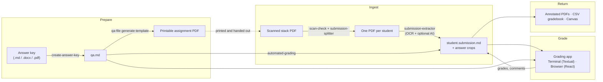
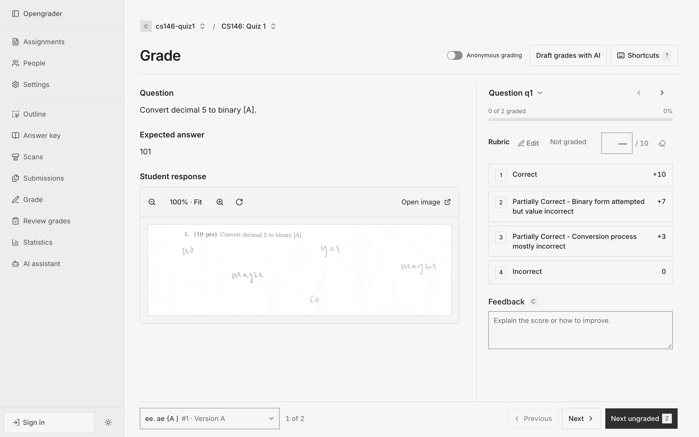

# Opengrader

[](https://pypi.org/project/opengrader/) [](LICENSE)

Grade paper assignments on your own computer. Print an assignment, scan the stack, and grade it question by question. Student work never leaves the machine unless you send it to an AI yourself.

## Team

| Name | GitHub | Email |
| --- | --- | --- |
| Andy Cortes | [@andycortes23](https://github.com/andycortes23) | andy.cortes@sjsu.edu |
| Arjun Gill | [@arjung04](https://github.com/arjung04) | arjun.gill@sjsu.edu |
| Tommy Liu | [@toommyliu](https://github.com/toommyliu) | tommy.liu@sjsu.edu |
| Marco Lopez | [@TheMarco408](https://github.com/TheMarco408) | marco.lopez@sjsu.edu |

Advisor: [Dr. Carlos Rojas](mailto:carlos.rojas@sjsu.edu)

## Project Description

Grading paper by hand is slow, and Gradescope and similar tools are paid cloud services that require uploading student work to a third party. Opengrader runs locally. It turns a markdown answer key into a printable assignment, splits and reads the scanned stack, and gives instructors and TAs a question-by-question rubric grader in the terminal or the browser. AI is optional: give a copy with no names or IDs to the assistant you already use, or connect a local or cloud model.

## Prototype Scope

### Works end to end

| Step | What you can do |
| --- | --- |
| 1. Answer key | Write a `qa.md` key ([format](src/opengrader/guides/qa-format.md)), or draft one from a Word, text, or PDF key with `opengrader create-answer-key`. |
| 2. Assignment | Generate printable PDFs with answer boxes, multiple versions, QR codes, and bubble sheets. |
| 3. Scan intake | Catch rotated, blank, or missing pages, split the stack into one PDF per student, and import phone photos. |
| 4. Reading | Crop every answer and read each student's name and ID with Tesseract and PP-OCR. A local vision model can read handwriting. |
| 5. Grading | Grade by question in the terminal app or web app with rubrics, comments, undo, and anonymous grading. |
| 6. Auto-grading | Score multiple choice, true/false, and numeric answers. An AI can suggest grades for written answers, and a human confirms each one. |
| 7. Hand back | Write grades onto each student's PDF, export a CSV gradebook, or push scores to Canvas. |

`opengrader run` chains steps 3 to 6 and resumes where it stopped. `opengrader classic` is a desktop app with every step as a button.

### Incomplete

- Windows and Linux installers exist but haven't been run on real machines. macOS is the tested platform.
- Google sign-in and shared web workspaces work but no real course staff has used them yet.
- Cloud AI works but answer crops are not yet masked before sending.
- Handwritten math recognition (`math` extra) is experimental.

### Left for the Expo

See [What's Next](#whats-next).

## System Architecture

Opengrader is a pipeline of command-line steps that pass plain files (markdown and image crops) to each other and end in a grading app. All logic lives in one Python package. The CLI, terminal app, and web app are thin front ends over it.



| Component | Folder | What it does |
| --- | --- | --- |
| Core library | `src/opengrader/core/` | Answer-key parsing, scoring, PDF generation, OCR, splitting, auto-grading, exports. No UI code. |
| CLI | `src/opengrader/cli/` | One command per pipeline step, all under `opengrader <command>`. |
| Terminal app | `src/opengrader/tui/` | Textual grading app and settings screens. |
| Local service | `src/opengrader/server/` | FastAPI service on `localhost` that stores a shared workspace in SQLite. |
| Web app | `src/opengrader/web/` | React/Vite client for the same workspace. |
| Installers | `packaging/` | Double-click installers and launchers. |
| AI (optional) | external | Your own assistant working in a redacted copy (`opengrader agent`), an [Ollama](https://ollama.com/) server on `127.0.0.1:11434`, or a cloud provider. |

Grades live in one of two places. A plain class folder saves them into each student's `.submission.md` file. A workspace keeps them in SQLite behind the local service so the terminal app, the web app, and several graders share them live.

## Prerequisites

| Requirement | Version | Needed for |
| --- | --- | --- |
| macOS (tested), Windows or Linux (untested) | | Everything |
| [Python](https://www.python.org/) | 3.12 exactly; `uv` installs it | Everything |
| [uv](https://docs.astral.sh/uv/) | 0.5+ (tested on 0.12) | Everything |
| [Git](https://git-scm.com/) | any | Cloning |
| [Tesseract OCR](https://tesseract-ocr.github.io/tessdoc/Installation.html) | 5.x (tested on 5.5) | Reading scans. Without it, answers come out empty. |
| [Node.js](https://nodejs.org/) | 22+ (CI uses 24) | Building the web app |
| [Ollama](https://ollama.com/) | tested on 0.23 | Optional local AI. The two default models need several GB of disk. |
| Scanner or phone camera | | Real submissions. `samples/` has scans you can use without one. |
| Canvas account + [`canvas-sak`](https://pypi.org/project/canvas-sak/) | | Optional Canvas export |
| Google Cloud OAuth client | | Optional sign-in for a hosted web app |

Any recent laptop can grade. Local AI wants 16 GB of RAM.

## Installation

### Desktop app

1. Clone or download this repository.
2. Double-click `Install Opengrader (Mac).command` or `Install Opengrader (Windows).bat`.
3. Open the Opengrader icon it puts on your Desktop. The first launch installs `uv`, Python 3.12, and dependencies, which takes a minute or two.

Details and uninstall steps are in [packaging/README.md](packaging/README.md).

### From a clean Mac

1. Install [Homebrew](https://brew.sh/), then the system tools:
   ```bash
   brew install git uv tesseract node
   brew install ollama            # optional, for local AI
   ```
2. Clone the repository:
   ```bash
   git clone https://github.com/SJSU-CMPE-195/group-project-group-14.git opengrader
   cd opengrader
   ```
3. Install the Python packages:
   ```bash
   uv sync --all-groups --extra pydantic-ai --extra photos
   ```
   A plain `uv sync` removes these extras. `pydantic-ai` adds cloud AI clients, `photos` adds iPhone HEIC support, and `math` (not included above, installs PyTorch) reads handwritten math.
4. Build the web app:
   ```bash
   npm --prefix src/opengrader/web ci
   npm --prefix src/opengrader/web run build
   ```
5. Put `opengrader` on your PATH:
   ```bash
   sh packaging/install-command.sh
   ```
6. Check the setup. `opengrader doctor` names anything missing and the command that fixes it:
   ```bash
   opengrader doctor
   ```

To use a local model, start `ollama serve`, run `ollama pull qwen3.5:9b` and `ollama pull qwen2.5vl:7b`, then pick it under Tools → AI models & providers. `opengrader ai-readme --local` prints every step.

### Environment variables

Local use needs none. Never commit real values.

For a hosted web app with Google sign-in, copy [`.env.example`](.env.example) to `~/.opengrader/server.env` and set:

| Variable | Purpose |
| --- | --- |
| `OPENGRADER_AUTH_ENABLED` | Turns on Google sign-in. Off by default. |
| `OPENGRADER_GOOGLE_CLIENT_ID` | Google OAuth client ID |
| `OPENGRADER_GOOGLE_CLIENT_SECRET` | Google OAuth client secret |
| `OPENGRADER_SESSION_SECRET` | Signs login cookies. Generate with `openssl rand -hex 48`. |
| `OPENGRADER_GOOGLE_DOMAIN` | Google Workspace domain allowed to sign in |
| `OPENGRADER_ADMINS` | Comma-separated emails of admins who can create courses |
| `OPENGRADER_SECURE_COOKIE` | Secure cookies for HTTPS |
| `OPENGRADER_SERVER_HOME` | Folder for the service's data and `server.env`. Defaults to `~/.opengrader`. |

Optional on any machine:

| Variable | Purpose |
| --- | --- |
| Provider key, such as `ANTHROPIC_API_KEY` | Cloud AI key. You can paste it in the app instead, which stores it in the OS password store. |
| `OPENGRADER_AI_ALLOW_CLOUD` | `0` blocks every cloud AI request on this machine. |
| `OPENGRADER_GRAPHICS` | Forces a terminal image protocol: `kitty`, `iterm2`, `sixel`, `halfcell`, or `unicode`. |
| `OPENGRADER_TERMINAL_TIMEOUT` | Seconds to wait for the terminal to report image support |
| `OPENGRADER_IMAGE_VIEWER` | Program the `o` key opens images with, such as `"feh {}"` |
| `OPENGRADER_HOME` / `OPENGRADER_PYTHON` | Checkout and interpreter the global `opengrader` command uses |

## Running the Prototype

Run the whole pipeline on a sample scan. Copy it first, because grading writes into the folder:

```bash
mkdir -p /tmp/og-demo
cp samples/cs146-quiz1/{qa.md,submissions.pdf,template-vA.pdf} /tmp/og-demo/
opengrader run /tmp/og-demo --no-llm
```

It checks the 6-page scan, splits it into 2 students, crops 22 answers, auto-grades what it can, and prints a summary in about 15 seconds. Run it again and it skips finished work. `--llm` lets the configured AI read handwriting and suggest grades.

Grade the result in the terminal (`enter` opens a question, `1`–`9` picks a rubric item, `?` lists shortcuts, `q` quits):

```bash
opengrader tui /tmp/og-demo
```

Or in the browser:

```bash
opengrader web --workspace /tmp/og-demo
opengrader stop          # when you're done
```

`opengrader classic` opens the desktop app, the same thing the Desktop icon runs. `opengrader --help` lists every command.

More how-tos:

- [Running each step by hand](docs/manual-steps.md)
- [Grading with other accounts on one computer](docs/shared-machine.md), including over SSH
- [Which terminal shows images best](docs/terminal-images.md)
- Optional: [working with your AI assistant](docs/ai-assistant.md), and where AI settings are stored

## Testing

```bash
uv run pytest
```

This runs about 280 test files in `tests/unit/`, using the scanned quizzes in `samples/` as fixtures. The browser tests drive the built web app in Chromium:

```bash
uv run --group browser playwright install chromium
uv run --group browser pytest browser_tests --browser chromium
```

GitHub Actions runs both on every push and pull request to `main` ([workflow](.github/workflows/tests.yml)).

| Folder | Files | Covers |
| --- | --- | --- |
| `tests/unit/core/` | 131 | Answer-key parsing, scoring, PDF generation, splitting, extraction, auto-grading, AI safeguards (no names sent to the cloud), exports, backups, encryption |
| `tests/unit/tui/` | 74 | The terminal app driven headlessly: key bindings, grading flow, screens, startup time |
| `tests/unit/cli/` | 37 | Each command's flags and output |
| `tests/unit/server/` | 21 | The local service's API, workspaces, sign-in |
| `tests/unit/ocr/` | 15 | Page layout detection, OCR, QR codes, bubble sheets |
| `tests/unit/packaging/` | 5 | Installers, launchers, bundled dependencies |
| `browser_tests/` | 26 tests | Scan upload, answer-key import, saving and syncing grades across tabs, anonymous grading, save conflicts, CSV export, AI rubric and grade drafts |

## Demo

Demo video (4.5 min, narrated):

https://github.com/user-attachments/assets/f4352f5d-af4e-4ce9-bed4-e0f48aceb68e

If the player doesn't load, [download the MP4](videos/opengrader-demo-narrated.mp4) ([captions](videos/opengrader-demo-narrated.srt)).

The video runs `opengrader run` on a class folder, grades in the terminal app with rubric items and comments, exports annotated PDFs, and finishes in the browser with the review table and per-question statistics.

[docs/demo/run-log.txt](docs/demo/run-log.txt) is the full output of the sample run above. This is the web grader on its first answer:



## Technical Stack

| Area | Technologies |
| --- | --- |
| Languages | Python 3.12 ([uv](https://docs.astral.sh/uv/)), TypeScript |
| Terminal app | [Textual](https://textual.textualize.io/), [Rich](https://rich.readthedocs.io/), textual-image |
| CLI | [Click](https://click.palletsprojects.com/) |
| Web app | [FastAPI](https://fastapi.tiangolo.com/), uvicorn, SQLite, [React](https://react.dev/), [Vite](https://vite.dev/), TanStack Router and Query |
| PDF | [PyMuPDF](https://pymupdf.readthedocs.io/), [pypdf](https://pypdf.readthedocs.io/), segno for QR codes |
| OCR and imaging | [Tesseract](https://tesseract-ocr.github.io/), [RapidOCR](https://github.com/RapidAI/RapidOCR) (PP-OCR on ONNX Runtime), [OpenCV](https://opencv.org/), Pillow, NumPy |
| AI (optional) | [Ollama](https://ollama.com/) with `qwen3.5:9b` and `qwen2.5vl:7b`, cloud providers through [Pydantic AI](https://ai.pydantic.dev/) |
| Integrations | Canvas via `canvas-sak`, Google sign-in via Authlib |
| Security | `cryptography` (AES-256-GCM backups), OS password stores for API keys |
| Testing and CI | pytest, Playwright, GitHub Actions |
| Hardware | Any scanner or phone camera, and a laptop |

## What's Next

Before the Project Expo on December 11:

- [ ] Run the Windows and Linux installers on real machines and fix what breaks.
- [ ] Grade a real quiz with several TAs on a shared web workspace with Google sign-in.
- [ ] Mask the name and ID area out of answer crops before any cloud request, and cap model response size.
- [ ] Measure how often handwriting reading and AI grade suggestions agree with human graders, using `opengrader llm-eval` and `opengrader transcribe-eval`.
- [ ] Build a one-click demo folder, record an updated video, and make the poster.

## License

[MIT](LICENSE). Third-party packages keep their own licenses, listed in [THIRD_PARTY_LICENSES](THIRD_PARTY_LICENSES).

## Acknowledgments

- Dr. Carlos Rojas, our advisor
- Dr. Ben Reed, for ideas and feedback

_CMPE 195A/B Senior Design Project, San José State University, 2026_
