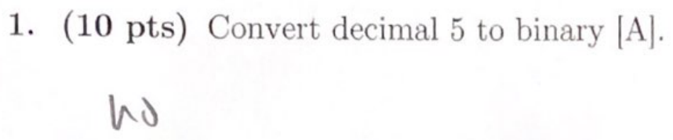
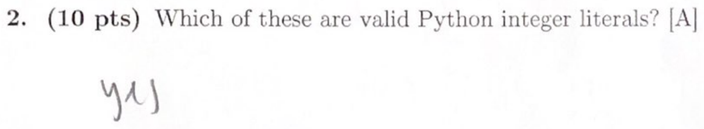
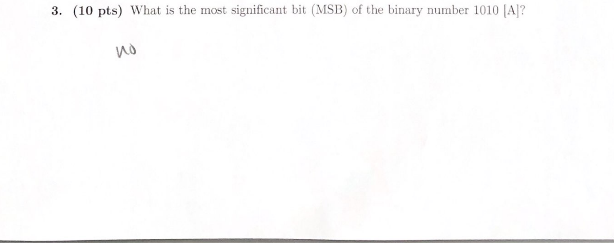
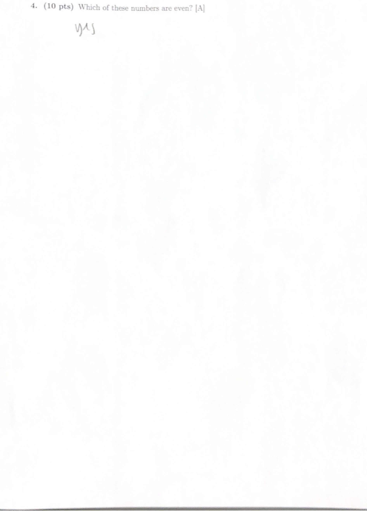

- q1:
  - Prompt: (10 points) Convert decimal 5 to binary [A].
  - Response image: 
  - Response text: |
    VOM
  - Possible points: 10
  - Points: 
  - Analysis: 

- q2:
  - Prompt: (10 points) Which of these are valid Python integer literals? [A]
  - Response image: 
  - Response text: |
    AVS
  - Possible points: 10
  - Points: 
  - Analysis: 

- q3:
  - Prompt: (10 points) What is the most significant bit (MSB) of the binary number 1010 [A]?
  - Response image: 
  - Response text: |
    AVM
  - Possible points: 10
  - Points: 
  - Analysis: 

- q4:
  - Prompt: (10 points) Which of these numbers are even? [A]
  - Response image: 
  - Response text: |
    NY 2
  - Possible points: 10
  - Points: 
  - Analysis:
