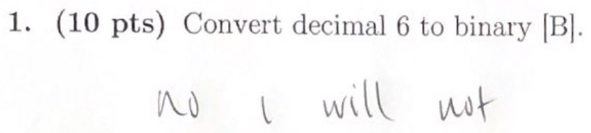
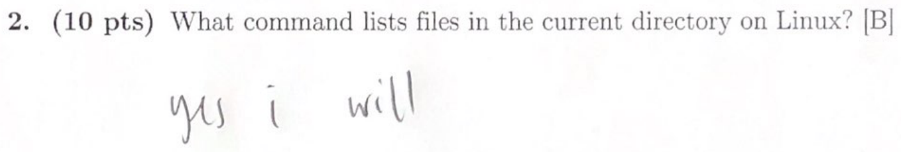
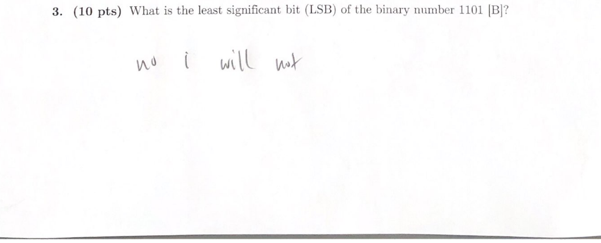
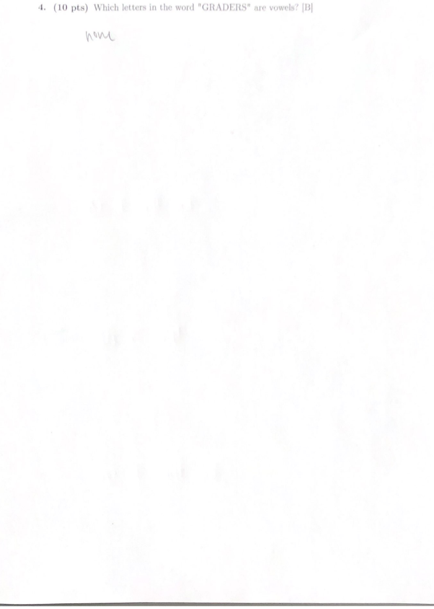

- q1:
  - Prompt: 
  - Response image: 
  - Response text: |
    1. (10 pts) Convert decimal 6 to binary |B]. Ady will wok
  - Possible points: 
  - Points: 
  - Analysis: 

- q2:
  - Prompt: 
  - Response image: 
  - Response text: |
    2. (10 pts) What command lists files in the current directory on Linux? [B} my «will
  - Possible points: 
  - Points: 
  - Analysis: 

- q3:
  - Prompt: 
  - Response image: 
  - Response text: |
    3. (10 pts) What is the least significant bit (LSB) of the binary number 1101 |B]? wi wk OOO
  - Possible points: 
  - Points: 
  - Analysis: 

- q4:
  - Prompt: 
  - Response image: 
  - Response text: |
    A (10 pts) detters aa the werel "GOR APD Ro de ty! la Gays peed ee ee ee eee RS
  - Possible points: 
  - Points: 
  - Analysis:
