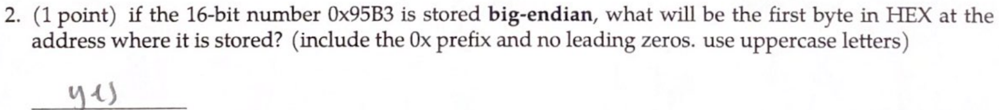
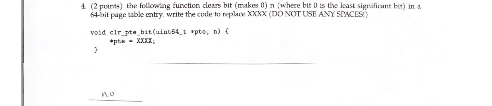

- q1:
  - Question type: Free Response
  - Prompt:
  - Response image: 
  - Source segments: [{"page":1,"bbox":[0.1698,0.5952,0.5153,0.0442]}]
  - Read by: tesseract
  - Confidence: 95.2143
  - Response text: |
    1. (50 points) Minimum score. You don’t have to do anything for this question.
  - Possible points:
  - Points:
  - Rubric:
  - Analysis:

- q2:
  - Question type: Free Response
  - Prompt:
  - Response image: 
  - Source segments: [{"page":1,"bbox":[0.169,0.6488,0.6812,0.0582]}]
  - Read by: vision-model
  - Response text: |
    y<)
  - Possible points:
  - Points:
  - Rubric:
  - Analysis:

- q3:
  - Question type: Free Response
  - Prompt:
  - Response image: 
  - Source segments: [{"page":1,"bbox":[0.1686,0.7167,0.682,0.0573]}]
  - Read by: vision-model
  - Response text: |
    0x
  - Possible points:
  - Points:
  - Rubric:
  - Analysis:

- q4:
  - Question type: Free Response
  - Prompt:
  - Response image: 
  - Source segments: [{"page":1,"bbox":[0.1682,0.7742,0.6835,0.1227]},{"page":2,"bbox":[0.1569,0.077,0.6992,0.0906]}]
  - Read by: tesseract
  - Confidence: 80.5345
  - Response text: |
    4. (2 points) the following function clears bit (makes 0) n (where bit 0 is the least significant bit) in a 64-bit page table entry. write the code to replace XXXX (DO NOT USE ANY SPACES!) void clr_pte_bit(uint64_t *pte, n) f *pte = XXXX; } L Name: Gar Qavty ID: ent A ————Seeeoeeeeeeee eee EE aaa SSS Wo
  - Possible points:
  - Points:
  - Rubric:
  - Analysis:

- q5:
  - Question type: Free Response
  - Prompt:
  - Response image: 
  - Source segments: [{"page":2,"bbox":[0.1651,0.177,0.6255,0.0461]}]
  - Read by: vision-model
  - Response text: |
    yrs
  - Possible points:
  - Points:
  - Rubric:
  - Analysis:

- q6:
  - Question type: Free Response
  - Prompt:
  - Response image: 
  - Source segments: [{"page":2,"bbox":[0.1655,0.2324,0.6886,0.0594]}]
  - Read by: vision-model
  - Response text: |
    no
  - Possible points:
  - Points:
  - Rubric:
  - Analysis:

- q7:
  - Question type: Free Response
  - Prompt:
  - Response image: 
  - Source segments: [{"page":2,"bbox":[0.1659,0.2918,0.6843,0.1973]}]
  - Read by: vision-model
  - Response text: |
    public static void main
  - Possible points:
  - Points:
  - Rubric:
  - Analysis:

- q8:
  - Question type: Free Response
  - Prompt:
  - Response image: 
  - Source segments: [{"page":2,"bbox":[0.1686,0.5558,0.6812,0.2879]}]
  - Read by: vision-model
  - Response text: |
    Swap
  - Possible points:
  - Points:
  - Rubric:
  - Analysis:
