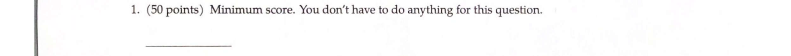

- q1:
  - Question type: Free Response
  - Prompt: (50 points) Minimum score. You don't have to do anything for this question.
  - Response image: 
  - Source segments: [{"page":1,"bbox":[0.0104,0.5935,0.9792,0.0542]}]
  - Response text: 
  - Possible points: 50
  - Points: 
  - Rubric:
  - Analysis: 

- q2:
  - Question type: Free Response
  - Prompt: (1 points) if the 16-bit number 0x95B3 is stored big-endian, what will be the first byte in HEX at the address where it is stored? (include the 0x prefix and no leading zeros. use uppercase letters)
  - Response image: 
  - Source segments: [{"page":1,"bbox":[0.0104,0.6477,0.9792,0.0686]}]
  - Response text: 
  - Possible points: 1
  - Points: 
  - Rubric:
  - Analysis: 

- q3:
  - Question type: Free Response
  - Prompt: (1 points) if the 16-bit number 0xB395 is stored little-endian, what will be the first byte in HEX at the address where it is stored? (include the Ox prefix and no leading zeros. use uppercase letters)
  - Response image: 
  - Source segments: [{"page":1,"bbox":[0.0104,0.7163,0.9792,0.0667]}]
  - Response text: 
  - Possible points: 1
  - Points: 
  - Rubric:
  - Analysis: 

- q4:
  - Question type: Free Response
  - Prompt: (2 points) the following function clears bit (makes 0) n (where bit 0 is the least significant bit) in a 64-bit page table entry. write the code to replace XXXX (DO NOT USE ANY SPACES!) void clr_pte_bit(uint64_t *pte, n) { *pte = XXXX; }
  - Response image: 
  - Source segments: [{"page":1,"bbox":[0.0104,0.783,0.9792,0.0979]},{"page":2,"bbox":[0.0104,0.1088,0.9792,0.0668]}]
  - Response text: 
  - Possible points: 2
  - Points: 
  - Rubric:
  - Analysis: 

- q5:
  - Question type: Free Response
  - Prompt: (2 points) What does each level of the Multi-Level Feedback Queue (MLFQ) correspond to?
  - Response image: 
  - Source segments: [{"page":2,"bbox":[0.0104,0.1756,0.9792,0.0553]}]
  - Response text: 
  - Possible points: 2
  - Points: 
  - Rubric:
  - Analysis: 

- q6:
  - Question type: Free Response
  - Prompt: (2 points) in MLFQ, rule 5 says: "After some time period S, move all the jobs in the system to the topmost queue." What problem does rule 5 prevent? (one word, all lowercase)
  - Response image: 
  - Source segments: [{"page":2,"bbox":[0.0104,0.2308,0.9792,0.0685]}]
  - Response text: 
  - Possible points: 2
  - Points: 
  - Rubric:
  - Analysis: 

- q7:
  - Question type: Free Response
  - Prompt: (2 points) if we have a program with the following lines of code: char buffer[1024]; int fd = open("/tmp/file", 0_RDWR); char *data = mmap(NULL, 1024*1024, PROT_READ|PROT_WRITE, MAP_SHARED, fd, 0); Assume all of the above lines and the following lines execute successfully. Write a line of code that will cause a dirty page for /tmp/file.
  - Response image: 
  - Source segments: [{"page":2,"bbox":[0.0104,0.2994,0.9792,0.2551]}]
  - Response text: 
  - Possible points: 2
  - Points: 
  - Rubric:
  - Analysis: 

- q8:
  - Question type: Free Response
  - Prompt: (2 points) if we are running on a Linux machine with 4G of RAM and 1G of swap, what happens when we run the following program? #include <stdio.h> #include <stdlib.h> int main(int argc, char *argv[]) { char *mem [20]; for (int i = 0; i < 20; i++) {
  - Response image: 
  - Source segments: [{"page":2,"bbox":[0.0105,0.5545,0.9792,0.3236]}]
  - Response text: 
  - Possible points: 2
  - Points: 
  - Rubric:
  - Analysis:
