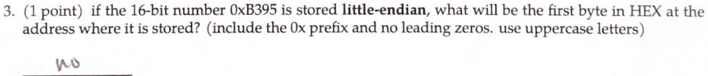
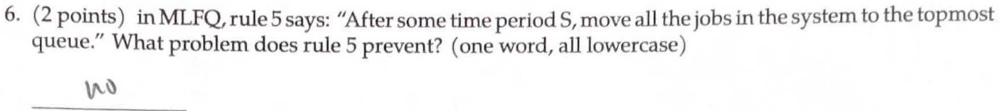
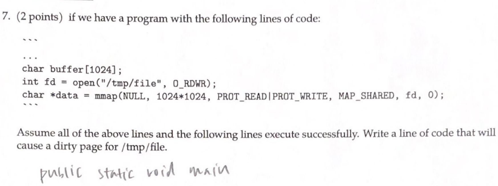
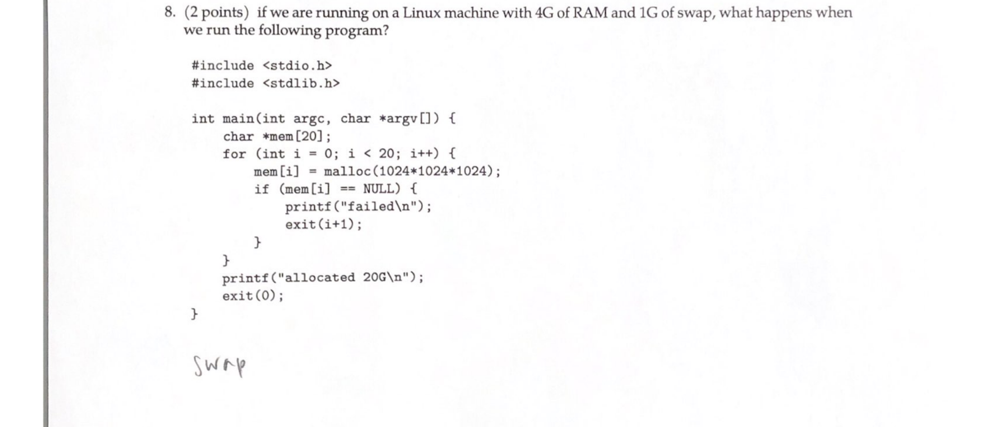

- q1:
  - Question type: Free Response
  - Prompt: 1. (50 points) Minimum score. You don’t have to do anything for this question.
  - Response image: 
  - Source segments: [{"page":1,"bbox":[0.1698,0.5952,0.5153,0.0442]}]
  - Response text: 
  - Possible points: 
  - Points: 
  - Rubric:
  - Analysis: 

- q2:
  - Question type: Free Response
  - Prompt: 2. (1 point) if the 16-bit number 0x95B3 is stored big-endian, what will be the first byte in HEX at the address where it is stored? (include the 0x prefix and no leading zeros. use uppercase letters)
  - Response image: 
  - Source segments: [{"page":1,"bbox":[0.169,0.6488,0.6812,0.0582]}]
  - Response text: |
    95
  - Possible points: 
  - Points: 
  - Rubric:
  - Analysis: 

- q3:
  - Question type: Free Response
  - Prompt: 3. (1 point) if the 16-bit number 0xB395 is stored little-endian, what will be the first byte in HEX at the address where it is stored? (include the 0x prefix and no leading zeros. use uppercase letters)
  - Response image: 
  - Source segments: [{"page":1,"bbox":[0.1686,0.7167,0.682,0.0573]}]
  - Response text: |
    95
  - Possible points: 
  - Points: 
  - Rubric:
  - Analysis: 

- q4:
  - Question type: Free Response
  - Prompt: 
  - Response image: 
  - Source segments: [{"page":1,"bbox":[0.1682,0.7742,0.6835,0.1227]},{"page":2,"bbox":[0.1569,0.077,0.6992,0.0906]}]
  - Response text: 
  - Possible points: 
  - Points: 
  - Rubric:
  - Analysis: 

- q5:
  - Question type: Free Response
  - Prompt: 
  - Response image: 
  - Source segments: [{"page":2,"bbox":[0.1651,0.177,0.6255,0.0461]}]
  - Response text: 
  - Possible points: 
  - Points: 
  - Rubric:
  - Analysis: 

- q6:
  - Question type: Free Response
  - Prompt: 6. (2 points) in MLFQ, rule 5 says: "After some time period S, move all the jobs in the system to the topmost queue." What problem does rule 5 prevent? (one word, all lowercase)
  - Response image: 
  - Source segments: [{"page":2,"bbox":[0.1655,0.2324,0.6886,0.0594]}]
  - Response text: |
    no
  - Possible points: 
  - Points: 
  - Rubric:
  - Analysis: 

- q7:
  - Question type: Free Response
  - Prompt: 
  - Response image: 
  - Source segments: [{"page":2,"bbox":[0.1659,0.2918,0.6843,0.1973]}]
  - Response text: 
  - Possible points: 
  - Points: 
  - Rubric:
  - Analysis: 

- q8:
  - Question type: Free Response
  - Prompt: 
  - Response image: 
  - Source segments: [{"page":2,"bbox":[0.1686,0.5558,0.6812,0.2879]}]
  - Response text: 
  - Possible points: 
  - Points: 
  - Rubric:
  - Analysis:
