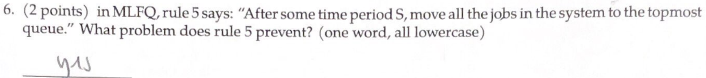
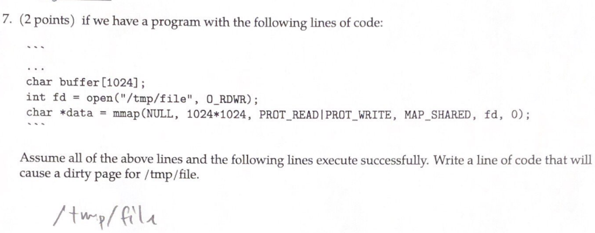
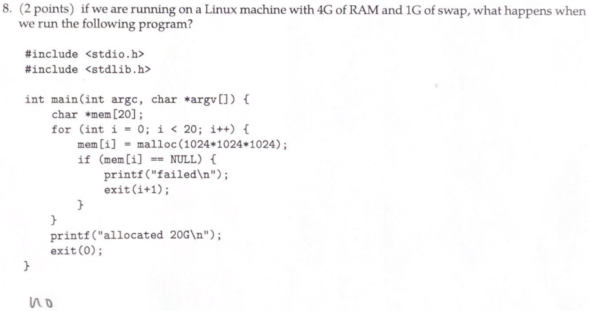

- q1:
  - Question type: Free Response
  - Prompt: 1. (50 points) Minimum score. You don’t have to do anything for this question.
  - Response image: 
  - Source segments: [{"page":1,"bbox":[0.1318,0.5885,0.5518,0.0533]}]
  - Response text: 
  - Possible points: 
  - Points: 
  - Rubric:
  - Analysis: 

- q2:
  - Question type: Free Response
  - Prompt: 2. (1 point) if the 16-bit number 0x95B3 is stored big-endian, what will be the first byte in HEX at the address where it is stored? (include the 0x prefix and no leading zeros. use uppercase letters)
  - Response image: 
  - Source segments: [{"page":1,"bbox":[0.1424,0.6418,0.7063,0.0682]}]
  - Response text: |
    95
  - Possible points: 
  - Points: 
  - Rubric:
  - Analysis: 

- q3:
  - Question type: Free Response
  - Prompt: 3. (1 point) if the 16-bit number 0xB395 is stored little-endian, what will be the first byte in HEX at the address where it is stored? (include the 0x prefix and no leading zeros. use uppercase letters)
  - Response image: 
  - Source segments: [{"page":1,"bbox":[0.1459,0.7103,0.7027,0.0655]}]
  - Response text: |
    95
  - Possible points: 
  - Points: 
  - Rubric:
  - Analysis: 

- q4:
  - Question type: Free Response
  - Prompt: 
  - Response image: 
  - Source segments: [{"page":1,"bbox":[0.1608,0.7761,0.7514,0.1824]},{"page":2,"bbox":[0.1604,0.0839,0.6961,0.0842]}]
  - Response text: 
  - Possible points: 
  - Points: 
  - Rubric:
  - Analysis: 

- q5:
  - Question type: Free Response
  - Prompt: 5. (2 points) What does each level of the Multi-Level Feedback Queue (MLFQ) correspond to?
  - Response image: 
  - Source segments: [{"page":2,"bbox":[0.1678,0.1685,0.6227,0.0548]}]
  - Response text: |
    no
  - Possible points: 
  - Points: 
  - Rubric:
  - Analysis: 

- q6:
  - Question type: Free Response
  - Prompt: 6. (2 points) in MLFQ, rule 5 says: "After some time period S, move all the jobs in the system to the topmost queue." What problem does rule 5 prevent? (one word, all lowercase)
  - Response image: 
  - Source segments: [{"page":2,"bbox":[0.1682,0.233,0.6851,0.0591]}]
  - Response text: |
    yws
  - Possible points: 
  - Points: 
  - Rubric:
  - Analysis: 

- q7:
  - Question type: Free Response
  - Prompt: 
  - Response image: 
  - Source segments: [{"page":2,"bbox":[0.169,0.2921,0.6796,0.2064]}]
  - Response text: 
  - Possible points: 
  - Points: 
  - Rubric:
  - Analysis: 

- q8:
  - Question type: Free Response
  - Prompt: 
  - Response image: 
  - Source segments: [{"page":2,"bbox":[0.1702,0.5539,0.6773,0.2767]}]
  - Response text: 
  - Possible points: 
  - Points: 
  - Rubric:
  - Analysis:
