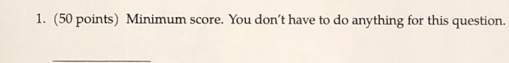
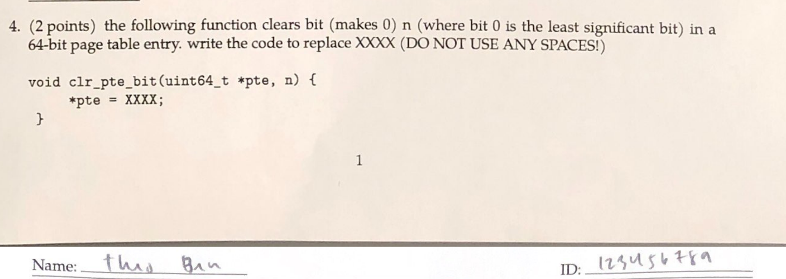
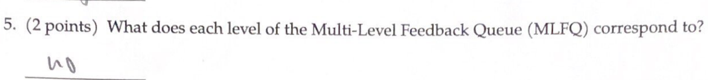

- q1:
  - Question type: Free Response
  - Prompt:
  - Response image: 
  - Source segments: [{"page":1,"bbox":[0.1318,0.5885,0.5518,0.0533]}]
  - Read by: tesseract
  - Confidence: 95.4286
  - Response text: |
    1. (50 points) Minimum score. You don’t have to do anything for this question.
  - Possible points:
  - Points:
  - Rubric:
  - Analysis:

- q2:
  - Question type: Free Response
  - Prompt:
  - Response image: 
  - Source segments: [{"page":1,"bbox":[0.1424,0.6418,0.7063,0.0682]}]
  - Read by: vision-model
  - Response text: |
    n0
  - Possible points:
  - Points:
  - Rubric:
  - Analysis:

- q3:
  - Question type: Free Response
  - Prompt:
  - Response image: 
  - Source segments: [{"page":1,"bbox":[0.1459,0.7103,0.7027,0.0655]}]
  - Read by: vision-model
  - Response text: |
    0x95
  - Possible points:
  - Points:
  - Rubric:
  - Analysis:

- q4:
  - Question type: Free Response
  - Prompt:
  - Response image: 
  - Source segments: [{"page":1,"bbox":[0.1608,0.7761,0.7514,0.1824]},{"page":2,"bbox":[0.1604,0.0839,0.6961,0.0842]}]
  - Read by: tesseract
  - Confidence: 83.5091
  - Response text: |
    4. (2 points) the following function clears bit (makes 0) n (where bit 0 is the least significant bit) in a 64-bit page table entry. write the code to replace XXXX (DO NOT USE ANY SPACES!) void clr_pte_bit(uint64_t *pte, n) f *pte = XXXX; } 1 NT EE Name:_ thay Qan ID: 24s ¥ ee"
  - Possible points:
  - Points:
  - Rubric:
  - Analysis:

- q5:
  - Question type: Free Response
  - Prompt:
  - Response image: 
  - Source segments: [{"page":2,"bbox":[0.1678,0.1685,0.6227,0.0548]}]
  - Read by: vision-model
  - Response text: |
    no
  - Possible points:
  - Points:
  - Rubric:
  - Analysis:

- q6:
  - Question type: Free Response
  - Prompt:
  - Response image: 
  - Source segments: [{"page":2,"bbox":[0.1682,0.233,0.6851,0.0591]}]
  - Read by: vision-model
  - Response text: |
    yus
  - Possible points:
  - Points:
  - Rubric:
  - Analysis:

- q7:
  - Question type: Free Response
  - Prompt:
  - Response image: 
  - Source segments: [{"page":2,"bbox":[0.169,0.2921,0.6796,0.2064]}]
  - Read by: vision-model
  - Response text: |
    /tmp/file
  - Possible points:
  - Points:
  - Rubric:
  - Analysis:

- q8:
  - Question type: Free Response
  - Prompt:
  - Response image: 
  - Source segments: [{"page":2,"bbox":[0.1702,0.5539,0.6773,0.2767]}]
  - Read by: tesseract
  - Confidence: 87.8333
  - Response text: |
    8. (2 points) if we are running on a Linux machine with 4G of RAM and 1G of swap, what happens when we run the following program? #include <stdio.h> #include <stdlib.h> int main(int argc, char *argv[]) { char *mem[20]; for (int i = 0; i < 20; i++) { mem[i] = malloc(1024*1024*1024) ; if (mem[i] == NULL) { printf ("failed\n") ; exit (iti); } } printf("allocated 20G\n") ; exit (0); } V0
  - Possible points:
  - Points:
  - Rubric:
  - Analysis:
