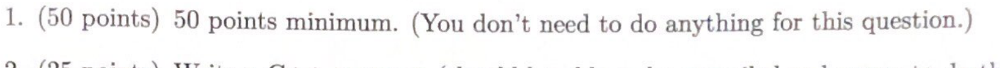
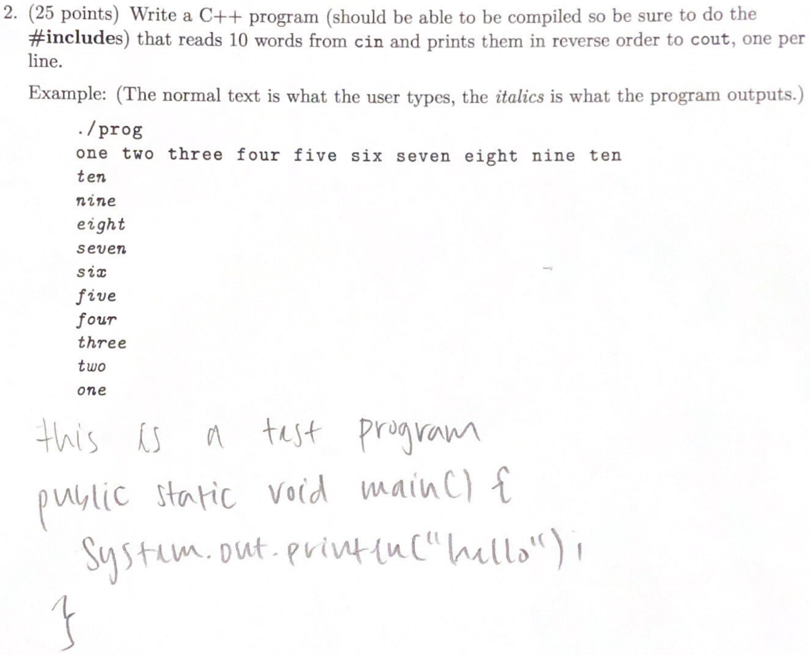
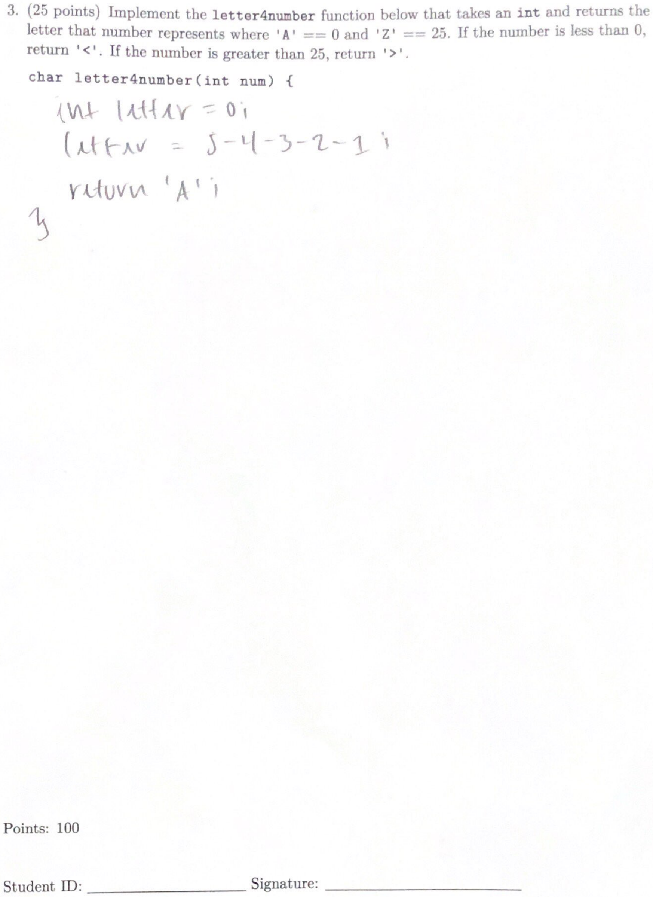

- q1:
  - Question type: Free Response
  - Prompt: 1. (50 points) 50 points minimum. (You don’t need to do anything for this question.)
  - Response image: 
  - Source segments: [{"page":1,"bbox":[0.1694,0.2179,0.6224,0.0327]}]
  - Response text: 
  - Possible points: 
  - Points: 
  - Rubric:
  - Analysis: 

- q2:
  - Question type: Free Response
  - Prompt: 
  - Response image: 
  - Source segments: [{"page":1,"bbox":[0.1694,0.2439,0.6765,0.4224]}]
  - Response text: 
  - Possible points: 
  - Points: 
  - Rubric:
  - Analysis: 

- q3:
  - Question type: Free Response
  - Prompt: 
  - Response image: 
  - Source segments: [{"page":2,"bbox":[0.1631,0.1224,0.6847,0.7264]}]
  - Response text: 
  - Possible points: 
  - Points: 
  - Rubric:
  - Analysis:
