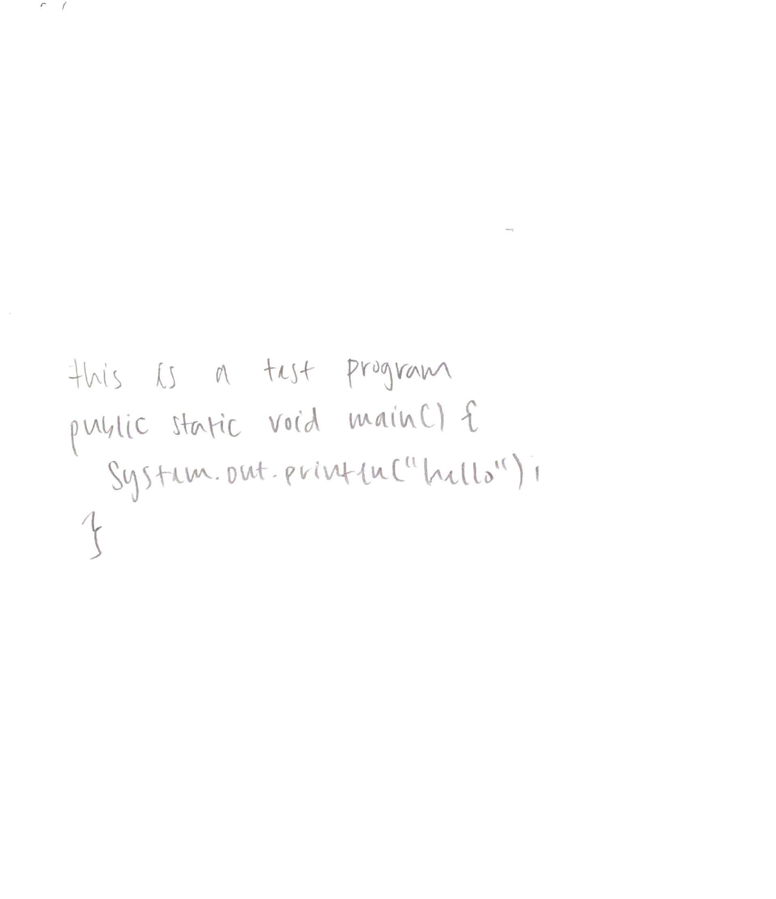
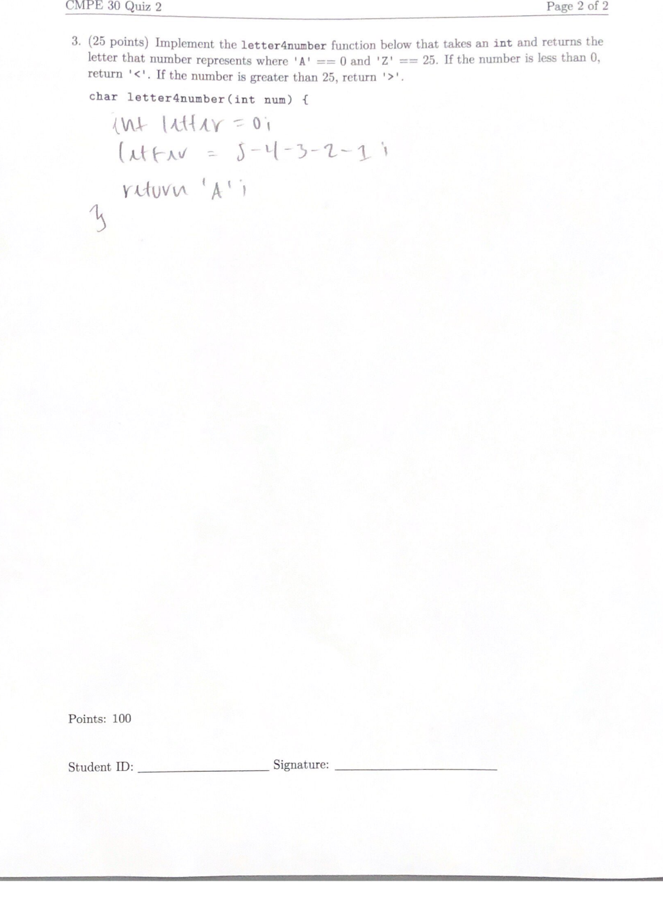
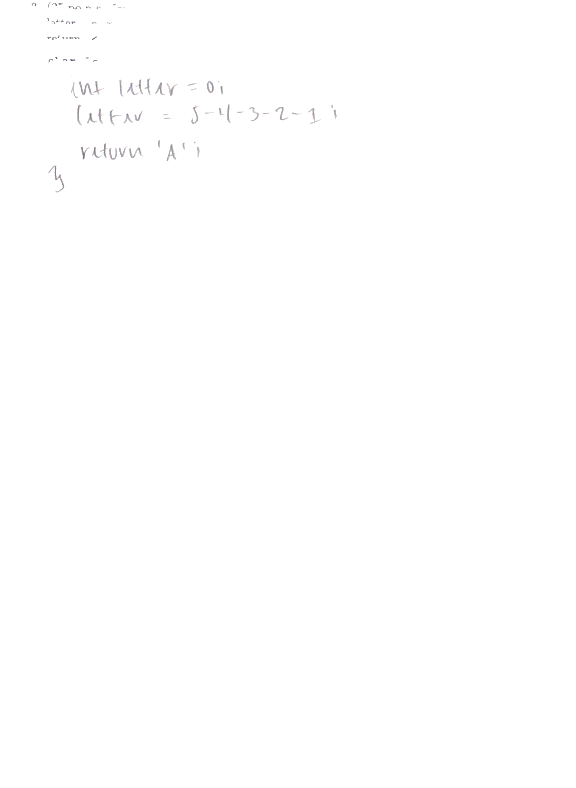

- q1:
  - Question type: Free Response
  - Prompt: (50 points) 50 points minimum. (You don’t need to do anything for this question.)
  - Response image: 
  - Ink image: 
  - Source segments: [{"page":1,"bbox":[0.08,0.1938,0.84,0.0264]}]
  - Ink fragments: [{"page":1,"bbox":[0.1739,0.2216,0.0035,0.0018],"text":""},{"page":1,"bbox":[0.1939,0.2207,0.0043,0.0072],"text":""},{"page":1,"bbox":[0.2205,0.2243,0.0067,0.0012],"text":""}]
  - Read by: vision-model
  - Response text: |
    +
    [mark]
    -
  - Possible points: 50
  - Points:
  - Rubric:
  - Analysis:

- q2:
  - Question type: Free Response
  - Prompt: (25 points) Write a C++ program (should be able to be compiled so be sure to do the
  - Response image: 
  - Ink image: 
  - Source segments: [{"page":1,"bbox":[0.08,0.2222,0.84,0.7528]}]
  - Ink fragments: [{"page":1,"bbox":[0.1727,0.2471,0.0055,0.0033],"text":""},{"page":1,"bbox":[0.1939,0.2465,0.0043,0.007],"text":""},{"page":1,"bbox":[0.6228,0.4159,0.0082,0.0027],"text":""},{"page":1,"bbox":[0.1421,0.4792,0.002,0.0015],"text":""},{"page":1,"bbox":[0.1998,0.5131,0.0514,0.0233],"text":""},{"page":1,"bbox":[0.2848,0.5165,0.0184,0.0197],"text":""},{"page":1,"bbox":[0.3425,0.518,0.0145,0.0155],"text":""},{"page":1,"bbox":[0.3887,0.5131,0.0498,0.0197],"text":""},{"page":1,"bbox":[0.4695,0.5134,0.1015,0.0245],"text":""},{"page":1,"bbox":[0.2017,0.5549,0.0757,0.0321],"text":""},{"page":1,"bbox":[0.3009,0.554,0.0663,0.0194],"text":""},{"page":1,"bbox":[0.3934,0.5498,0.0498,0.0194],"text":""},{"page":1,"bbox":[0.4715,0.5462,0.0917,0.0224],"text":""},{"page":1,"bbox":[0.5797,0.5443,0.0169,0.0245],"text":""},{"page":1,"bbox":[0.2382,0.5843,0.4112,0.037],"text":""},{"page":1,"bbox":[0.6518,0.5937,0.0035,0.0118],"text":""},{"page":1,"bbox":[0.2123,0.6277,0.0204,0.0364],"text":""}]
  - Read by: vision-model
  - Response text: |
    this is a test program
    public static void main() {
    System.out.println("hello");
    }
  - Possible points: 25
  - Points:
  - Rubric:
  - Analysis:

- q3:
  - Question type: Free Response
  - Prompt: (25 points) Implement the letter4number function below that takes an int and returns the
  - Response image: 
  - Ink image: 
  - Source segments: [{"page":2,"bbox":[0.08,0.0906,0.84,0.8844]}]
  - Ink fragments: [{"page":2,"bbox":[0.1714,0.1253,0.0067,0.0036],"text":""},{"page":2,"bbox":[0.1925,0.1244,0.0694,0.0085],"text":""},{"page":2,"bbox":[0.2777,0.1268,0.0169,0.0045],"text":""},{"page":2,"bbox":[0.1918,0.1408,0.0373,0.0067],"text":""},{"page":2,"bbox":[0.2506,0.145,0.0059,0.0021],"text":""},{"page":2,"bbox":[0.2702,0.1453,0.0071,0.0015],"text":""},{"page":2,"bbox":[0.1918,0.1581,0.0428,0.0048],"text":""},{"page":2,"bbox":[0.2502,0.1596,0.0075,0.0039],"text":""},{"page":2,"bbox":[0.1933,0.1802,0.0357,0.0061],"text":""},{"page":2,"bbox":[0.242,0.1808,0.0161,0.0048],"text":""},{"page":2,"bbox":[0.2216,0.2002,0.0027,0.0009],"text":""},{"page":2,"bbox":[0.2228,0.2044,0.0439,0.0176],"text":""},{"page":2,"bbox":[0.2863,0.202,0.1024,0.0188],"text":""},{"page":2,"bbox":[0.4004,0.2044,0.0216,0.0142],"text":""},{"page":2,"bbox":[0.231,0.2284,0.0863,0.0215],"text":""},{"page":2,"bbox":[0.3432,0.2381,0.0122,0.0055],"text":""},{"page":2,"bbox":[0.3801,0.2284,0.1706,0.02],"text":""},{"page":2,"bbox":[0.5632,0.2287,0.0078,0.0149],"text":""},{"page":2,"bbox":[0.2357,0.2672,0.0828,0.0176],"text":""},{"page":2,"bbox":[0.3365,0.2641,0.0035,0.0082],"text":""},{"page":2,"bbox":[0.3479,0.2684,0.0141,0.0176],"text":""},{"page":2,"bbox":[0.3687,0.266,0.018,0.0088],"text":""},{"page":2,"bbox":[0.3879,0.2717,0.0039,0.0109],"text":""},{"page":2,"bbox":[0.1929,0.2899,0.0216,0.0279],"text":""}]
  - Read by: vision-model
  - Response text: |
    int letter = 0;
    letter = 5-4-3-2-1;
    return 'A';
  - Possible points: 25
  - Points:
  - Rubric:
  - Analysis:
