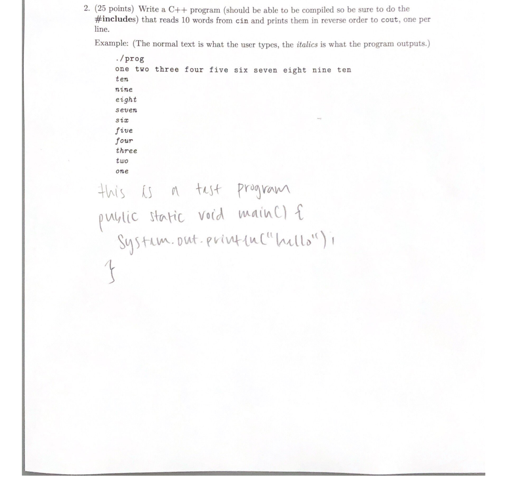

- q1:
  - Question type: Free Response
  - Prompt: (50 points) 50 points minimum. (You don't need to do anything for this question.)
  - Response image: 
  - Source segments: [{"page":1,"bbox":[0.0104,0.2142,0.9792,0.0257]}]
  - Response text: 
  - Possible points: 50
  - Points: 
  - Rubric:
  - Analysis: 

- q2:
  - Question type: Free Response
  - Prompt: (25 points) Write a C++ program (should be able to be compiled so be sure to do the #includes) that reads 10 words from cin and prints them in reverse order to cout, one per line. Example: (The normal text is what the user types, the italics is what the program outputs.) ./prog one two three four five six seven eight nine ten ten nine eight seven six five four three two one
  - Response image: 
  - Source segments: [{"page":1,"bbox":[0.0104,0.2399,0.9792,0.7231]}]
  - Response text: 
  - Possible points: 25
  - Points: 
  - Rubric:
  - Analysis: 

- q3:
  - Question type: Free Response
  - Prompt: (25 points) Implement the letter4number function below that takes an int and returns the letter that number represents where 'A' == 0 and 'Z' == 25. If the number is less than 0, return '<'. If the number is greater than 25, return '>'. char letter4number(int num) {
  - Response image: 
  - Source segments: [{"page":2,"bbox":[0.0103,0.117,0.9794,0.8461]}]
  - Response text: 
  - Possible points: 25
  - Points: 
  - Rubric:
  - Analysis:
