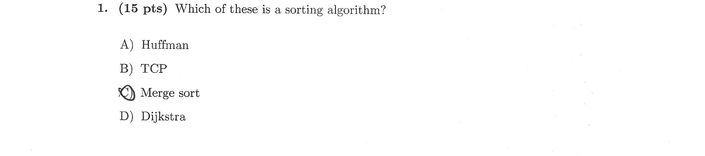
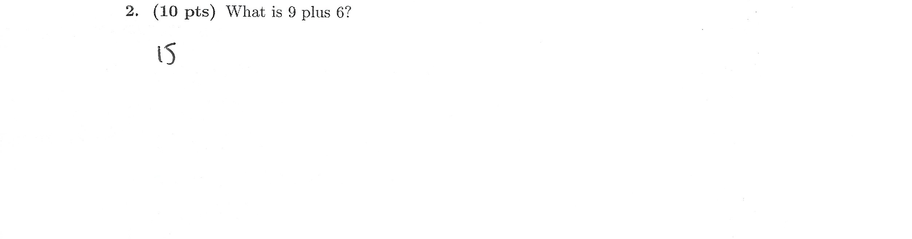
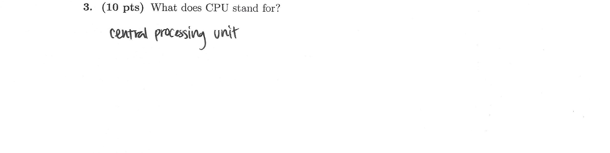
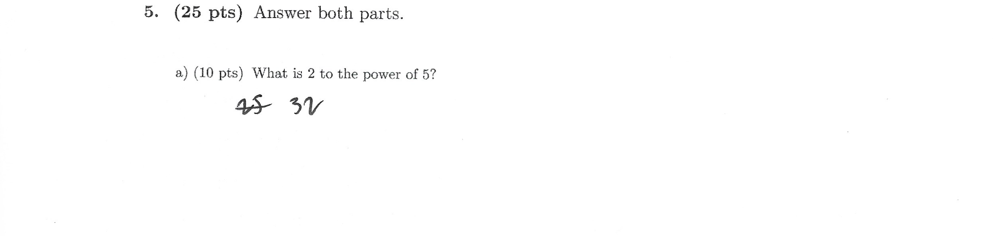
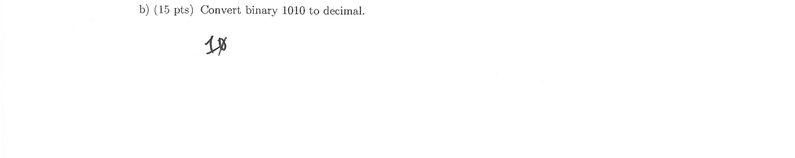
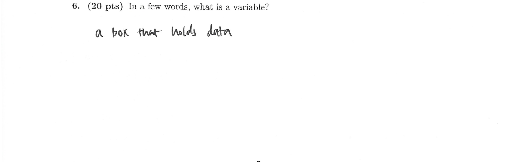

- q1:
  - Question type: Multiple Choice
  - Prompt: (15 points) Which of these is a sorting algorithm?
  - Response image: 
  - Source segments: [{"page":1,"bbox":[0.01,0.3567,0.98,0.1681]}]
  - Response text: 
  - Possible points: 15
  - Points: 
  - Rubric:
  - Analysis: 

- q2:
  - Question type: Free Response
  - Prompt: (10 points) What is 9 plus 6?
  - Response image: 
  - Source segments: [{"page":1,"bbox":[0.01,0.5248,0.98,0.1993]}]
  - Response text: 
  - Possible points: 10
  - Points: 
  - Rubric:
  - Analysis: 

- q3:
  - Question type: Free Response
  - Prompt: (10 points) What does CPU stand for?
  - Response image: 
  - Source segments: [{"page":1,"bbox":[0.01,0.724,0.98,0.1907]}]
  - Response text: 
  - Possible points: 10
  - Points: 
  - Rubric:
  - Analysis: 

- q4a:
  - Question type: Free Response
  - Prompt: (10 points) Answer both parts. a) (10 pts) What is 2 to the power of 5?
  - Response image: 
  - Source segments: [{"page":2,"bbox":[0.0,0.3494,0.9853,0.1878]}]
  - Response text: 
  - Possible points: 10
  - Points: 
  - Rubric:
  - Analysis: 

- q4b:
  - Question type: Free Response
  - Prompt: (15 points) Convert binary 1010 to decimal.
  - Response image: 
  - Source segments: [{"page":2,"bbox":[0.0,0.5284,0.981,0.1595]}]
  - Response text: 
  - Possible points: 15
  - Points: 
  - Rubric:
  - Analysis: 

- q5:
  - Question type: Free Response
  - Prompt: (20 points) In a few words, what is a variable?
  - Response image: 
  - Source segments: [{"page":2,"bbox":[0.0,0.6787,0.9774,0.248]}]
  - Response text: 
  - Possible points: 20
  - Points: 
  - Rubric:
  - Analysis: 

- q6:
  - Question type: Free Response
  - Prompt: (20 points) Write a Python expression for the last item of the list xs.
  - Response image: 
  - Source segments: [{"page":2,"bbox":[0.0,0.917,0.9716,0.083]}]
  - Response text: 
  - Possible points: 20
  - Points: 
  - Rubric:
  - Analysis:
