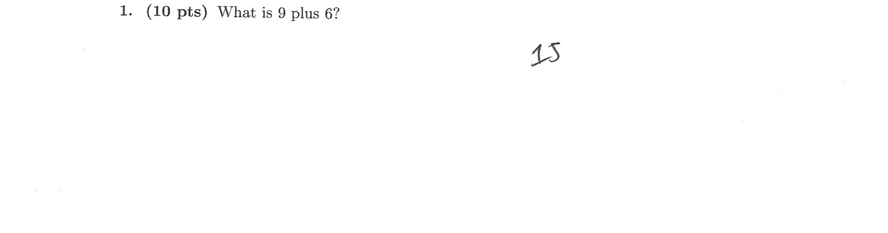
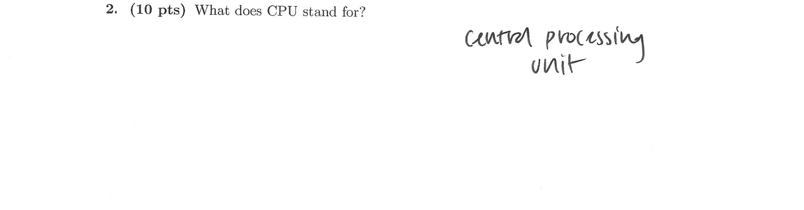
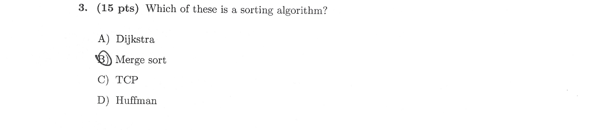
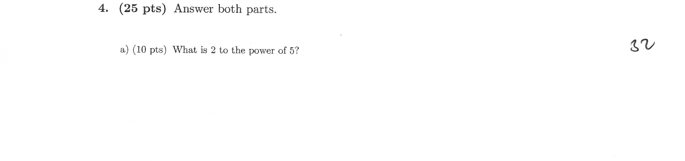
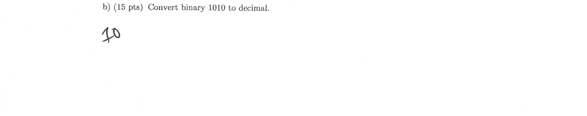
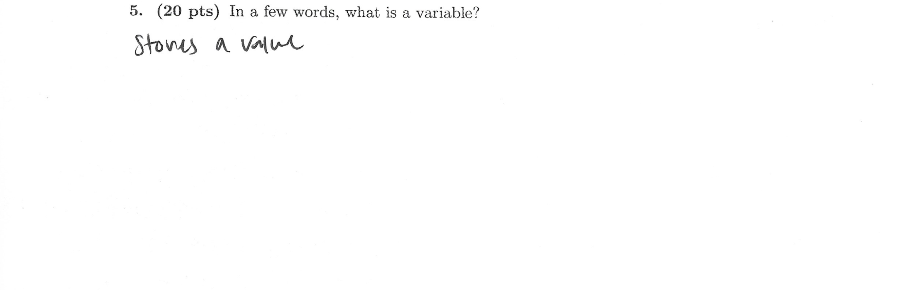
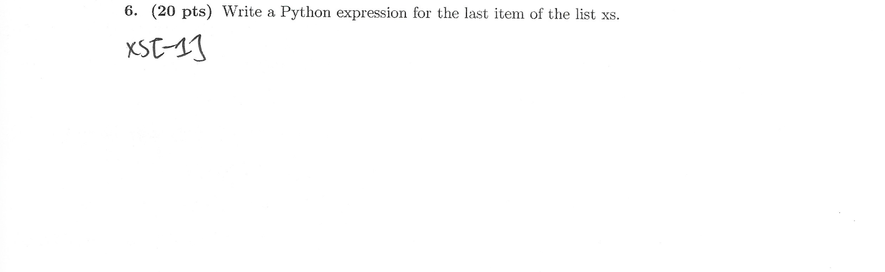

- q1:
  - Question type: Free Response
  - Prompt: (10 points) What is 9 plus 6?
  - Response image: 
  - Source segments: [{"page":1,"bbox":[0.0134,0.352,0.9818,0.2032]}]
  - Response text: 
  - Possible points: 10
  - Points: 
  - Rubric:
  - Analysis: 

- q2:
  - Question type: Free Response
  - Prompt: (10 points) What does CPU stand for?
  - Response image: 
  - Source segments: [{"page":1,"bbox":[0.0147,0.5519,0.9817,0.2006]}]
  - Response text: 
  - Possible points: 10
  - Points: 
  - Rubric:
  - Analysis: 

- q3:
  - Question type: Multiple Choice
  - Prompt: (15 points) Which of these is a sorting algorithm?
  - Response image: 
  - Source segments: [{"page":1,"bbox":[0.0159,0.7498,0.9815,0.1643]}]
  - Response text: 
  - Possible points: 15
  - Points: 
  - Rubric:
  - Analysis: 

- q4a:
  - Question type: Free Response
  - Prompt: (10 points) Answer both parts. a) (10 pts) What is 2 to the power of 5?
  - Response image: 
  - Source segments: [{"page":2,"bbox":[0.0036,0.1077,0.9805,0.1812]}]
  - Response text: 
  - Possible points: 10
  - Points: 
  - Rubric:
  - Analysis: 

- q4b:
  - Question type: Free Response
  - Prompt: (15 points) Convert binary 1010 to decimal.
  - Response image: 
  - Source segments: [{"page":2,"bbox":[0.0031,0.2866,0.9804,0.1532]}]
  - Response text: 
  - Possible points: 15
  - Points: 
  - Rubric:
  - Analysis: 

- q5:
  - Question type: Free Response
  - Prompt: (20 points) In a few words, what is a variable?
  - Response image: 
  - Source segments: [{"page":2,"bbox":[0.0022,0.4376,0.9808,0.2428]}]
  - Response text: 
  - Possible points: 20
  - Points: 
  - Rubric:
  - Analysis: 

- q6:
  - Question type: Free Response
  - Prompt: (20 points) Write a Python expression for the last item of the list xs.
  - Response image: 
  - Source segments: [{"page":2,"bbox":[0.0013,0.6783,0.9808,0.2352]}]
  - Response text: 
  - Possible points: 20
  - Points: 
  - Rubric:
  - Analysis:
