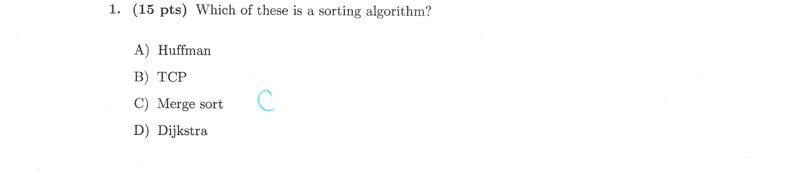
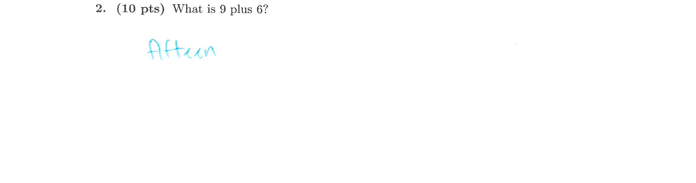
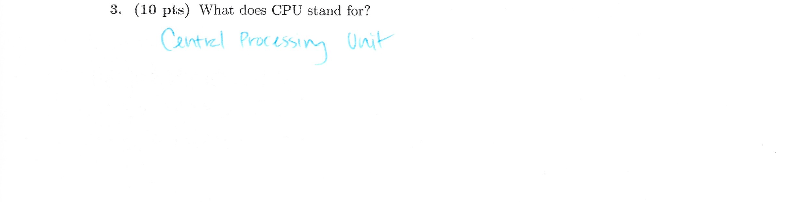
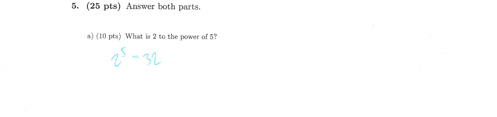
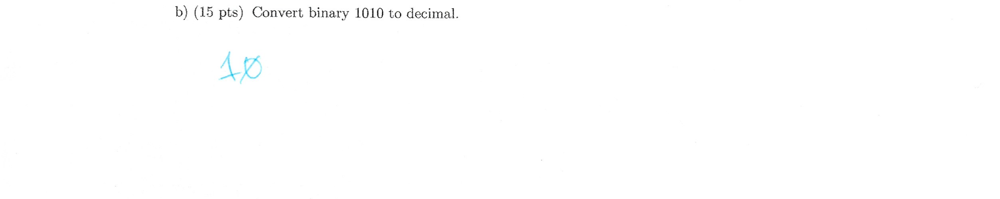
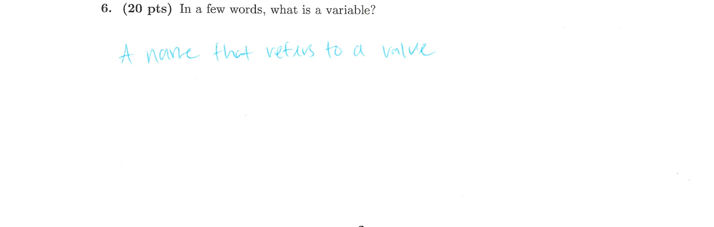

- q1:
  - Question type: Multiple Choice
  - Prompt: (15 points) Which of these is a sorting algorithm?
  - Response image: 
  - Source segments: [{"page":1,"bbox":[0.0065,0.3552,0.9816,0.1718]}]
  - Response text: 
  - Possible points: 15
  - Points: 
  - Rubric:
  - Analysis: 

- q2:
  - Question type: Free Response
  - Prompt: (10 points) What is 9 plus 6?
  - Response image: 
  - Source segments: [{"page":1,"bbox":[0.0053,0.5229,0.9817,0.2032]}]
  - Response text: 
  - Possible points: 10
  - Points: 
  - Rubric:
  - Analysis: 

- q3:
  - Question type: Free Response
  - Prompt: (10 points) What does CPU stand for?
  - Response image: 
  - Source segments: [{"page":1,"bbox":[0.0041,0.7215,0.9815,0.195]}]
  - Response text: 
  - Possible points: 10
  - Points: 
  - Rubric:
  - Analysis: 

- q4a:
  - Question type: Free Response
  - Prompt: (10 points) Answer both parts. a) (10 pts) What is 2 to the power of 5?
  - Response image: 
  - Source segments: [{"page":2,"bbox":[0.0028,0.3507,0.9829,0.1792]}]
  - Response text: 
  - Possible points: 10
  - Points: 
  - Rubric:
  - Analysis: 

- q4b:
  - Question type: Free Response
  - Prompt: (15 points) Convert binary 1010 to decimal.
  - Response image: 
  - Source segments: [{"page":2,"bbox":[0.0035,0.5297,0.9806,0.1507]}]
  - Response text: 
  - Possible points: 15
  - Points: 
  - Rubric:
  - Analysis: 

- q5:
  - Question type: Free Response
  - Prompt: (20 points) In a few words, what is a variable?
  - Response image: 
  - Source segments: [{"page":2,"bbox":[0.0041,0.68,0.9786,0.2392]}]
  - Response text: 
  - Possible points: 20
  - Points: 
  - Rubric:
  - Analysis: 

- q6:
  - Question type: Free Response
  - Prompt: (20 points) Write a Python expression for the last item of the list xs.
  - Response image: 
  - Source segments: [{"page":2,"bbox":[0.005,0.9185,0.9756,0.0815]}]
  - Response text: 
  - Possible points: 20
  - Points: 
  - Rubric:
  - Analysis:
