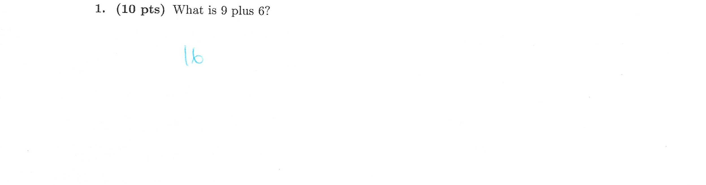
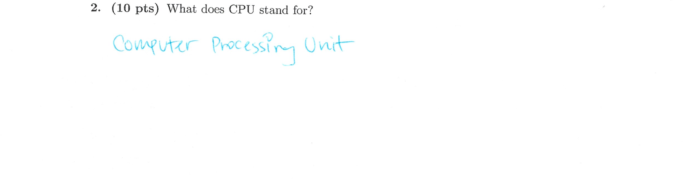
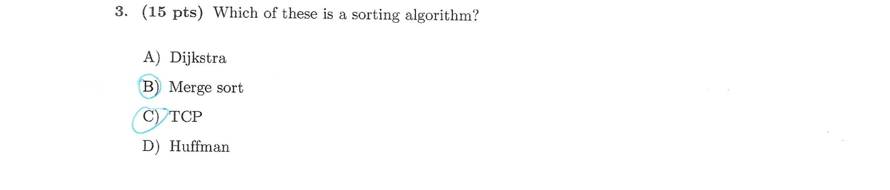
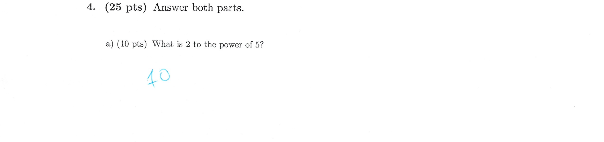
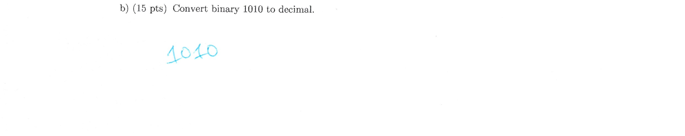
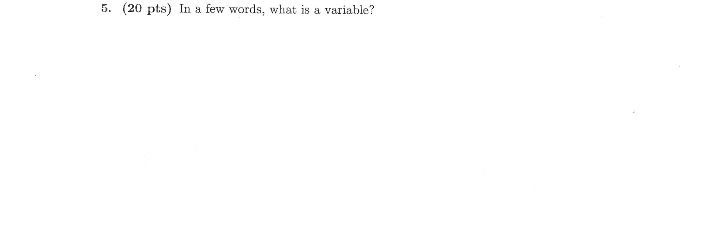
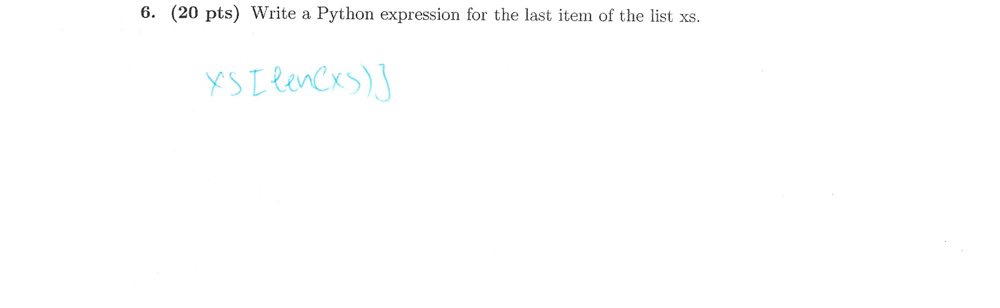

- q1:
  - Question type: Free Response
  - Prompt: (10 points) What is 9 plus 6?
  - Response image: 
  - Source segments: [{"page":1,"bbox":[0.0134,0.3511,0.9829,0.2048]}]
  - Response text: 
  - Possible points: 10
  - Points: 
  - Rubric:
  - Analysis: 

- q2:
  - Question type: Free Response
  - Prompt: (10 points) What does CPU stand for?
  - Response image: 
  - Source segments: [{"page":1,"bbox":[0.0152,0.5511,0.9833,0.2023]}]
  - Response text: 
  - Possible points: 10
  - Points: 
  - Rubric:
  - Analysis: 

- q3:
  - Question type: Multiple Choice
  - Prompt: (15 points) Which of these is a sorting algorithm?
  - Response image: 
  - Source segments: [{"page":1,"bbox":[0.0169,0.7493,0.9831,0.1661]}]
  - Response text: 
  - Possible points: 15
  - Points: 
  - Rubric:
  - Analysis: 

- q4a:
  - Question type: Free Response
  - Prompt: (10 points) Answer both parts. a) (10 pts) What is 2 to the power of 5?
  - Response image: 
  - Source segments: [{"page":2,"bbox":[0.005,0.1082,0.9803,0.1797]}]
  - Response text: 
  - Possible points: 10
  - Points: 
  - Rubric:
  - Analysis: 

- q4b:
  - Question type: Free Response
  - Prompt: (15 points) Convert binary 1010 to decimal.
  - Response image: 
  - Source segments: [{"page":2,"bbox":[0.0049,0.2873,0.9802,0.1516]}]
  - Response text: 
  - Possible points: 15
  - Points: 
  - Rubric:
  - Analysis: 

- q5:
  - Question type: Free Response
  - Prompt: (20 points) In a few words, what is a variable?
  - Response image: 
  - Source segments: [{"page":2,"bbox":[0.0047,0.4384,0.9803,0.2412]}]
  - Response text: 
  - Possible points: 20
  - Points: 
  - Rubric:
  - Analysis: 

- q6:
  - Question type: Free Response
  - Prompt: (20 points) Write a Python expression for the last item of the list xs.
  - Response image: 
  - Source segments: [{"page":2,"bbox":[0.0045,0.6793,0.9803,0.2334]}]
  - Response text: 
  - Possible points: 20
  - Points: 
  - Rubric:
  - Analysis:
