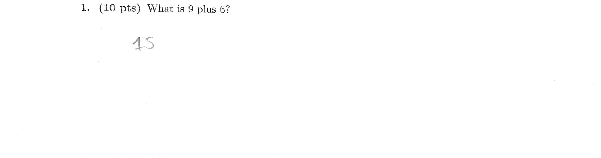
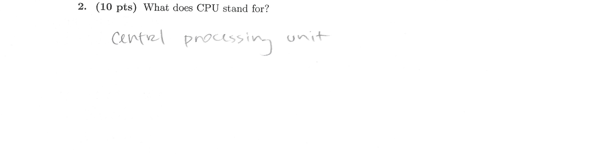
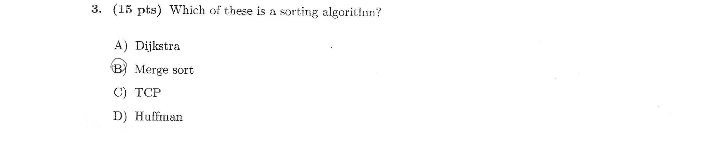
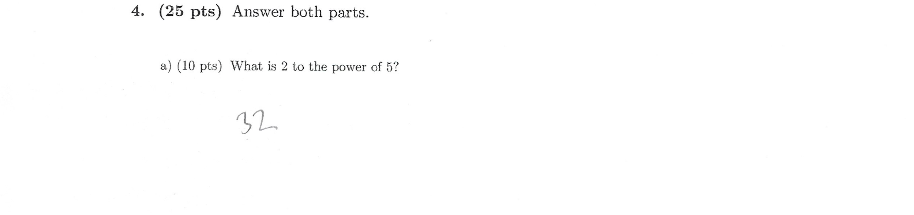
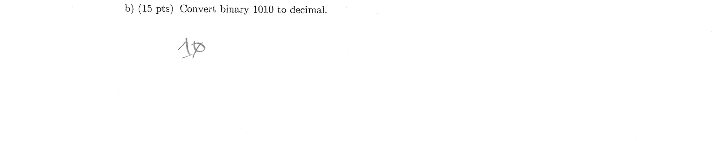
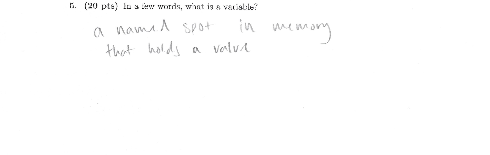
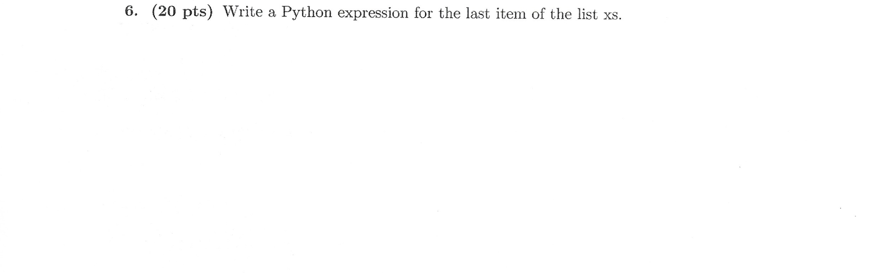

- q1:
  - Question type: Free Response
  - Prompt: (10 points) What is 9 plus 6?
  - Response image: 
  - Source segments: [{"page":1,"bbox":[0.0151,0.3509,0.9828,0.2039]}]
  - Response text: 
  - Possible points: 10
  - Points: 
  - Rubric:
  - Analysis: 

- q2:
  - Question type: Free Response
  - Prompt: (10 points) What does CPU stand for?
  - Response image: 
  - Source segments: [{"page":1,"bbox":[0.0168,0.5506,0.9827,0.2011]}]
  - Response text: 
  - Possible points: 10
  - Points: 
  - Rubric:
  - Analysis: 

- q3:
  - Question type: Multiple Choice
  - Prompt: (15 points) Which of these is a sorting algorithm?
  - Response image: 
  - Source segments: [{"page":1,"bbox":[0.0185,0.7481,0.9815,0.1648]}]
  - Response text: 
  - Possible points: 15
  - Points: 
  - Rubric:
  - Analysis: 

- q4a:
  - Question type: Free Response
  - Prompt: (10 points) Answer both parts. a) (10 pts) What is 2 to the power of 5?
  - Response image: 
  - Source segments: [{"page":2,"bbox":[0.0101,0.1077,0.9826,0.1857]}]
  - Response text: 
  - Possible points: 10
  - Points: 
  - Rubric:
  - Analysis: 

- q4b:
  - Question type: Free Response
  - Prompt: (15 points) Convert binary 1010 to decimal.
  - Response image: 
  - Source segments: [{"page":2,"bbox":[0.0084,0.2869,0.9821,0.1576]}]
  - Response text: 
  - Possible points: 15
  - Points: 
  - Rubric:
  - Analysis: 

- q5:
  - Question type: Free Response
  - Prompt: (20 points) In a few words, what is a variable?
  - Response image: 
  - Source segments: [{"page":2,"bbox":[0.0057,0.4381,0.9829,0.2471]}]
  - Response text: 
  - Possible points: 20
  - Points: 
  - Rubric:
  - Analysis: 

- q6:
  - Question type: Free Response
  - Prompt: (20 points) Write a Python expression for the last item of the list xs.
  - Response image: 
  - Source segments: [{"page":2,"bbox":[0.0032,0.6789,0.9825,0.2392]}]
  - Response text: 
  - Possible points: 20
  - Points: 
  - Rubric:
  - Analysis:
