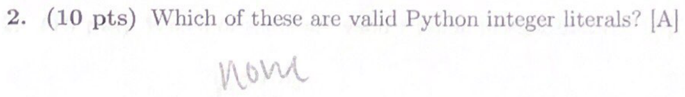
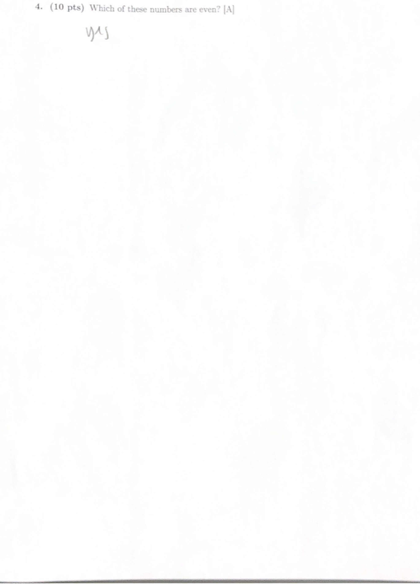
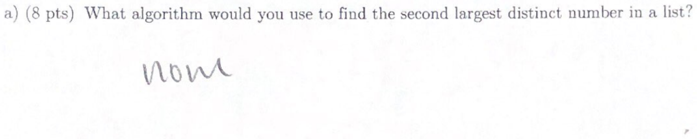
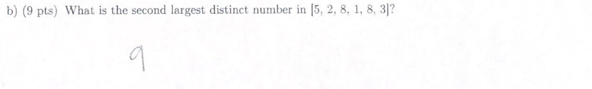
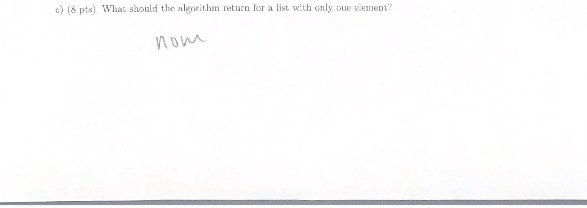
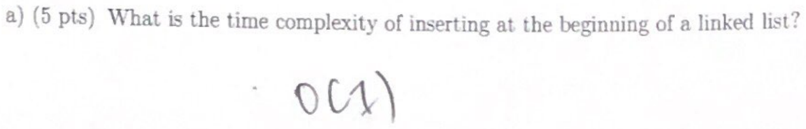
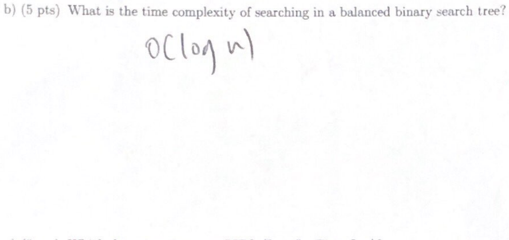
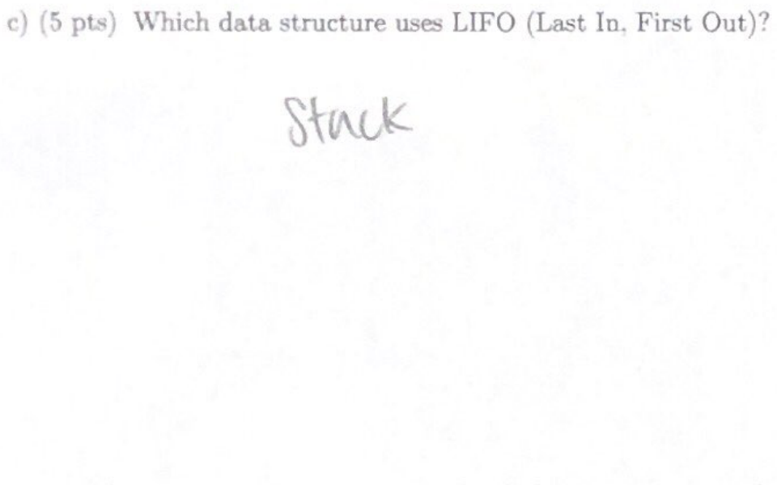
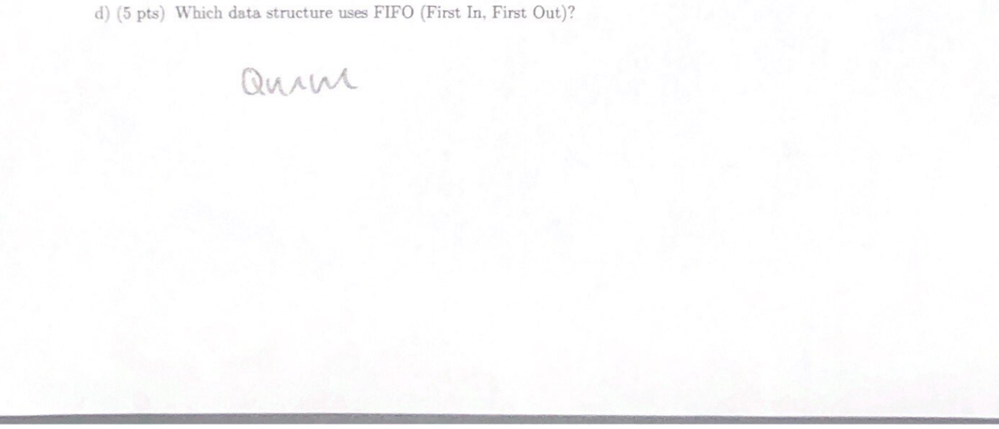

- q1:
  - Prompt: 
  - Response image: 
  - Response text: |
    1. (10 pts) Convert decimal 5 to binary [A].
  - Possible points: 
  - Points: 
  - Analysis: 

- q2:
  - Prompt: 
  - Response image: 
  - Response text: |
    2. (10 pts) Which of these are valid Python integer literals? [A] Wass
  - Possible points: 
  - Points: 
  - Analysis: 

- q3:
  - Prompt: 
  - Response image: 
  - Response text: |
    3. (10 pts) What is the most significant bit (MSB) of the binary number 1010 [A]? eee
  - Possible points: 
  - Points: 
  - Analysis: 

- q4:
  - Prompt: 
  - Response image: 
  - Response text: |
    4. (10 pts) Which of these numbers are even? [A] \AdDWA
  - Possible points: 
  - Points: 
  - Analysis: 

- q5a:
  - Prompt: 
  - Response image: 
  - Response text: |
    a) (8 pts) What algorithm would you use to find the second largest distinct number in a list? Vows
  - Possible points: 
  - Points: 
  - Analysis: 

- q5b:
  - Prompt: 
  - Response image: 
  - Response text: |
    b) (9 pts) What is the second largest distinct number in [5, 2. 8. 1, 8, 3]?
  - Possible points: 
  - Points: 
  - Analysis: 

- q5c:
  - Prompt: 
  - Response image: 
  - Response text: |
    c) (8 pts) What should the algorithm return for a list with only one element? for eee
  - Possible points: 
  - Points: 
  - Analysis: 

- q6a:
  - Prompt: 
  - Response image: 
  - Response text: |
    a) (5 pts) What is the time complexity of inserting at. the beginning of a linked list?
  - Possible points: 
  - Points: 
  - Analysis: 

- q6b:
  - Prompt: 
  - Response image: 
  - Response text: |
    b) (5 pts) What is the time complexity of searching in a balanced binary search tree? OC Log
  - Possible points: 
  - Points: 
  - Analysis: 

- q6c:
  - Prompt: 
  - Response image: 
  - Response text: |
    c) (5 pts) V Vhich data structure uses LIF O (Last In. First Out)? Sack
  - Possible points: 
  - Points: 
  - Analysis: 

- q6d:
  - Prompt: 
  - Response image: 
  - Response text: |
    .5 pts} Which data structure uses FIFO (First In. First Out)? re 4 IM AAfe®e eee
  - Possible points: 
  - Points: 
  - Analysis:
