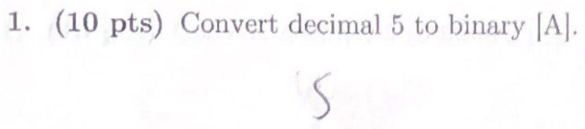
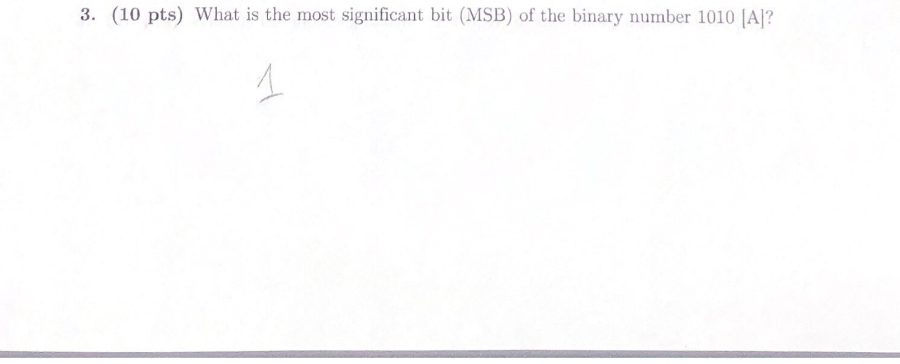
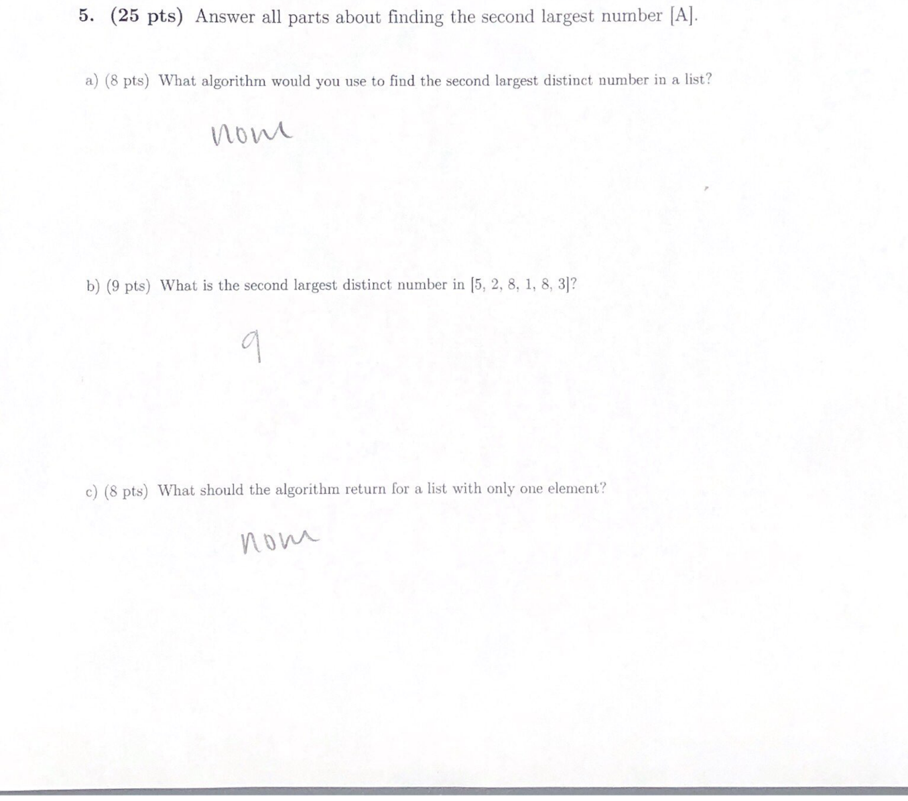
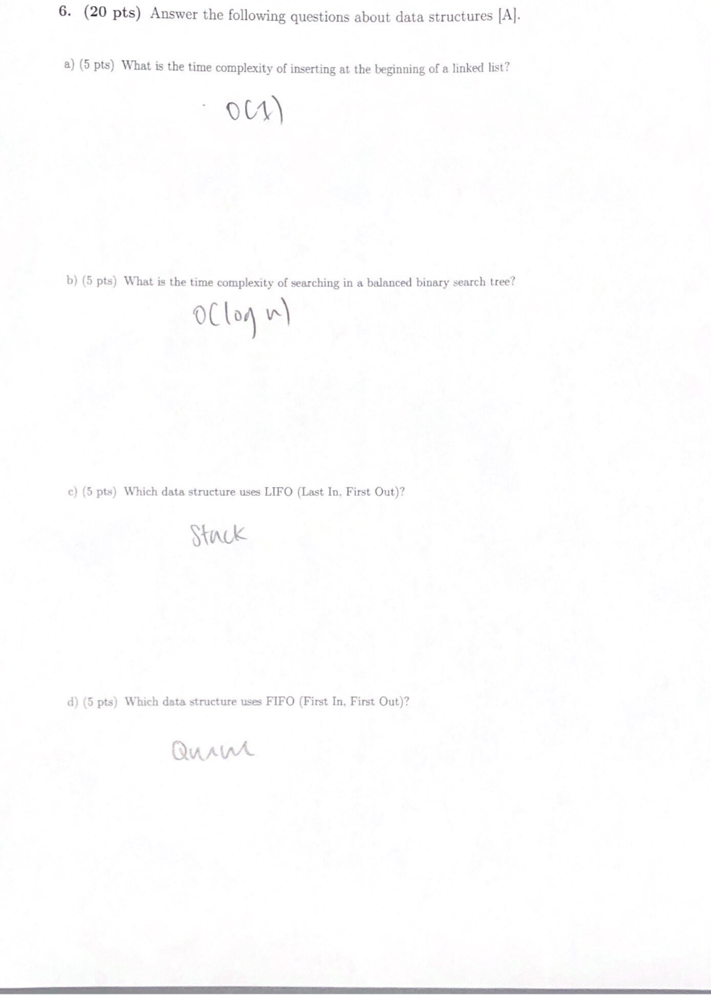

- q1:
  - Prompt: 
  - Response image: 
  - Response text: |
    1. (10 pts) Convert decimal 5 to binary [A].
  - Possible points: 
  - Points: 
  - Analysis: 

- q2:
  - Prompt: 
  - Response image: 
  - Response text: |
    2. (10 pts) Which of these are valid Python integer literals? [A] Wass
  - Possible points: 
  - Points: 
  - Analysis: 

- q3:
  - Prompt: 
  - Response image: 
  - Response text: |
    3. (10 pts) What is the most significant bit (MSB) of the binary number 1010 [A]? eee
  - Possible points: 
  - Points: 
  - Analysis: 

- q4:
  - Prompt: 
  - Response image: 
  - Response text: |
    4. (10 pts) Which of these numbers are even? [A] \AdDWA
  - Possible points: 
  - Points: 
  - Analysis: 

- q5:
  - Prompt: 
  - Response image: 
  - Response text: |
    5. (25 pts) Answer all parts about finding the second largest number [A]. a) (8 pts) What algorithm would you use to find the second largest distinct number in a list? Vows b) (9 pts) What is the second largest distinct number in [5, 2, 8. 1, 8, 3]? c) (8 pts) What should the algorithm return for a list with only one element? ovr ee eee eee eee
  - Possible points: 
  - Points: 
  - Analysis: 

- q6:
  - Prompt: 
  - Response image: 
  - Response text: |
    6. (20 pts) Answer the following questions about data structures [A]. a) (5 pts) What is the time complexity of inserting at the beginning of a linked list? b) (5 pts) What is the time complexity of searching in a balanced binary search tree? OC log w) c) (5 pts} Which data structure uses LIFO (Last In. First Out)? yack d) (5 pts} Which data structure uses FIFO (First In, First Out)? Qu AWA eee ee ee
  - Possible points: 
  - Points: 
  - Analysis:
