- q1:
  - Question type: Free Response
  - Prompt: 1. (10 pts) Convert decimal 5 to binary [A].
  - Response image: 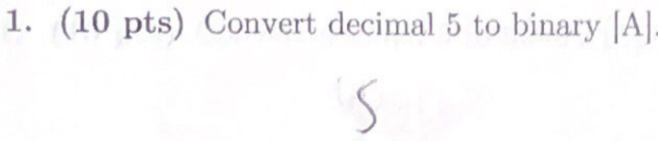
  - Source segments: [{"page":1,"bbox":[0.1776,0.3655,0.3278,0.0545]}]
  - Response text: |
    5
  - Possible points: 
  - Points: 
  - Rubric:
  - Analysis: 

- q2:
  - Question type: Free Response
  - Prompt: 2. (10 pts) Which of these are valid Python integer literals? [A]
  - Response image: 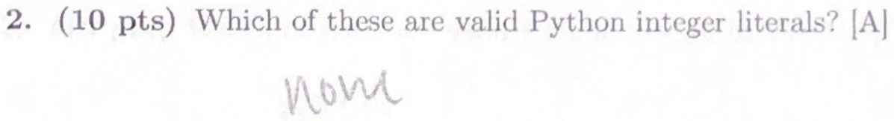
  - Source segments: [{"page":1,"bbox":[0.1776,0.5415,0.4694,0.0494]}]
  - Response text: |
    none
  - Possible points: 
  - Points: 
  - Rubric:
  - Analysis: 

- q3:
  - Question type: Free Response
  - Prompt: 3. (10 pts) What is the most significant bit (MSB) of the binary number 1010 [A]?
  - Response image: 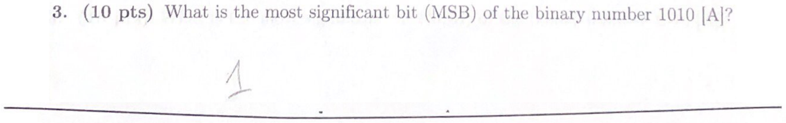
  - Source segments: [{"page":1,"bbox":[0.1765,0.717,0.6075,0.07]},{"page":2,"bbox":[0.1576,0.0809,0.6941,0.0142]}]
  - Response text: |
    1
  - Possible points: 
  - Points: 
  - Rubric:
  - Analysis: 

- q4:
  - Question type: Free Response
  - Prompt: 4. (10 pts) Which of these numbers are even? [A]
  - Response image: 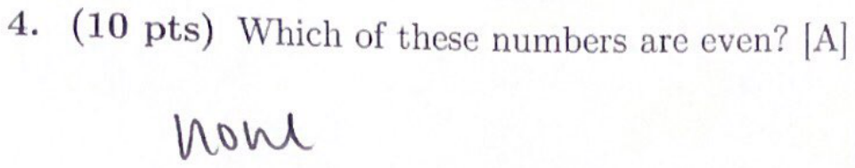
  - Source segments: [{"page":2,"bbox":[0.1702,0.1203,0.3765,0.0573]}]
  - Response text: |
    none
  - Possible points: 
  - Points: 
  - Rubric:
  - Analysis: 

- q5a:
  - Question type: Free Response
  - Prompt: a) (8 pts) What algorithm would you use to find the second largest distinct number in a list?
  - Response image: 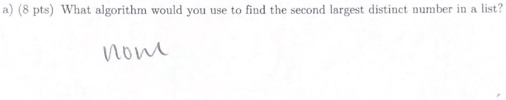
  - Source segments: [{"page":2,"bbox":[0.1745,0.47,0.5506,0.1399]}]
  - Response text: |
    norn
  - Possible points: 
  - Points: 
  - Rubric:
  - Analysis: 

- q5b:
  - Question type: Free Response
  - Prompt: b) (9 pts) What is the second largest distinct number in [5, 2, 8, 1, 8, 3]?
  - Response image: 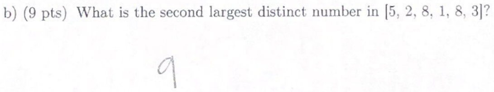
  - Source segments: [{"page":2,"bbox":[0.1745,0.607,0.5506,0.1396]}]
  - Response text: |
    9
  - Possible points: 
  - Points: 
  - Rubric:
  - Analysis: 

- q5c:
  - Question type: Free Response
  - Prompt: (8 pts) What should the algorithm return for a list with only one element?
  - Response image: 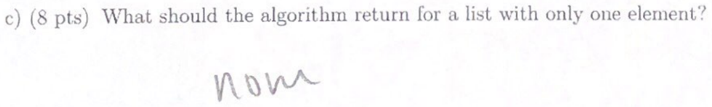
  - Source segments: [{"page":2,"bbox":[0.1745,0.7437,0.5506,0.0557]}]
  - Response text: |
    now
  - Possible points: 
  - Points: 
  - Rubric:
  - Analysis: 

- q6a:
  - Question type: Free Response
  - Prompt: a) (5 pts) What is the time complexity of inserting at the beginning of a linked list?
  - Response image: 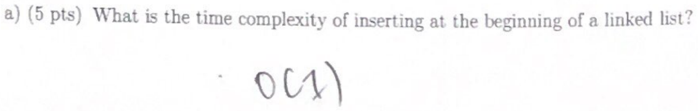
  - Source segments: [{"page":3,"bbox":[0.1714,0.1574,0.5082,0.1894]}]
  - Response text: |
    O(1)
  - Possible points: 
  - Points: 
  - Rubric:
  - Analysis: 

- q6b:
  - Question type: Free Response
  - Prompt: b) (5 pts) What is the time complexity of searching in a balanced binary search tree?
  - Response image: 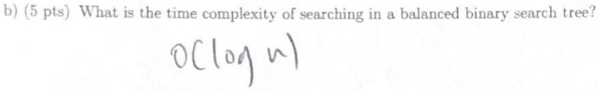
  - Source segments: [{"page":3,"bbox":[0.1714,0.3417,0.5082,0.1858]}]
  - Response text: |
    O(log n)
  - Possible points: 
  - Points: 
  - Rubric:
  - Analysis: 

- q6c:
  - Question type: Free Response
  - Prompt: c) (5 pts) Which data structure uses LIFO (Last In, First Out)?
  - Response image: 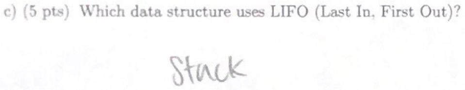
  - Source segments: [{"page":3,"bbox":[0.1714,0.5223,0.5082,0.1825]}]
  - Response text: |
    Stack
  - Possible points: 
  - Points: 
  - Rubric:
  - Analysis: 

- q6d:
  - Question type: Free Response
  - Prompt: d) (5 pts) Which data structure uses FIFO (First In, First Out)?
  - Response image: 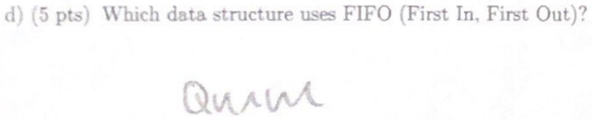
  - Source segments: [{"page":3,"bbox":[0.1714,0.6996,0.5082,0.0641]}]
  - Response text: |
    Queue
  - Possible points: 
  - Points: 
  - Rubric:
  - Analysis:
