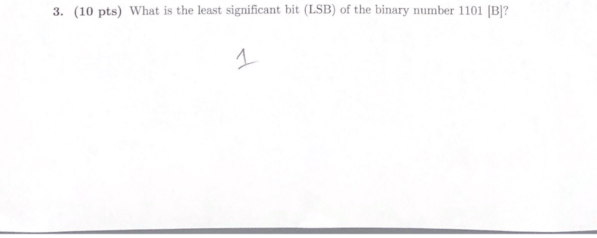
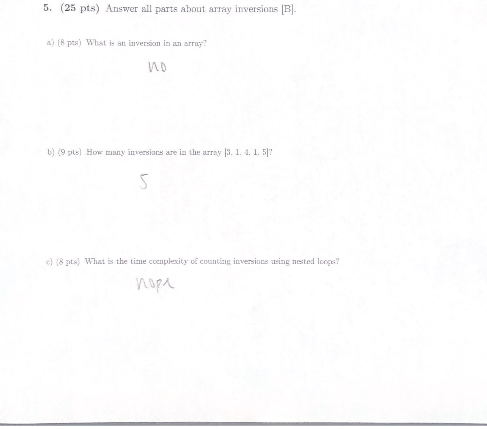
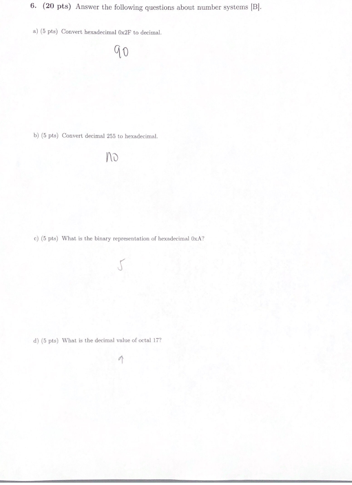

- q1:
  - Prompt: 
  - Response image: 
  - Response text: |
    1. (10 pts) Convert decimal 6 to binary [B].
  - Possible points: 
  - Points: 
  - Analysis: 

- q2:
  - Prompt: 
  - Response image: 
  - Response text: |
    2. (10 pts) What command lists files in the current directory on Linux? [B]
  - Possible points: 
  - Points: 
  - Analysis: 

- q3:
  - Prompt: 
  - Response image: 
  - Response text: |
    3. (10 pts) What is the least significant bit (LSB) of the binary number 1101 (BI? ee EEN EN
  - Possible points: 
  - Points: 
  - Analysis: 

- q4:
  - Prompt: 
  - Response image: 
  - Response text: |
    4. (10 pts) Which letters in the word "GRADERS" are vowels? [B]
  - Possible points: 
  - Points: 
  - Analysis: 

- q5:
  - Prompt: 
  - Response image: 
  - Response text: |
    5. (25 pts) Answer all parts about array inversions |B]. a) (8 pts) What is an inversion in an array? Wd b) (9 pts) How many inversions are in the array [3, 1, 4, 1. 5]? c) (& pts) What is the time complexity of counting inversions using nested loops? eS
  - Possible points: 
  - Points: 
  - Analysis: 

- q6:
  - Prompt: 
  - Response image: 
  - Response text: |
    6. (20 pts) Answer the following questions about number systems [B]. a) (5 pts) Convert hexadecimal 0x2F to decimal. b) (5 pts) Convert decimal 255 to hexadecimal. c) (5 pts) What. is the binary representation of hexadecimal 0xA? c J d) (5 pts) What is the decimal value of octal 17? err ee eee a
  - Possible points: 
  - Points: 
  - Analysis:
