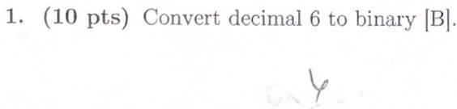
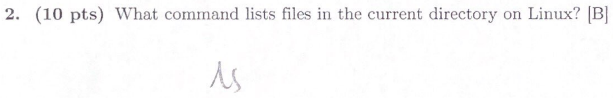
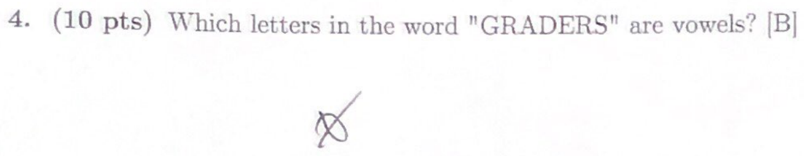
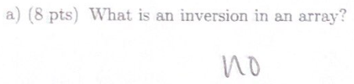
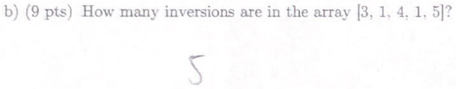
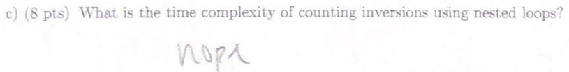
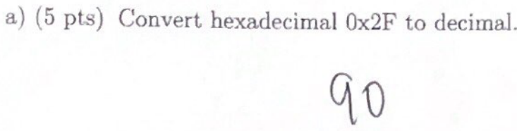
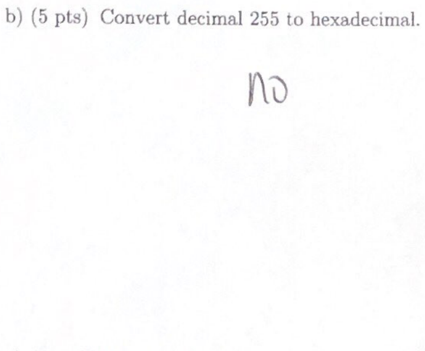
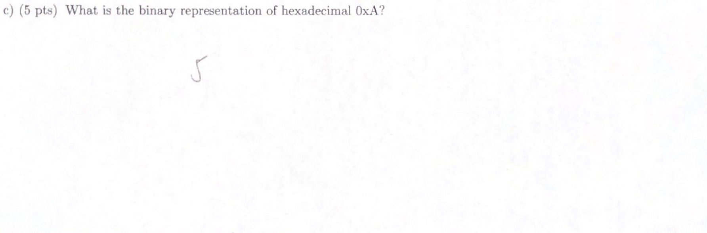
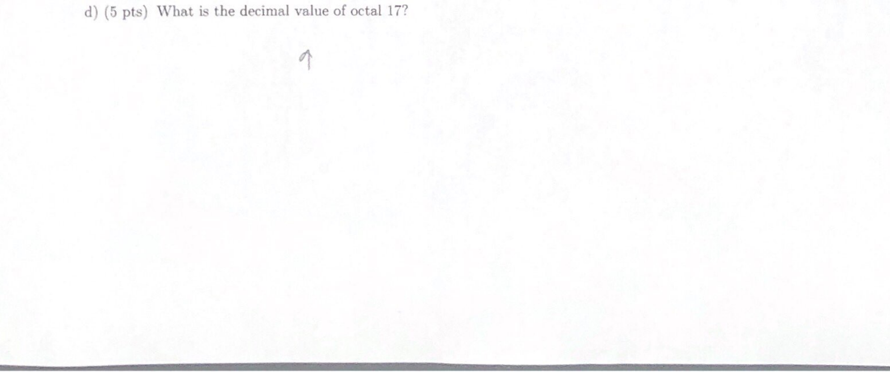

- q1:
  - Prompt: 
  - Response image: 
  - Response text: |
    1. (10 pts) Convert decimal 6 to binary [B].
  - Possible points: 
  - Points: 
  - Analysis: 

- q2:
  - Prompt: 
  - Response image: 
  - Response text: |
    2. (10 pts) What command lists files in the current directory on Linux? [B]
  - Possible points: 
  - Points: 
  - Analysis: 

- q3:
  - Prompt: 
  - Response image: 
  - Response text: |
    3. (10 pts) What is the least significant bit (LSB) of the binary number 1101 (BI? ee EEN EN
  - Possible points: 
  - Points: 
  - Analysis: 

- q4:
  - Prompt: 
  - Response image: 
  - Response text: |
    4. (10 pts) Which letters in the word "GRADERS" are vowels? [B]
  - Possible points: 
  - Points: 
  - Analysis: 

- q5a:
  - Prompt: 
  - Response image: 
  - Response text: |
    a) (8 pts) What is an inversion in an array? Wd
  - Possible points: 
  - Points: 
  - Analysis: 

- q5b:
  - Prompt: 
  - Response image: 
  - Response text: |
    b) (9 pts) How many inversions are in the array (3, 1. 4, 1. 5]?
  - Possible points: 
  - Points: 
  - Analysis: 

- q5c:
  - Prompt: 
  - Response image: 
  - Response text: |
    c) (& pts) What is the time complexity of counting inversions using nested loops? [Xsa ee eee ee eee eer eee ee ee aS
  - Possible points: 
  - Points: 
  - Analysis: 

- q6a:
  - Prompt: 
  - Response image: 
  - Response text: |
    a) (5 pts) Convert hexadecimal 0x2F to decimal.
  - Possible points: 
  - Points: 
  - Analysis: 

- q6b:
  - Prompt: 
  - Response image: 
  - Response text: |
    b) (5 pts) Convert decimal 255 to hexadecimal.
  - Possible points: 
  - Points: 
  - Analysis: 

- q6c:
  - Prompt: 
  - Response image: 
  - Response text: |
    c) (5 pts) What is the binary representation of hexadecimal 0xA?
  - Possible points: 
  - Points: 
  - Analysis: 

- q6d:
  - Prompt: 
  - Response image: 
  - Response text: |
    d) (5 pts) What is the decimal value of octal 17? ee ee eee eee eee eee eee eee a
  - Possible points: 
  - Points: 
  - Analysis:
