- q1:
  - Question type: Free Response
  - Prompt: 1. (10 pts) Convert decimal 6 to binary [B].
  - Response image: 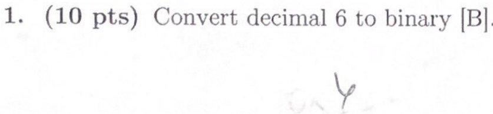
  - Source segments: [{"page":1,"bbox":[0.1765,0.3676,0.3282,0.0591]}]
  - Response text: |
    110
  - Possible points: 
  - Points: 
  - Rubric:
  - Analysis: 

- q2:
  - Question type: Free Response
  - Prompt: 2. (10 pts) What command lists files in the current directory on Linux? [B]
  - Response image: 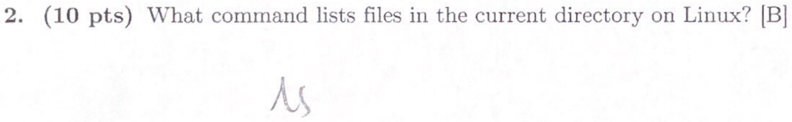
  - Source segments: [{"page":1,"bbox":[0.1773,0.5418,0.5518,0.0661]}]
  - Response text: |
    ls
  - Possible points: 
  - Points: 
  - Rubric:
  - Analysis: 

- q3:
  - Question type: Free Response
  - Prompt: 3. (10 pts) What is the least significant bit (LSB) of the binary number 1101 [B]?
  - Response image: 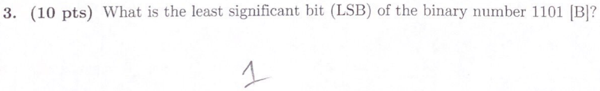
  - Source segments: [{"page":1,"bbox":[0.1761,0.7145,0.7749,0.2352]},{"page":2,"bbox":[0.1616,0.0848,0.6898,0.0106]}]
  - Response text: |
    1
  - Possible points: 
  - Points: 
  - Rubric:
  - Analysis: 

- q4:
  - Question type: Free Response
  - Prompt: 4. (10 pts) Which letters in the word "GRADERS" are vowels? [B]
  - Response image: 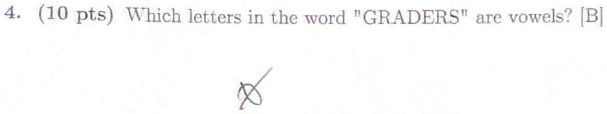
  - Source segments: [{"page":2,"bbox":[0.1737,0.1227,0.502,0.0733]}]
  - Response text: |
    A
  - Possible points: 
  - Points: 
  - Rubric:
  - Analysis: 

- q5a:
  - Question type: Free Response
  - Prompt: a) (8 pts) What is an inversion in an array?
  - Response image: 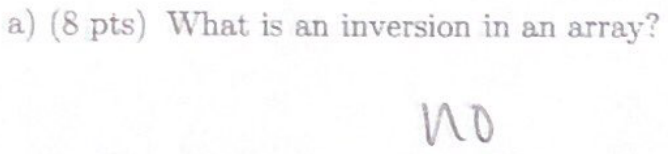
  - Source segments: [{"page":2,"bbox":[0.1761,0.4689,0.4804,0.138]}]
  - Response text: |
    no
  - Possible points: 
  - Points: 
  - Rubric:
  - Analysis: 

- q5b:
  - Question type: Free Response
  - Prompt: (9 pts) How many inversions are in the array [3, 1, 4, 1, 5]?
  - Response image: 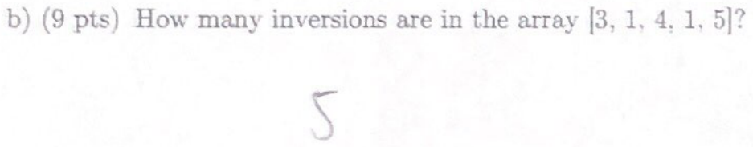
  - Source segments: [{"page":2,"bbox":[0.1761,0.604,0.4804,0.1393]}]
  - Response text: |
    5
  - Possible points: 
  - Points: 
  - Rubric:
  - Analysis: 

- q5c:
  - Question type: Free Response
  - Prompt: c) (8 pts) What is the time complexity of counting inversions using nested loops?
  - Response image: 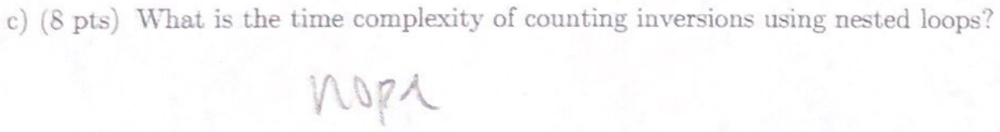
  - Source segments: [{"page":2,"bbox":[0.1761,0.7403,0.4804,0.0521]}]
  - Response text: |
    nora
  - Possible points: 
  - Points: 
  - Rubric:
  - Analysis: 

- q6a:
  - Question type: Free Response
  - Prompt: a) (5 pts) Convert hexadecimal 0x2F to decimal.
  - Response image: 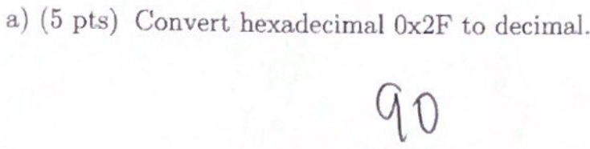
  - Source segments: [{"page":3,"bbox":[0.1741,0.1641,0.5137,0.1835]}]
  - Response text: |
    90
  - Possible points: 
  - Points: 
  - Rubric:
  - Analysis: 

- q6b:
  - Question type: Free Response
  - Prompt: b) (5 pts) Convert decimal 255 to hexadecimal.
  - Response image: 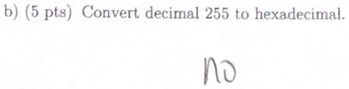
  - Source segments: [{"page":3,"bbox":[0.1741,0.3426,0.5137,0.1826]}]
  - Response text: |
    FF
  - Possible points: 
  - Points: 
  - Rubric:
  - Analysis: 

- q6c:
  - Question type: Free Response
  - Prompt: c) (5 pts) What is the binary representation of hexadecimal 0xA?
  - Response image: 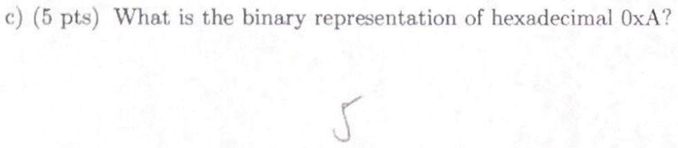
  - Source segments: [{"page":3,"bbox":[0.1741,0.5202,0.5137,0.181]}]
  - Response text: |
    5
  - Possible points: 
  - Points: 
  - Rubric:
  - Analysis: 

- q6d:
  - Question type: Free Response
  - Prompt: d) (5 pts) What is the decimal value of octal 17?
  - Response image: 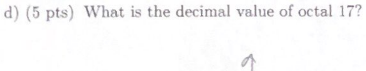
  - Source segments: [{"page":3,"bbox":[0.1741,0.6962,0.5137,0.0528]}]
  - Response text: 
  - Possible points: 
  - Points: 
  - Rubric:
  - Analysis:
