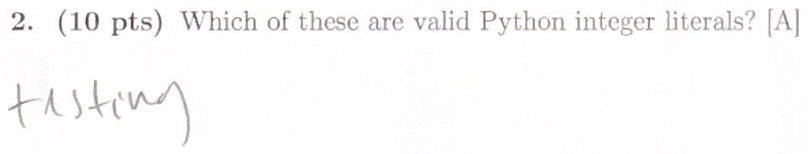
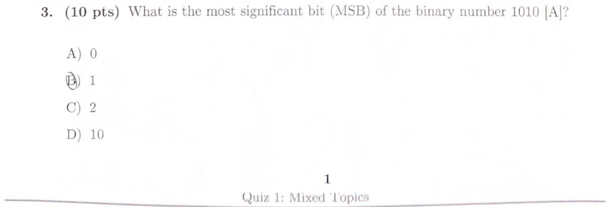
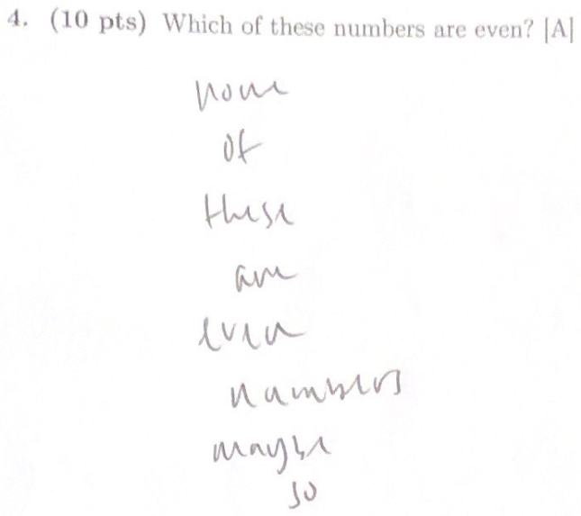
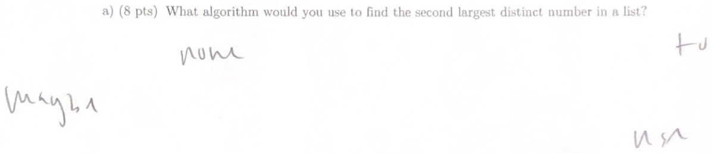
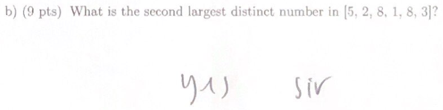
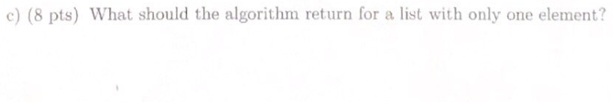
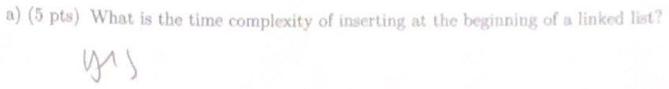
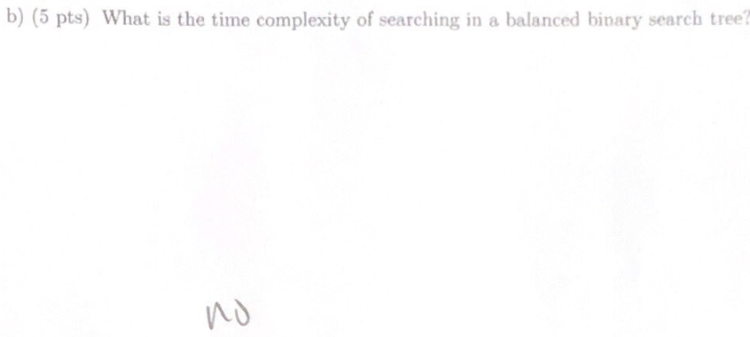
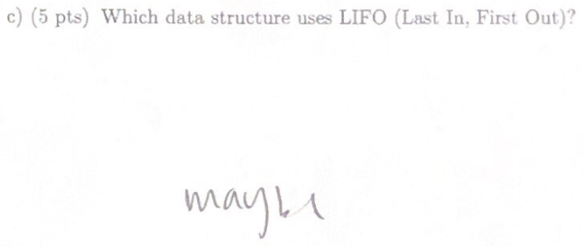
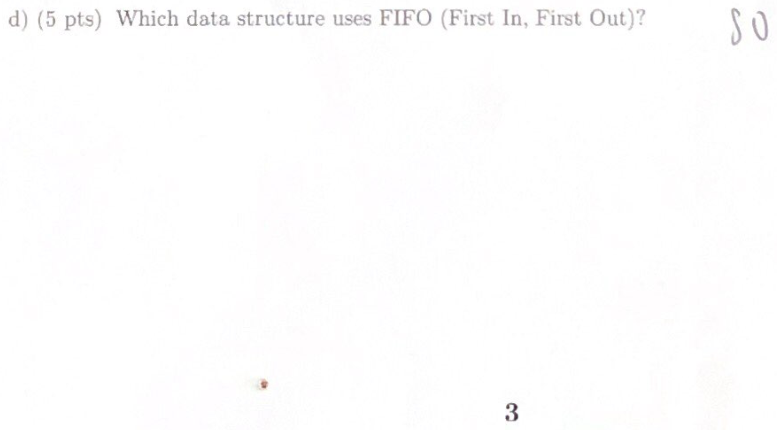

- q1:
  - Question type: Free Response
  - Prompt: 1. (10 pts) Convert decimal 5 to binary [A].
  - Response image: 
  - Response text: |
    no
  - Possible points: 
  - Points: 
  - Analysis: 

- q2:
  - Question type: Free Response
  - Prompt: 2. (10 pts) Which of these are valid Python integer literals? [A]
  - Response image: 
  - Response text: |
    tasting
  - Possible points: 
  - Points: 
  - Analysis: 

- q3:
  - Question type: Free Response
  - Prompt: 3. (10 pts) What is the most significant bit (MSB) of the binary number 1010 [A]?
  - Response image: 
  - Response text: |
    B)
  - Possible points: 
  - Points: 
  - Analysis: 

- q4:
  - Question type: Free Response
  - Prompt: 4. (10 pts) Which of these numbers are even? [A]
  - Response image: 
  - Response text: |
    none of these are even numbers maybe so
  - Possible points: 
  - Points: 
  - Analysis: 

- q5a:
  - Question type: Free Response
  - Prompt: a) (8 pts) What algorithm would you use to find the second largest distinct number in a list?
  - Response image: 
  - Response text: |
    none
  - Possible points: 
  - Points: 
  - Analysis: 

- q5b:
  - Question type: Free Response
  - Prompt: b) (9 pts) What is the second largest distinct number in [5, 2, 8, 1, 8, 3]?
  - Response image: 
  - Response text: |
    y(1) siv
  - Possible points: 
  - Points: 
  - Analysis: 

- q5c:
  - Question type: Free Response
  - Prompt: c) (8 pts) What should the algorithm return for a list with only one element?
  - Response image: 
  - Response text: 
  - Possible points: 
  - Points: 
  - Analysis: 

- q6a:
  - Question type: Free Response
  - Prompt: a) (5 pts) What is the time complexity of inserting at the beginning of a linked list?
  - Response image: 
  - Response text: |
    O(1)
  - Possible points: 
  - Points: 
  - Analysis: 

- q6b:
  - Question type: Free Response
  - Prompt: b) (5 pts) What is the time complexity of searching in a balanced binary search tree?
  - Response image: 
  - Response text: |
    no
  - Possible points: 
  - Points: 
  - Analysis: 

- q6c:
  - Question type: Free Response
  - Prompt: c) (5 pts) Which data structure uses LIFO (Last In, First Out)?
  - Response image: 
  - Response text: |
    maybe
  - Possible points: 
  - Points: 
  - Analysis: 

- q6d:
  - Question type: Free Response
  - Prompt: d) (5 pts) Which data structure uses FIFO (First In, First Out)?
  - Response image: 
  - Response text: |
    S0
  - Possible points: 
  - Points: 
  - Analysis:
