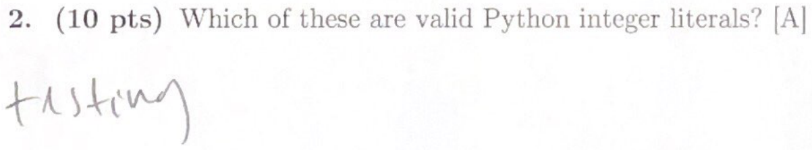
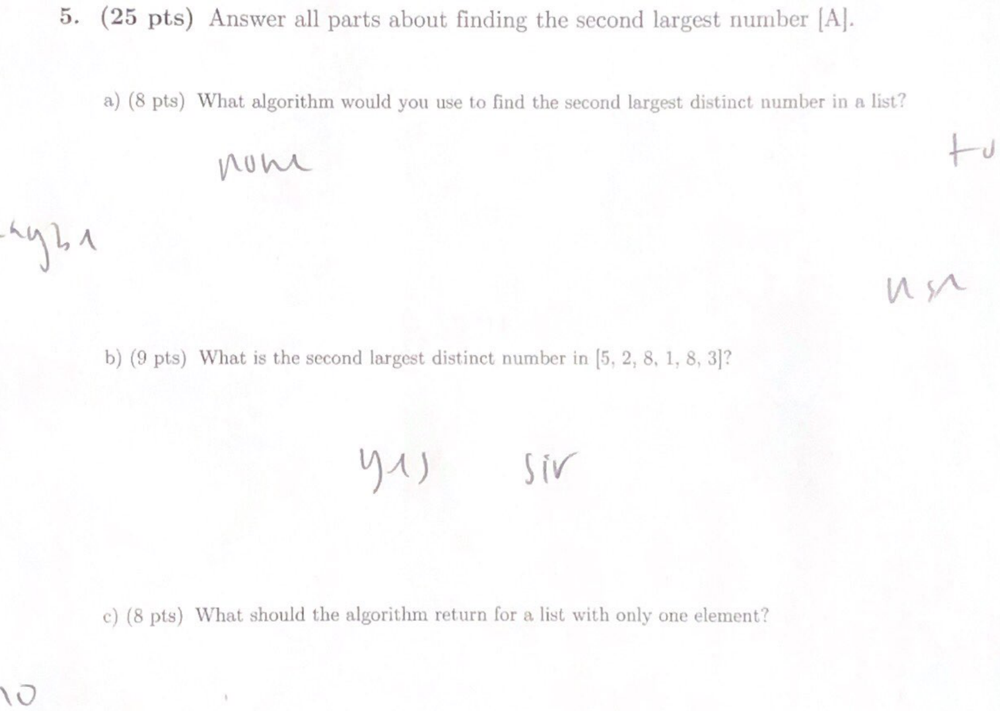
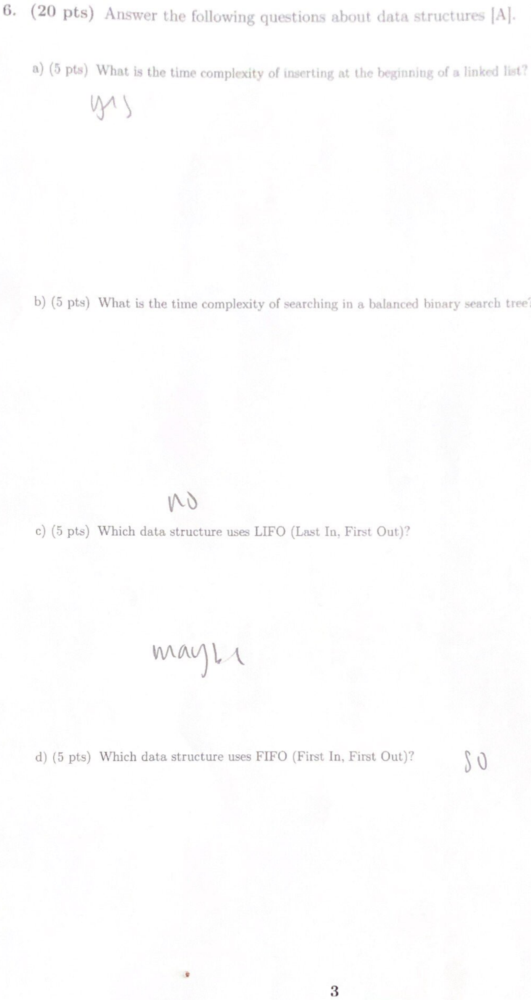

- q1:
  - Question type: Free Response
  - Prompt: 
  - Response image: 
  - Source segments: [{"page":1,"bbox":[0.1733,0.3676,0.7122,0.1564]}]
  - Read by: tesseract
  - Confidence: 72.1053
  - Response text: |
    1. (10 pts) Convert decimal 5 to binary [A]. Ie as \ Ww ~“ lA yr eA LA Co
  - Possible points: 
  - Points: 
  - Rubric:
  - Analysis: 

- q2:
  - Question type: Free Response
  - Prompt: 
  - Response image: 
  - Source segments: [{"page":1,"bbox":[0.1765,0.5539,0.4718,0.0676]}]
  - Read by: vision-model
  - Response text: |
    +123456
  - Possible points: 
  - Points: 
  - Rubric:
  - Analysis: 

- q3:
  - Question type: Free Response
  - Prompt: 
  - Response image: 
  - Source segments: [{"page":1,"bbox":[0.1769,0.74,0.6078,0.1273]},{"page":2,"bbox":[0.1616,0.0848,0.6925,0.0197]}]
  - Read by: tesseract
  - Confidence: 88.25
  - Response text: |
    3. (10 pts) What is the most significant bit (MSB) of the binary number 1010 [A]? A) 0 B 1 C) 2 D) 10
  - Possible points: 
  - Points: 
  - Rubric:
  - Analysis: 

- q4:
  - Question type: Free Response
  - Prompt: 
  - Response image: 
  - Source segments: [{"page":2,"bbox":[0.1745,0.1297,0.3757,0.2585]}]
  - Read by: vision-model
  - Response text: |
    none of these are even numbers maybe so
  - Possible points: 
  - Points: 
  - Rubric:
  - Analysis: 

- q5:
  - Question type: Free Response
  - Prompt: 
  - Response image: 
  - Source segments: [{"page":2,"bbox":[0.1408,0.4318,0.6698,0.3685]}]
  - Read by: tesseract
  - Confidence: 86.3108
  - Response text: |
    5. (25 pts) Answer all parts about finding the second largest number [A]. a) (8 pts) What algorithm would you use to find the second largest: distinct number in a list? J YW WA r ole A A 5% b) (9 pts) What is the second largest distinct number in [5, 2, 8, 1, 8, 3]? WA) Siv c) (8 pts) What should the algorithm return for a list with only one element? \O
  - Possible points: 
  - Points: 
  - Rubric:
  - Analysis: 

- q6:
  - Question type: Free Response
  - Prompt: 
  - Response image: 
  - Source segments: [{"page":3,"bbox":[0.1749,0.1318,0.5251,0.7633]}]
  - Read by: tesseract
  - Confidence: 91.6622
  - Response text: |
    6. (20 pts) Answer the following questions about data structures [A]. a) (5 pts) What is the time complexity of inserting at the beginning of a linked list? b) (5 pts) What is the time complexity of searching in a balanced binary search tree’ c) (5 pts) Which data structure uses LIFO (Last In, First Out)? sailed A d) (5 pts) Which data structure uses FIFO (First In, First Out)? 5 0 * 3
  - Possible points: 
  - Points: 
  - Rubric:
  - Analysis:
