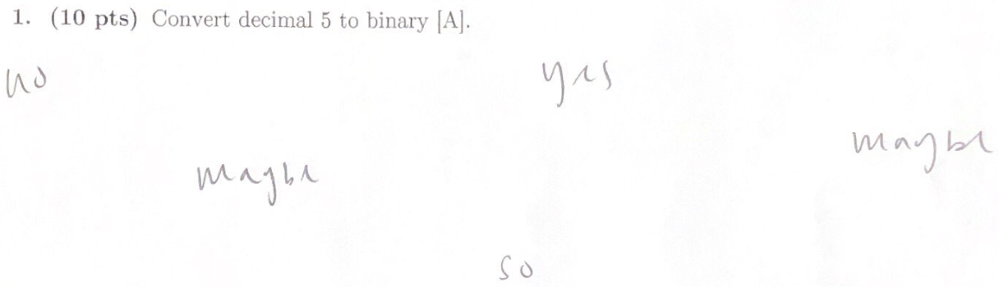
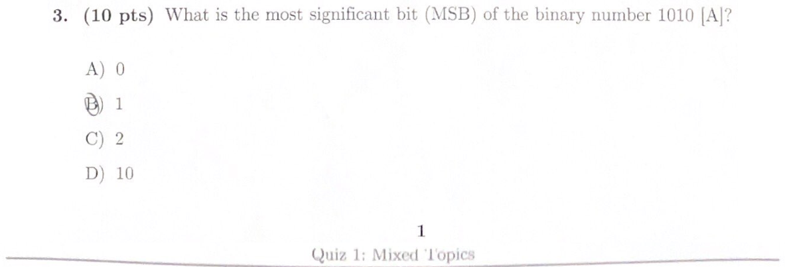
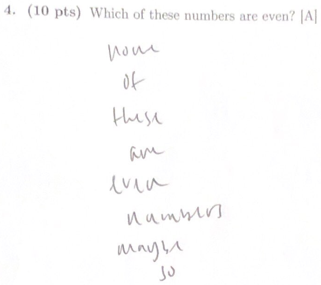
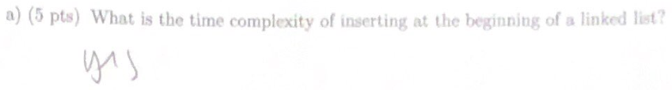

- q1:
  - Question type: Free Response
  - Prompt: 1. (10 pts) Convert decimal 5 to binary [A].
  - Response image: 
  - Source segments: [{"page":1,"bbox":[0.1718,0.3664,0.7153,0.1591]}]
  - Response text: |
    no
  - Possible points: 10
  - Points: 5
  - Rubric: Partially Correct
    - Binary form attempted but value incorrect
  - Analysis: Hello world, this was a comment from Tommy. How do you do?

- q2:
  - Question type: Free Response
  - Prompt: 2. (10 pts) Which of these are valid Python integer literals? [A]
  - Response image: 
  - Source segments: [{"page":1,"bbox":[0.1747,0.5527,0.4753,0.07]}]
  - Response text: |
    tasting
  - Possible points: 
  - Points: 
  - Rubric:
  - Analysis: 

- q3:
  - Question type: Multiple Choice
  - Prompt: 3. (10 pts) What is the most significant bit (MSB) of the binary number 1010 [A]?
  - Response image: 
  - Source segments: [{"page":1,"bbox":[0.1753,0.7386,0.6118,0.1664]},{"page":2,"bbox":[0.1594,0.0836,0.6965,0.0223]}]
  - Response text: |
    B)
  - Possible points: 
  - Points: 
  - Rubric:
  - Analysis: 

- q4:
  - Question type: Free Response
  - Prompt: 4. (10 pts) Which of these numbers are even? [A]
  - Response image: 
  - Source segments: [{"page":2,"bbox":[0.1724,0.1286,0.3794,0.2605]}]
  - Response text: |
    none of these are even numbers maybe so
  - Possible points: 
  - Points: 
  - Rubric:
  - Analysis: 

- q5a:
  - Question type: Free Response
  - Prompt: a) (8 pts) What algorithm would you use to find the second largest distinct number in a list?
  - Response image: 
  - Source segments: [{"page":2,"bbox":[0.14,0.4731,0.6724,0.1357]}]
  - Response text: |
    none
  - Possible points: 
  - Points: 
  - Rubric:
  - Analysis: 

- q5b:
  - Question type: Free Response
  - Prompt: b) (9 pts) What is the second largest distinct number in [5, 2, 8, 1, 8, 3]?
  - Response image: 
  - Source segments: [{"page":2,"bbox":[0.14,0.6058,0.6724,0.1375]}]
  - Response text: |
    y(1) siv
  - Possible points: 
  - Points: 
  - Rubric:
  - Analysis: 

- q5c:
  - Question type: Free Response
  - Prompt: c) (8 pts) What should the algorithm return for a list with only one element?
  - Response image: 
  - Source segments: [{"page":2,"bbox":[0.14,0.7404,0.6724,0.061]}]
  - Response text: 
  - Possible points: 
  - Points: 
  - Rubric:
  - Analysis: 

- q6a:
  - Question type: Free Response
  - Prompt: a) (5 pts) What is the time complexity of inserting at the beginning of a linked list?
  - Response image: 
  - Source segments: [{"page":3,"bbox":[0.1729,0.1706,0.5288,0.1843]}]
  - Response text: |
    O(1)
  - Possible points: 
  - Points: 
  - Rubric:
  - Analysis: 

- q6b:
  - Question type: Free Response
  - Prompt: b) (5 pts) What is the time complexity of searching in a balanced binary search tree?
  - Response image: 
  - Source segments: [{"page":3,"bbox":[0.1729,0.3488,0.5288,0.1811]}]
  - Response text: |
    no
  - Possible points: 
  - Points: 
  - Rubric:
  - Analysis: 

- q6c:
  - Question type: Free Response
  - Prompt: c) (5 pts) Which data structure uses LIFO (Last In, First Out)?
  - Response image: 
  - Source segments: [{"page":3,"bbox":[0.1729,0.5238,0.5288,0.1798]}]
  - Response text: |
    maybe
  - Possible points: 
  - Points: 
  - Rubric:
  - Analysis: 

- q6d:
  - Question type: Free Response
  - Prompt: d) (5 pts) Which data structure uses FIFO (First In, First Out)?
  - Response image: 
  - Source segments: [{"page":3,"bbox":[0.1729,0.6974,0.5288,0.199]}]
  - Response text: |
    S0
  - Possible points: 
  - Points: 
  - Rubric:
  - Analysis:
