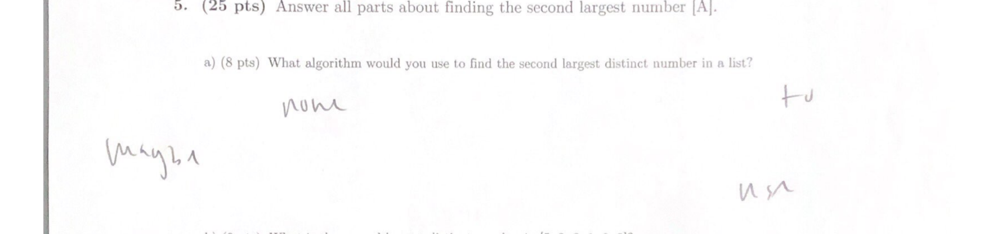
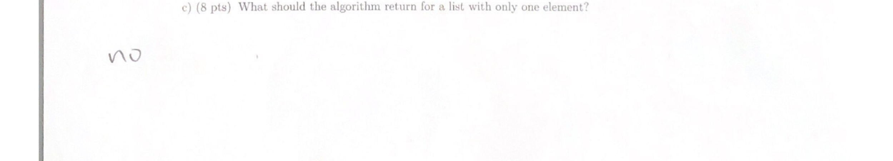

- q1:
  - Question type: Free Response
  - Prompt: (10 points) Convert decimal 5 to binary [A].
  - Response image: 
  - Source segments: [{"page":1,"bbox":[0.0104,0.3649,0.9791,0.1865]}]
  - Response text: 
  - Possible points: 10
  - Points: 
  - Rubric:
  - Analysis: 

- q2:
  - Question type: Free Response
  - Prompt: (10 points) Which of these are valid Python integer literals? [A]
  - Response image: 
  - Source segments: [{"page":1,"bbox":[0.0104,0.5514,0.9791,0.1864]}]
  - Response text: 
  - Possible points: 10
  - Points: 
  - Rubric:
  - Analysis: 

- q3:
  - Question type: Free Response
  - Prompt: (10 points) What is the most significant bit (MSB) of the binary number 1010 [A]? A) O0 B1 C) 2 D) 10
  - Response image: 
  - Source segments: [{"page":1,"bbox":[0.0104,0.7378,0.9791,0.1501]}]
  - Response text: 
  - Possible points: 10
  - Points: 
  - Rubric:
  - Analysis: 

- q4:
  - Question type: Free Response
  - Prompt: (10 points) Which of these numbers are even? [A]
  - Response image: 
  - Source segments: [{"page":2,"bbox":[0.0104,0.1323,0.9792,0.3042]}]
  - Response text: 
  - Possible points: 10
  - Points: 
  - Rubric:
  - Analysis: 

- q5a:
  - Question type: Free Response
  - Prompt: (8 points) Answer all parts about finding the second largest number [A]. a) (8 pts) What algorithm would you use to find the second largest distinct number in a list?
  - Response image: 
  - Source segments: [{"page":2,"bbox":[0.0104,0.4365,0.9792,0.1776]}]
  - Response text: 
  - Possible points: 8
  - Points: 
  - Rubric:
  - Analysis: 

- q5b:
  - Question type: Free Response
  - Prompt: (9 points) What is the second largest distinct number in [5, 2, 8, 1, 8, 3]?
  - Response image: 
  - Source segments: [{"page":2,"bbox":[0.0104,0.6142,0.9791,0.1307]}]
  - Response text: 
  - Possible points: 9
  - Points: 
  - Rubric:
  - Analysis: 

- q5c:
  - Question type: Free Response
  - Prompt: (8 points) What should the algorithm return for a list with only one element?
  - Response image: 
  - Source segments: [{"page":2,"bbox":[0.0104,0.7449,0.9791,0.1375]}]
  - Response text: 
  - Possible points: 8
  - Points: 
  - Rubric:
  - Analysis: 

- q6a:
  - Question type: Free Response
  - Prompt: (5 points) Answer the following questions about data structures [A]. a) (5 pts) What is the time complexity of inserting at the beginning of a linked list?
  - Response image: 
  - Source segments: [{"page":3,"bbox":[0.0104,0.134,0.9792,0.2186]}]
  - Response text: 
  - Possible points: 5
  - Points: 
  - Rubric:
  - Analysis: 

- q6b:
  - Question type: Free Response
  - Prompt: (5 points) What is the time complexity of searching in a balanced binary search tree?
  - Response image: 
  - Source segments: [{"page":3,"bbox":[0.0104,0.3526,0.9792,0.1752]}]
  - Response text: 
  - Possible points: 5
  - Points: 
  - Rubric:
  - Analysis: 

- q6c:
  - Question type: Free Response
  - Prompt: (5 points) Which data structure uses LIFO (Last In, First Out)?
  - Response image: 
  - Source segments: [{"page":3,"bbox":[0.0104,0.5278,0.9792,0.1714]}]
  - Response text: 
  - Possible points: 5
  - Points: 
  - Rubric:
  - Analysis: 

- q6d:
  - Question type: Free Response
  - Prompt: (5 points) Which data structure uses FIFO (First In, First Out)?
  - Response image: 
  - Source segments: [{"page":3,"bbox":[0.0104,0.6991,0.9792,0.1808]}]
  - Response text: 
  - Possible points: 5
  - Points: 
  - Rubric:
  - Analysis:
