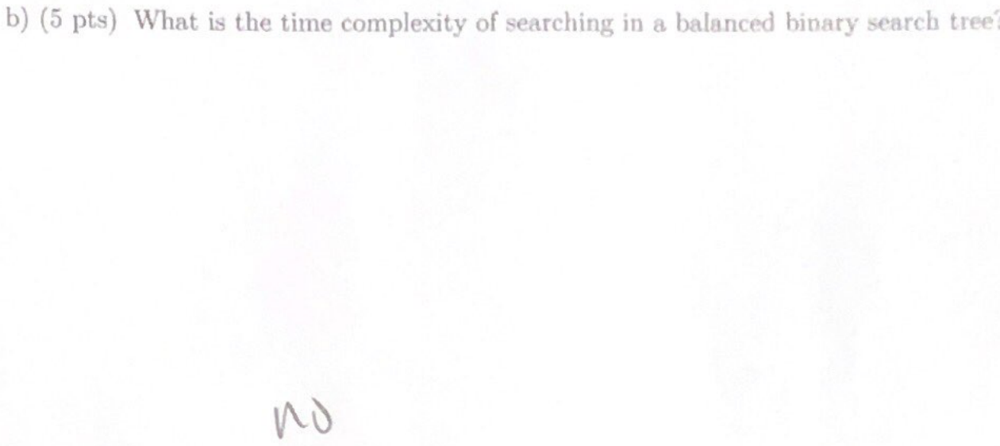

- q1:
  - Question type: Free Response
  - Prompt: 
  - Response image: 
  - Source segments: [{"page":1,"bbox":[0.1733,0.3676,0.7122,0.1564]}]
  - Response text: 
  - Possible points: 
  - Points: 
  - Rubric:
  - Analysis: 

- q2:
  - Question type: Free Response
  - Prompt: 
  - Response image: 
  - Source segments: [{"page":1,"bbox":[0.1765,0.5539,0.4718,0.0676]}]
  - Response text: 
  - Possible points: 
  - Points: 
  - Rubric:
  - Analysis: 

- q3:
  - Question type: Multiple Choice
  - Prompt: 
  - Response image: 
  - Source segments: [{"page":1,"bbox":[0.1769,0.74,0.6078,0.1273]},{"page":2,"bbox":[0.1616,0.0848,0.6925,0.0197]}]
  - Response text: 
  - Possible points: 
  - Points: 
  - Rubric:
  - Analysis: 

- q4:
  - Question type: Free Response
  - Prompt: 
  - Response image: 
  - Source segments: [{"page":2,"bbox":[0.1745,0.1297,0.3757,0.2585]}]
  - Response text: 
  - Possible points: 
  - Points: 
  - Rubric:
  - Analysis: 

- q5a:
  - Question type: Free Response
  - Prompt: a) (8 pts) What algorithm would you use to find the second largest distinct number in a list?
  - Response image: 
  - Source segments: [{"page":2,"bbox":[0.1408,0.4724,0.6698,0.1363]}]
  - Response text: |
    none
  - Possible points: 
  - Points: 
  - Rubric:
  - Analysis: 

- q5b:
  - Question type: Free Response
  - Prompt: b) (9 pts) What is the second largest distinct number in [5, 2, 8, 1, 8, 3]?
  - Response image: 
  - Source segments: [{"page":2,"bbox":[0.1408,0.6058,0.6698,0.1375]}]
  - Response text: |
    5
  - Possible points: 
  - Points: 
  - Rubric:
  - Analysis: 

- q5c:
  - Question type: Free Response
  - Prompt: c) (8 pts) What should the algorithm return for a list with only one element?
  - Response image: 
  - Source segments: [{"page":2,"bbox":[0.1408,0.7403,0.6698,0.06]}]
  - Response text: 
  - Possible points: 
  - Points: 
  - Rubric:
  - Analysis: 

- q6a:
  - Question type: Free Response
  - Prompt: a) (5 pts) What is the time complexity of inserting at the beginning of a linked list?
  - Response image: 
  - Source segments: [{"page":3,"bbox":[0.1749,0.1703,0.5251,0.1849]}]
  - Response text: |
    O(1)
  - Possible points: 
  - Points: 
  - Rubric:
  - Analysis: 

- q6b:
  - Question type: Free Response
  - Prompt: b) (5 pts) What is the time complexity of searching in a balanced binary search tree?
  - Response image: 
  - Source segments: [{"page":3,"bbox":[0.1749,0.349,0.5251,0.1803]}]
  - Response text: |
    no
  - Possible points: 
  - Points: 
  - Rubric:
  - Analysis: 

- q6c:
  - Question type: Free Response
  - Prompt: c) (5 pts) Which data structure uses LIFO (Last In, First Out)?
  - Response image: 
  - Source segments: [{"page":3,"bbox":[0.1749,0.5233,0.5251,0.18]}]
  - Response text: |
    maybe
  - Possible points: 
  - Points: 
  - Rubric:
  - Analysis: 

- q6d:
  - Question type: Free Response
  - Prompt: d) (5 pts) Which data structure uses FIFO (First In, First Out)?
  - Response image: 
  - Source segments: [{"page":3,"bbox":[0.1749,0.6972,0.5251,0.1979]}]
  - Response text: |
    S0
  - Possible points: 
  - Points: 
  - Rubric:
  - Analysis:
