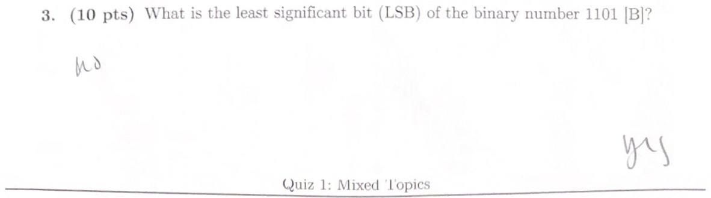
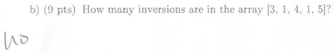
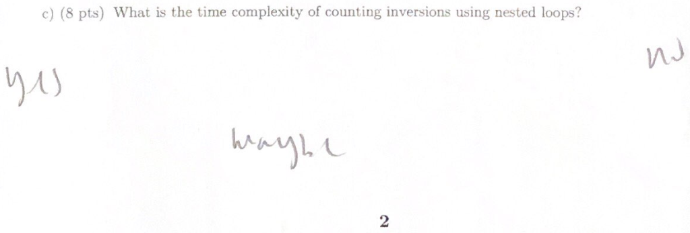
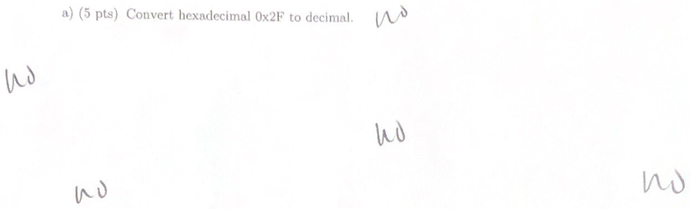

- q1:
  - Question type: Free Response
  - Prompt: 1. (10 pts) Convert decimal 6 to binary [B].
  - Response image: 
  - Source segments: [{"page":1,"bbox":[0.1647,0.3632,0.47,0.1105]}]
  - Response text: |
    maybe
  - Possible points: 
  - Points: 
  - Rubric:
  - Analysis:

- q2:
  - Question type: Free Response
  - Prompt: 2. (10 pts) What command lists files in the current directory on Linux? [B]
  - Response image: 
  - Source segments: [{"page":1,"bbox":[0.1747,0.5505,0.5576,0.1295]}]
  - Response text: |
    B) pwd
  - Possible points: 
  - Points: 
  - Rubric:
  - Analysis: 

- q3:
  - Question type: Free Response
  - Prompt: 3. (10 pts) What is the least significant bit (LSB) of the binary number 1101 [B]?
  - Response image: 
  - Source segments: [{"page":1,"bbox":[0.1735,0.7068,0.6235,0.1318]},{"page":2,"bbox":[0.16,0.0841,0.6959,0.0218]}]
  - Response text: |
    no
  - Possible points: 
  - Points: 
  - Rubric:
  - Analysis: 

- q4:
  - Question type: Free Response
  - Prompt: 4. (10 pts) Which letters in the word "GRADERS" are vowels? [B]
  - Response image: 
  - Source segments: [{"page":2,"bbox":[0.1388,0.1291,0.5465,0.2532]}]
  - Response text: |
    no
  - Possible points: 
  - Points: 
  - Rubric:
  - Analysis: 

- q5a:
  - Question type: Free Response
  - Prompt: a) (8 pts) What is an inversion in an array?
  - Response image: 
  - Source segments: [{"page":2,"bbox":[0.1724,0.4708,0.6024,0.1365]}]
  - Response text: |
    y^2
  - Possible points: 
  - Points: 
  - Rubric:
  - Analysis: 

- q5b:
  - Question type: Free Response
  - Prompt: b) (9 pts) How many inversions are in the array [3, 1, 4, 1, 5]?
  - Response image: 
  - Source segments: [{"page":2,"bbox":[0.1724,0.6035,0.6024,0.1388]}]
  - Response text: |
    no
  - Possible points: 
  - Points: 
  - Rubric:
  - Analysis: 

- q5c:
  - Question type: Free Response
  - Prompt: c) (8 pts) What is the time complexity of counting inversions using nested loops?
  - Response image: 
  - Source segments: [{"page":2,"bbox":[0.1724,0.7385,0.6024,0.1592]}]
  - Response text: |
    maybe
  - Possible points: 
  - Points: 
  - Rubric:
  - Analysis: 

- q6a:
  - Question type: Free Response
  - Prompt: a) (5 pts) Convert hexadecimal 0x2F to decimal.
  - Response image: 
  - Source segments: [{"page":3,"bbox":[0.1459,0.172,0.7082,0.182]}]
  - Response text: |
    47
  - Possible points: 
  - Points: 
  - Rubric:
  - Analysis: 

- q6b:
  - Question type: Free Response
  - Prompt: b) (5 pts) Convert decimal 255 to hexadecimal.
  - Response image: 
  - Source segments: [{"page":3,"bbox":[0.1459,0.3479,0.7082,0.1802]}]
  - Response text: |
    FF
  - Possible points: 
  - Points: 
  - Rubric:
  - Analysis: 

- q6c:
  - Question type: Free Response
  - Prompt: c) (5 pts) What is the binary representation of hexadecimal 0xA?
  - Response image: 
  - Source segments: [{"page":3,"bbox":[0.1459,0.522,0.7082,0.1788]}]
  - Response text: |
    y13
    maybe
    10
  - Possible points: 
  - Points: 
  - Rubric:
  - Analysis: 

- q6d:
  - Question type: Free Response
  - Prompt: d) (5 pts) What is the decimal value of octal 17?
  - Response image: 
  - Source segments: [{"page":3,"bbox":[0.1459,0.6947,0.7082,0.199]}]
  - Response text: |
    15
  - Possible points: 
  - Points: 
  - Rubric:
  - Analysis:
