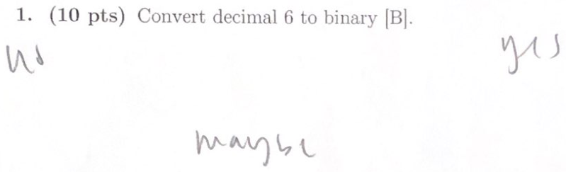
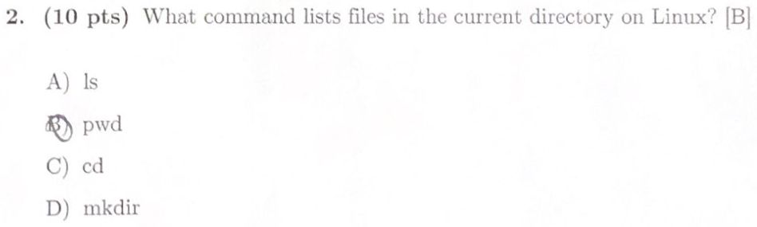
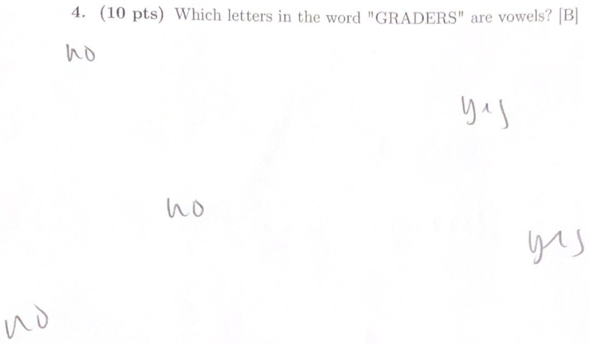
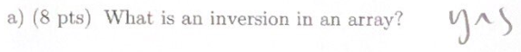
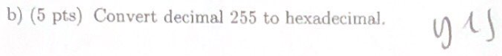
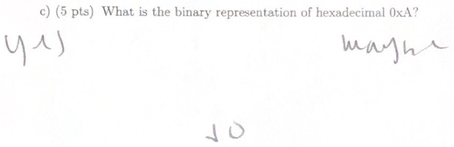
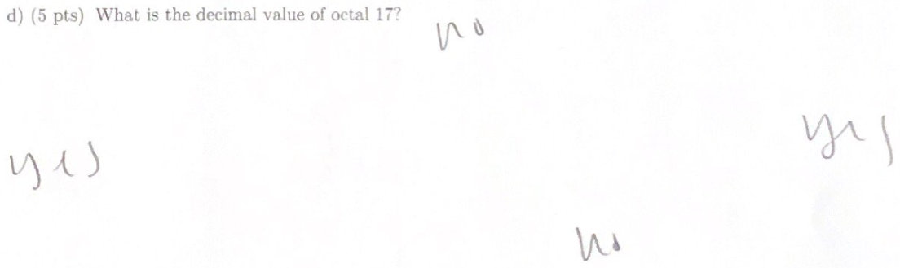

- q1:
  - Prompt: 1. (10 pts) Convert decimal 6 to binary [B].
  - Response image: 
  - Response text: |
    maybe
  - Possible points: 
  - Points: 
  - Analysis: 

- q2:
  - Prompt: 2. (10 pts) What command lists files in the current directory on Linux? [B]
  - Response image: 
  - Response text: |
    B) pwd
  - Possible points: 
  - Points: 
  - Analysis: 

- q3:
  - Prompt: 3. (10 pts) What is the least significant bit (LSB) of the binary number 1101 [B]?
  - Response image: 
  - Response text: |
    1
  - Possible points: 
  - Points: 
  - Analysis: 

- q4:
  - Prompt: 4. (10 pts) Which letters in the word "GRADERS" are vowels? [B]
  - Response image: 
  - Response text: |
    no
  - Possible points: 
  - Points: 
  - Analysis: 

- q5a:
  - Prompt: a) (8 pts) What is an inversion in an array?
  - Response image: 
  - Response text: |
    y^2
  - Possible points: 
  - Points: 
  - Analysis: 

- q5b:
  - Prompt: b) (9 pts) How many inversions are in the array [3, 1, 4, 1, 5]?
  - Response image: 
  - Response text: |
    no
  - Possible points: 
  - Points: 
  - Analysis: 

- q5c:
  - Prompt: c) (8 pts) What is the time complexity of counting inversions using nested loops?
  - Response image: 
  - Response text: |
    maybe
  - Possible points: 
  - Points: 
  - Analysis: 

- q6a:
  - Prompt: a) (5 pts) Convert hexadecimal 0x2F to decimal.
  - Response image: 
  - Response text: |
    47
  - Possible points: 
  - Points: 
  - Analysis: 

- q6b:
  - Prompt: b) (5 pts) Convert decimal 255 to hexadecimal.
  - Response image: 
  - Response text: |
    FF
  - Possible points: 
  - Points: 
  - Analysis: 

- q6c:
  - Prompt: c) (5 pts) What is the binary representation of hexadecimal 0xA?
  - Response image: 
  - Response text: |
    y13
    maybe
    10
  - Possible points: 
  - Points: 
  - Analysis: 

- q6d:
  - Prompt: d) (5 pts) What is the decimal value of octal 17?
  - Response image: 
  - Response text: |
    15
  - Possible points: 
  - Points: 
  - Analysis:
