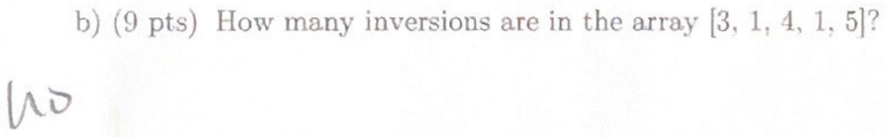
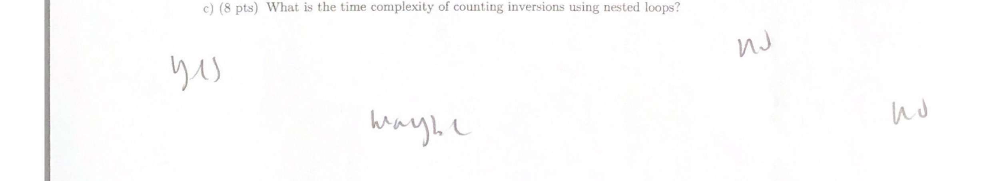
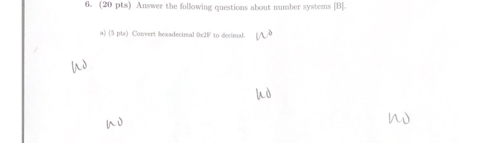
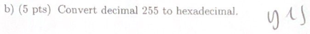
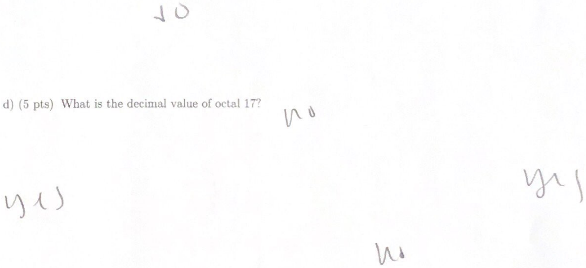

- q1:
  - Question type: Free Response
  - Prompt: 1. (10 pts) Convert decimal 6 to binary [B].
  - Response image: 
  - Source segments: [{"page":1,"bbox":[0.1667,0.3645,0.4663,0.1082]}]
  - Response text: |
    maybe
  - Possible points: 
  - Points: 
  - Rubric:
  - Analysis: 

- q2:
  - Question type: Free Response
  - Prompt: 2. (10 pts) What command lists files in the current directory on Linux? [B]
  - Response image: 
  - Source segments: [{"page":1,"bbox":[0.1765,0.5515,0.5541,0.1276]}]
  - Response text: |
    B
  - Possible points: 
  - Points: 
  - Rubric:
  - Analysis: 

- q3:
  - Question type: Free Response
  - Prompt: 
  - Response image: 
  - Source segments: [{"page":1,"bbox":[0.1753,0.7082,0.62,0.1909]},{"page":2,"bbox":[0.162,0.0855,0.6918,0.0197]}]
  - Response text: 
  - Possible points: 
  - Points: 
  - Rubric:
  - Analysis: 

- q4:
  - Question type: Free Response
  - Prompt: 
  - Response image: 
  - Source segments: [{"page":2,"bbox":[0.1392,0.1306,0.5443,0.2503]}]
  - Response text: 
  - Possible points: 
  - Points: 
  - Rubric:
  - Analysis: 

- q5a:
  - Question type: Free Response
  - Prompt: a) (8 pts) What is an inversion in an array?
  - Response image: 
  - Source segments: [{"page":2,"bbox":[0.1741,0.4709,0.5984,0.1365]}]
  - Response text: |
    yes
  - Possible points: 
  - Points: 
  - Rubric:
  - Analysis: 

- q5b:
  - Question type: Free Response
  - Prompt: b) (9 pts) How many inversions are in the array [3, 1, 4, 1, 5]?
  - Response image: 
  - Source segments: [{"page":2,"bbox":[0.1741,0.6036,0.5984,0.1383]}]
  - Response text: |
    10
  - Possible points: 
  - Points: 
  - Rubric:
  - Analysis: 

- q5c:
  - Question type: Free Response
  - Prompt: c) (8 pts) What is the time complexity of counting inversions using nested loops?
  - Response image: 
  - Source segments: [{"page":2,"bbox":[0.1741,0.7382,0.5984,0.1582]}]
  - Response text: |
    yes
    maybe
  - Possible points: 
  - Points: 
  - Rubric:
  - Analysis: 

- q6a:
  - Question type: Free Response
  - Prompt: a) (5 pts) Convert hexadecimal 0x2F to decimal.
  - Response image: 
  - Source segments: [{"page":3,"bbox":[0.1478,0.1733,0.5424,0.1796]}]
  - Response text: |
    47
  - Possible points: 
  - Points: 
  - Rubric:
  - Analysis: 

- q6b:
  - Question type: Free Response
  - Prompt: b) (5 pts) Convert decimal 255 to hexadecimal.
  - Response image: 
  - Source segments: [{"page":3,"bbox":[0.1478,0.3494,0.5424,0.1775]}]
  - Response text: |
    FF
  - Possible points: 
  - Points: 
  - Rubric:
  - Analysis: 

- q6c:
  - Question type: Free Response
  - Prompt: c) (5 pts) What is the binary representation of hexadecimal 0xA?
  - Response image: 
  - Source segments: [{"page":3,"bbox":[0.1478,0.5234,0.5424,0.0572]}]
  - Response text: |
    1010
  - Possible points: 
  - Points: 
  - Rubric:
  - Analysis: 

- q40:
  - Question type: Free Response
  - Prompt: 
  - Response image: 
  - Source segments: [{"page":3,"bbox":[0.2067,0.6182,0.6455,0.2285]}]
  - Response text: 
  - Possible points: 
  - Points: 
  - Rubric:
  - Analysis:
