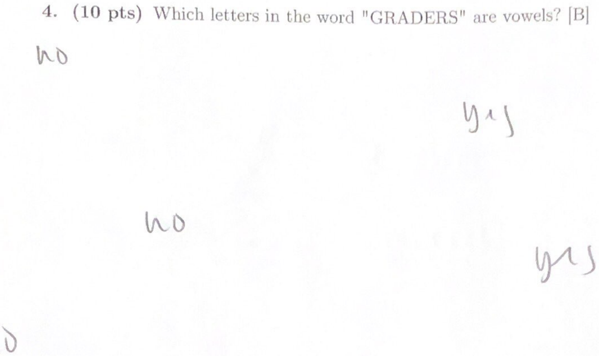
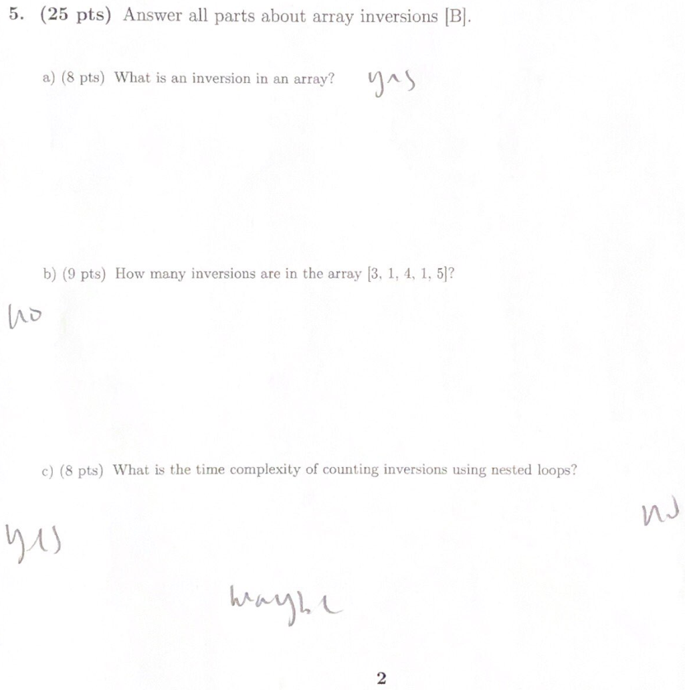
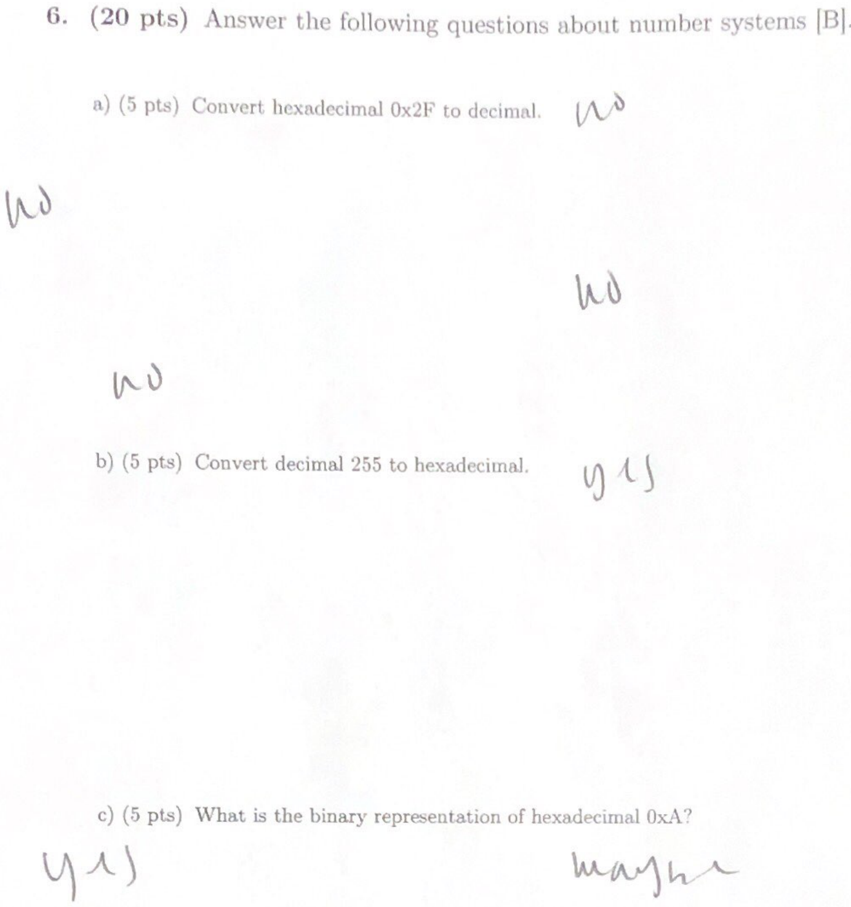

- q1:
  - Question type: Free Response
  - Prompt: 
  - Response image: 
  - Source segments: [{"page":1,"bbox":[0.1667,0.3645,0.4663,0.1082]}]
  - Read by: tesseract
  - Confidence: 78.9231
  - Response text: |
    1. (10 pts) Convert decimal 6 to binary [B]. Ws WA ) May
  - Possible points: 
  - Points: 
  - Rubric:
  - Analysis: 

- q2:
  - Question type: Free Response
  - Prompt: 
  - Response image: 
  - Source segments: [{"page":1,"bbox":[0.1765,0.5515,0.5541,0.1276]}]
  - Read by: vision-model
  - Response text: |
    B) pwd
  - Possible points: 
  - Points: 
  - Rubric:
  - Analysis: 

- q3:
  - Question type: Free Response
  - Prompt: 
  - Response image: 
  - Source segments: [{"page":1,"bbox":[0.1753,0.7082,0.62,0.1909]},{"page":2,"bbox":[0.162,0.0855,0.6918,0.0197]}]
  - Read by: tesseract
  - Confidence: 92.1667
  - Response text: |
    3. (10 pts) What is the least significant bit (LSB) of the binary number 1101 [B]? \d 1
  - Possible points: 
  - Points: 
  - Rubric:
  - Analysis: 

- q4:
  - Question type: Free Response
  - Prompt: 
  - Response image: 
  - Source segments: [{"page":2,"bbox":[0.1392,0.1306,0.5443,0.2503]}]
  - Read by: vision-model
  - Response text: |
    no
    
    no
    
    yes
  - Possible points: 
  - Points: 
  - Rubric:
  - Analysis: 

- q5:
  - Question type: Free Response
  - Prompt: 
  - Response image: 
  - Source segments: [{"page":2,"bbox":[0.1741,0.4309,0.5984,0.4655]}]
  - Read by: tesseract
  - Confidence: 88.4182
  - Response text: |
    5. (25 pts) Answer all parts about array inversions [B]. a) (8 pts) What is an inversion in an array? i S b) (9 pts) How many inversions are in the array [8, 1, 4, 1, 5]? [Ad c) (8 pts) What is the time complexity of counting inversions using nested loops? aad L 2
  - Possible points: 
  - Points: 
  - Rubric:
  - Analysis: 

- q6:
  - Question type: Free Response
  - Prompt: 
  - Response image: 
  - Source segments: [{"page":3,"bbox":[0.1478,0.1342,0.5424,0.4464]}]
  - Read by: tesseract
  - Confidence: 92.9524
  - Response text: |
    6. (20 pts) Answer the following questions about number systems [B] a) (5 pts) Convert hexadecimal 0x2F to decimal. yr b) (5 pts) Convert decimal 255 to hexadecimal. \) A \ c) (5 pts) What is the binary representation of hexadecimal 0xA?
  - Possible points: 
  - Points: 
  - Rubric:
  - Analysis: 

- q40:
  - Question type: Free Response
  - Prompt: 
  - Response image: 
  - Source segments: [{"page":3,"bbox":[0.2067,0.6182,0.6455,0.2285]}]
  - Read by: tesseract
  - Confidence: 72.1333
  - Response text: |
    {0 d) (5 pts) What is the decimal value of octal 17? \ ‘ \AA
  - Possible points: 
  - Points: 
  - Rubric:
  - Analysis:
