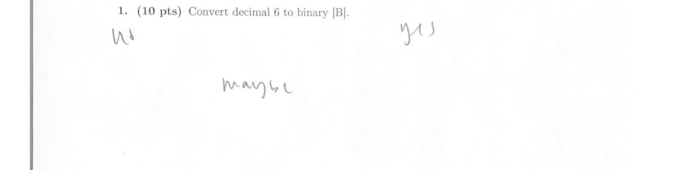
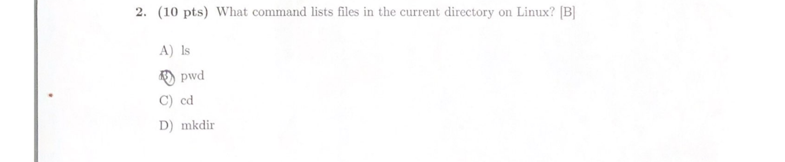
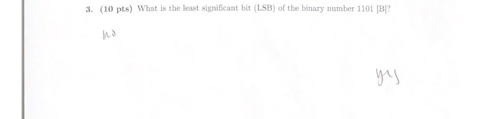
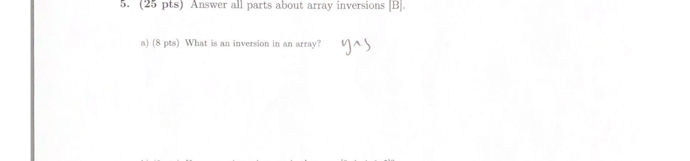
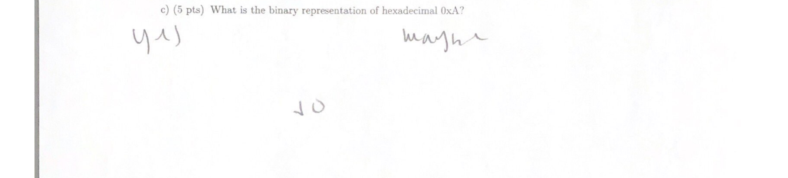
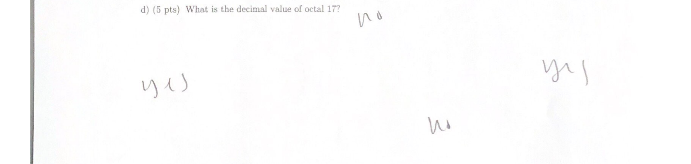

- q1:
  - Question type: Free Response
  - Prompt: (10 points) Convert decimal 6 to binary [B].
  - Response image: 
  - Source segments: [{"page":1,"bbox":[0.0104,0.361,0.9792,0.1879]}]
  - Response text: 
  - Possible points: 10
  - Points: 
  - Rubric:
  - Analysis: 

- q2:
  - Question type: Free Response
  - Prompt: (10 points) What command lists files in the current directory on Linux? [B] A) ls pwd C) cd D) mkdir
  - Response image: 
  - Source segments: [{"page":1,"bbox":[0.0104,0.5489,0.9792,0.1557]}]
  - Response text: 
  - Possible points: 10
  - Points: 
  - Rubric:
  - Analysis: 

- q3:
  - Question type: Free Response
  - Prompt: (10 points) What is the least significant bit (LSB) of the binary number 1101 [B]?
  - Response image: 
  - Source segments: [{"page":1,"bbox":[0.0104,0.7045,0.9792,0.1808]}]
  - Response text: 
  - Possible points: 10
  - Points: 
  - Rubric:
  - Analysis: 

- q4:
  - Question type: Free Response
  - Prompt: (10 points) Which of these numbers are even? [A]
  - Response image: 
  - Source segments: [{"page":2,"bbox":[0.0095,0.1324,0.9833,0.3026]}]
  - Response text: 
  - Possible points: 10
  - Points: 
  - Rubric:
  - Analysis: 

- q5a:
  - Question type: Free Response
  - Prompt: (8 points) Answer all parts about finding the second largest number [A]. a) (8 pts) What algorithm would you use to find the second largest distinct number in a list?
  - Response image: 
  - Source segments: [{"page":2,"bbox":[0.0093,0.4349,0.9844,0.1772]}]
  - Response text: 
  - Possible points: 8
  - Points: 
  - Rubric:
  - Analysis: 

- q5b:
  - Question type: Free Response
  - Prompt: (9 points) What is the second largest distinct number in [5, 2, 8, 1, 8, 3]?
  - Response image: 
  - Source segments: [{"page":2,"bbox":[0.0091,0.6121,0.9852,0.1307]}]
  - Response text: 
  - Possible points: 9
  - Points: 
  - Rubric:
  - Analysis: 

- q5c:
  - Question type: Free Response
  - Prompt: (8 points) What should the algorithm return for a list with only one element?
  - Response image: 
  - Source segments: [{"page":2,"bbox":[0.0089,0.7428,0.9861,0.1377]}]
  - Response text: 
  - Possible points: 8
  - Points: 
  - Rubric:
  - Analysis: 

- q6a:
  - Question type: Free Response
  - Prompt: (5 points) Answer the following questions about data structures [A]. a) (5 pts) What is the time complexity of inserting at the beginning of a linked list?
  - Response image: 
  - Source segments: [{"page":3,"bbox":[0.0101,0.1347,0.9836,0.2176]}]
  - Response text: 
  - Possible points: 5
  - Points: 
  - Rubric:
  - Analysis: 

- q6b:
  - Question type: Free Response
  - Prompt: (5 points) What is the time complexity of searching in a balanced binary search tree?
  - Response image: 
  - Source segments: [{"page":3,"bbox":[0.01,0.3517,0.9848,0.1743]}]
  - Response text: 
  - Possible points: 5
  - Points: 
  - Rubric:
  - Analysis: 

- q6c:
  - Question type: Free Response
  - Prompt: (5 points) Which data structure uses LIFO (Last In, First Out)?
  - Response image: 
  - Source segments: [{"page":3,"bbox":[0.0099,0.526,0.986,0.171]}]
  - Response text: 
  - Possible points: 5
  - Points: 
  - Rubric:
  - Analysis: 

- q6d:
  - Question type: Free Response
  - Prompt: (5 points) Which data structure uses FIFO (First In, First Out)?
  - Response image: 
  - Source segments: [{"page":3,"bbox":[0.0097,0.6965,0.9873,0.1813]}]
  - Response text: 
  - Possible points: 5
  - Points: 
  - Rubric:
  - Analysis:
